# 📁 项目结构：main

**根路径**: `D:\CaveSystem\Demos\ruoyi-ai\ruoyi-modules\ruoyi-acls-engine\src\main`

**生成时间**: 2026-09-25 17:14:50

├── 📁 **java**
│   └── 📁 **com**
│       └── 📁 **ruoyi**
│           └── 📁 **acls**
│               ├── 📁 **adapter**
│               │   └── 📄 **AclsIntelligentProcessor.java**  (4.9 KB, 2026-09-25 14:29:34)

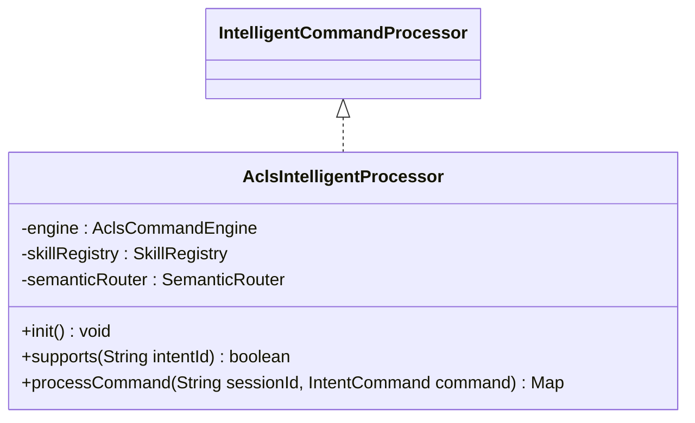

│               ├── 📁 **arbiter**
│               │   ├── 📄 **ArbiterResult.java**  (682.0 B, 2026-09-05 10:21:05)

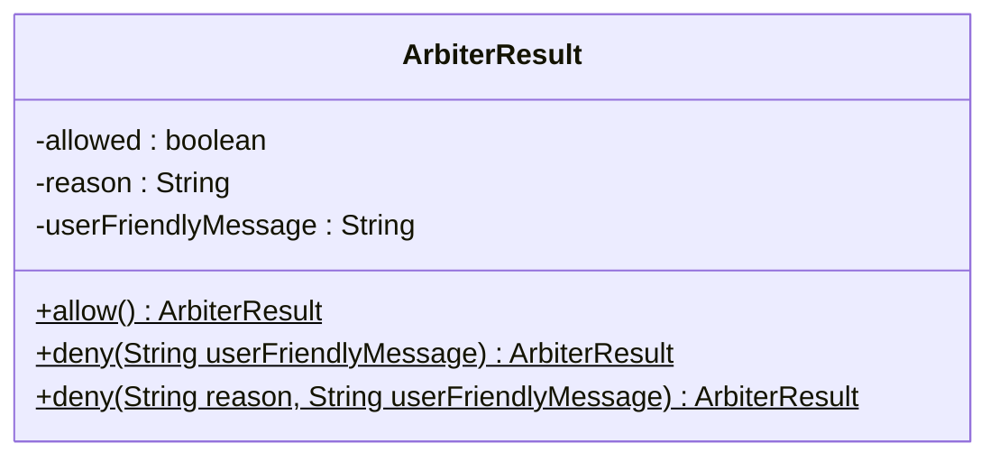

│               │   └── 📄 **OperationArbiter.java**  (6.8 KB, 2026-09-08 08:21:15)

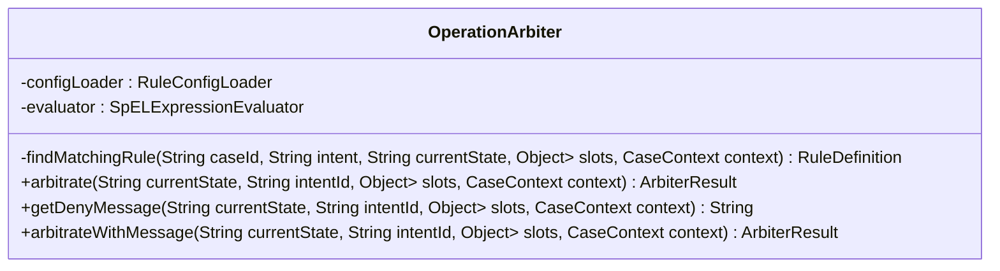

│               ├── 📁 **branch**
│               │   ├── 📄 **StudentResponseBranch.java**  (1.6 KB, 2026-09-23 21:03:03)

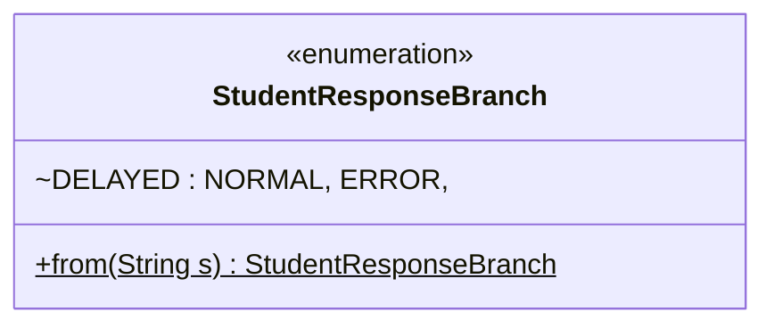

│               │   ├── 📄 **StudentResponseBranchProviderImpl.java**  (773.0 B, 2026-09-23 21:29:56)

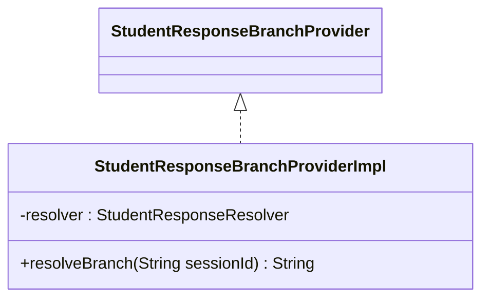

│               │   ├── 📄 **StudentResponseResolver.java**  (4.6 KB, 2026-09-23 21:04:14)

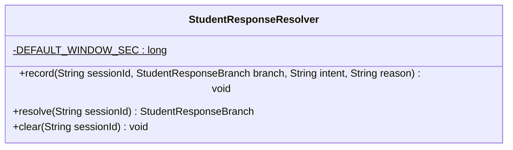

│               │   └── 📄 **StudentResponseSignal.java**  (1.4 KB, 2026-09-23 21:03:41)

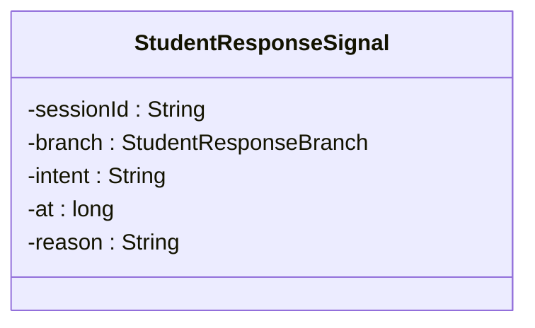

│               ├── 📁 **cognitive**
│               │   ├── 📄 **MemberCognitiveService.java**  (4.0 KB, 2026-09-08 08:37:13)

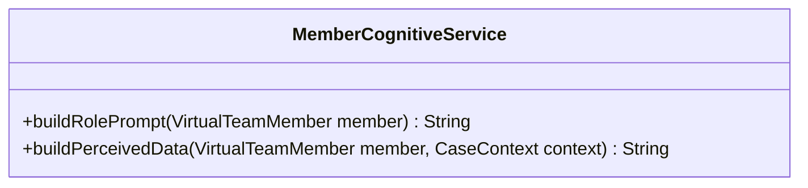

│               │   ├── 📄 **ReflexRule.java**  (1.5 KB, 2026-09-08 08:37:13)

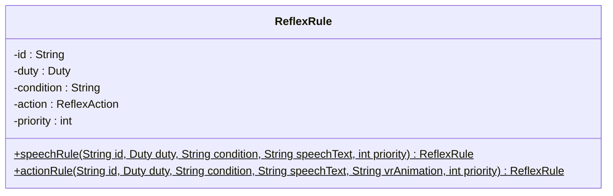

│               │   └── 📄 **ReflexRuleLoader.java**  (14.9 KB, 2026-09-13 21:05:03)

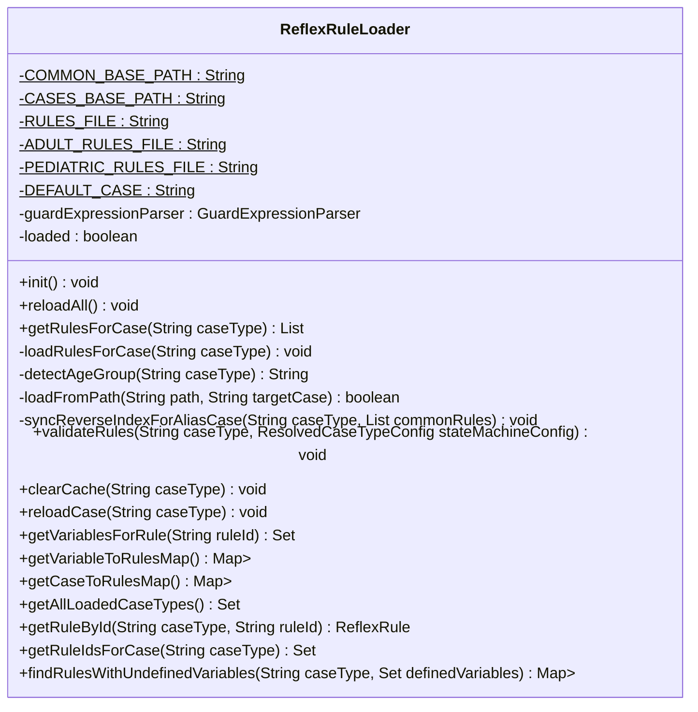

│               ├── 📁 **config**
│               │   └── 📄 **AclsEngineProperties.java**  (1.5 KB, 2026-09-02 19:13:14)

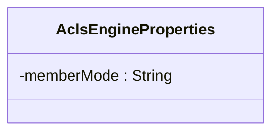

│               ├── 📁 **contract**
│               │   ├── 📁 **diagnose**
│               │   │   ├── 📄 **BlockingDiagnoser.java**  (15.0 KB, 2026-09-24 19:13:25)

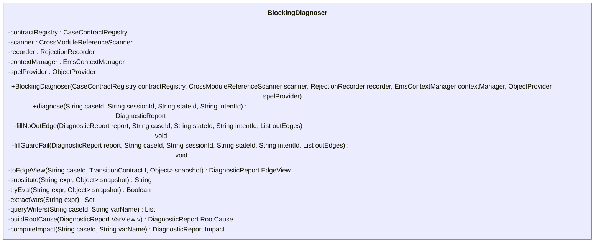

│               │   │   ├── 📄 **DiagnosticReport.java**  (2.9 KB, 2026-09-24 18:55:59)

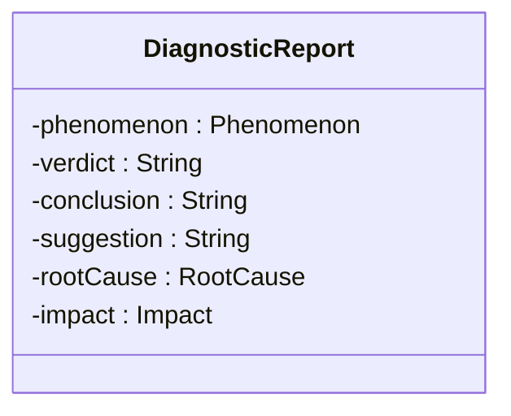

│               │   │   └── 📄 **RejectionRecorder.java**  (2.0 KB, 2026-09-24 18:51:15)

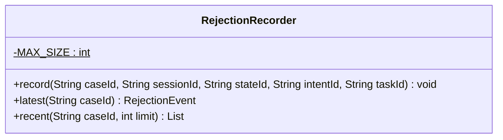

│               │   ├── 📁 **models**
│               │   │   ├── 📄 **CaseContract.java**  (743.0 B, 2026-09-13 20:49:24)

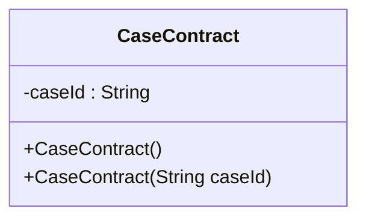

│               │   │   ├── 📄 **CaseFileBaseline.java**  (1.9 KB, 2026-09-20 08:38:16)

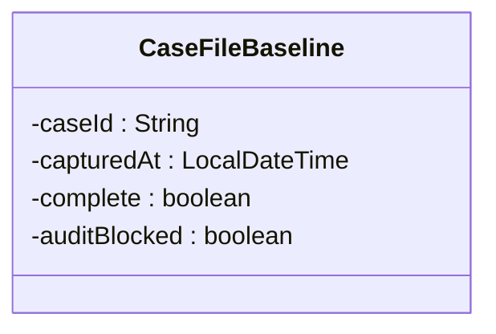

│               │   │   ├── 📄 **ContractDiagnostics.java**  (1.9 KB, 2026-09-13 20:50:56)

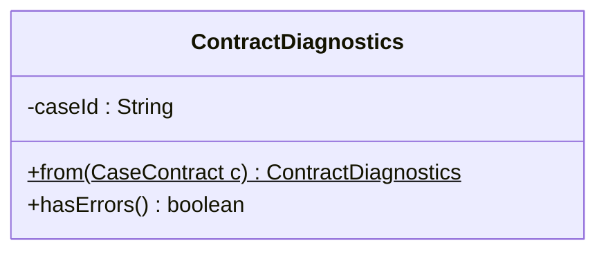

│               │   │   ├── 📄 **DerivedVarContract.java**  (679.0 B, 2026-09-13 20:50:40)

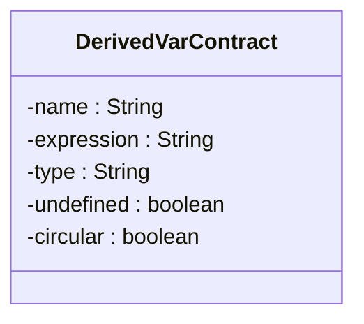

│               │   │   ├── 📄 **IntentContract.java**  (1.4 KB, 2026-09-13 20:50:08)

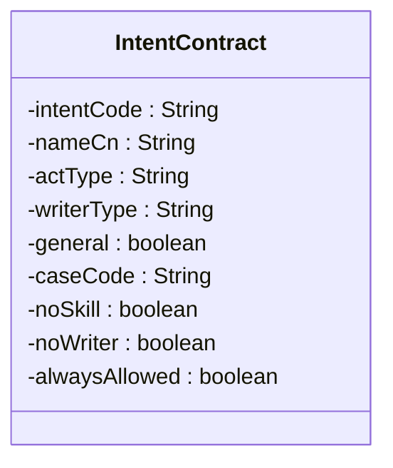

│               │   │   ├── 📄 **StateContract.java**  (527.0 B, 2026-09-13 20:49:55)

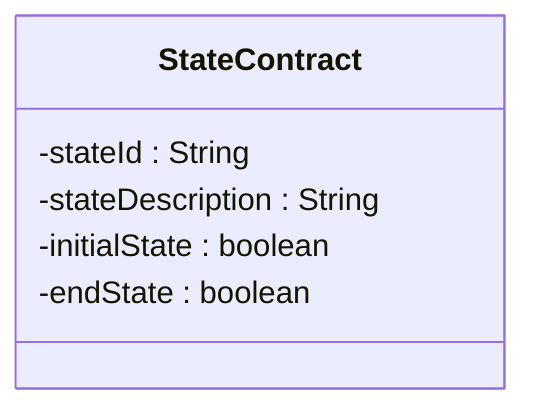

│               │   │   ├── 📄 **TransitionContract.java**  (12.1 KB, 2026-09-19 20:31:03)

```mermaid
classDiagram
    class TransitionContract {
        -transitionId : String
        -sourceState : String
        -targetState : String
        -priority : int
        -description : String
        -exitReason : String
        -intentCode : String
        -event : String
        -systemTrigger : boolean
        -enabled : boolean
        -deviation : boolean
        -guardExpression : String
        -actionExpression : String
        -systemActionType : String
        -systemActionParams : Map<String, Object>
        -dead : boolean
        -selfLoop : boolean
        +hasIntent() boolean
        +hasEvent() boolean
        +hasGuardCondition() boolean
        +hasSystemAction() boolean
        +isSystemEvent() boolean
        +getTriggerType() String
        +isTriggerable() boolean
        +hasSkill() boolean
        +hasBusinessSideEffects() boolean
        +getBusinessWrittenVariables() Set<String>
        +getDisplayName() String
        +getSummary() String
        +addWarning(String warning) void
        +getSystemActionParamsReadonly() Map<String, Object>
        +shallowCopy() TransitionContract
        +toString() String
    }
```

│               │   │   └── 📄 **VariableContract.java**  (1.3 KB, 2026-09-13 20:50:26)

```mermaid
classDiagram
    class VariableContract {
        -name : String
        -nameCn : String
        -type : String
        -category : String
        -source : String
        -writableBy : String
        -writtenBySystem : boolean
        -orphan : boolean
        -unwritable : boolean
    }
```

│               │   ├── 📁 **util**
│               │   │   ├── 📄 **CaseFileReviewStatusResolver.java**  (7.8 KB, 2026-09-20 13:27:46)

```mermaid
classDiagram
    class CaseFileReviewStatusResolver {
        +DRAFT : String$
        +IN_REVIEW : String$
        +PENDING : String$
        +APPROVED : String$
        +REJECTED : String$
        -CASE_BASE : String$
        -resourceLoader : ResourceLoader
        +resolve(String caseId, String fileName) String
        -doResolve(String caseId, String fileName) String
        -extract(String fileName, Object> root) List<String>
        -extractLessonPlanReviewStatus(Object> root) String
        -collectNested(Object> root, String listKey) List<String>
        -asString(Object o) String$
        +aggregate(List<String> statuses) String$
        +isInvalid(String status) boolean$
    }
```

│               │   │   ├── 📄 **CrossModuleReferenceScanner.java**  (21.0 KB, 2026-09-24 19:10:06)
│               │   │   ├── 📄 **DanglingRefChecker.java**  (2.9 KB, 2026-09-24 20:46:49)

```mermaid
classDiagram
    class DanglingRefChecker {
        -scanner : CrossModuleReferenceScanner
        -variableMetaLoader : VariableMetaLoader
        +DanglingRefChecker(CrossModuleReferenceScanner scanner, VariableMetaLoader variableMetaLoader)
        +check(String caseId) DanglingReport
    }
```

│               │   │   ├── 📄 **DerivationGraphBuilder.java**  (3.3 KB, 2026-09-13 20:51:30)

```mermaid
classDiagram
    class DerivationGraphBuilder {
        -parser : GuardExpressionParser
        +buildDependencyGraph(List<DerivationRule> rules) Map<String, Set<String>>
        +topologicalSort(Set<String>> graph, Set<String> cyclicNodes) List<String>
        +expandToLeafVariables(String var, Set<String>> graph) Set<String>
        -expand(String var, Set<String>> graph, Set<String> result, Set<String> visiting) void
    }
```

│               │   │   └── 📄 **GuardExpressionParser.java**  (4.0 KB, 2026-09-13 20:51:14)

```mermaid
classDiagram
    class GuardExpressionParser {
        +extractVariables(String expression) Set<String>
        +extractWriteTargets(String expression) Set<String>
        +extractReadVariables(String expression) Set<String>
        +isAssignment(String expression) boolean
        -findAssignmentOperator(String s) int
        -skipWhitespace(String s, int idx) char
    }
```

│               │   ├── 📄 **CaseConfigLoader.java**  (24.3 KB, 2026-09-21 13:23:04)

```mermaid
classDiagram
    class CaseConfigLoader {
        -variableMetaManager : VariableMetaLoader
        -intentLoader : CaseIntentDefinitionsLoader
        -stateMachineLoader : YamlStateMachineLoader
        -validators : ObjectProvider<CaseConfigValidator>
        -ruleConfigLoader : RuleConfigLoader
        -physiologyConfigLoader : PhysiologyConfigLoader
        -derivationRuleLoader : DerivationRuleLoader
        -exceptionRuleLoader : ExceptionRuleLoader
        -semanticRoutingLoader : SemanticRoutingLoader
        -guardRailLoader : GuardRailLoader
        -reflexRuleLoader : ReflexRuleLoader
        -yamlSkillLoader : YamlSkillLoader
        -intentDictLoader : IntentDictLoader
        -atomicActionRegistry : AtomicActionRegistry
        -skillRegistry : SkillRegistry
        -springSkills : List<EmsSkill>
        -contractBuilder : CaseContractBuilder
        -contractRegistry : CaseContractRegistry
        +CaseConfigLoader(VariableMetaLoader variableMetaManager, CaseIntentDefinitionsLoader intentLoader, YamlStateMachineLoader stateMachineLoader, ObjectProvider<CaseConfigValidator> validators, RuleConfigLoader ruleConfigLoader, PhysiologyConfigLoader physiologyConfigLoader, DerivationRuleLoader derivationRuleLoader, ExceptionRuleLoader exceptionRuleLoader, SemanticRoutingLoader semanticRoutingLoader, YamlSkillLoader yamlSkillLoader, GuardRailLoader guardRailLoader, ReflexRuleLoader reflexRuleLoader, IntentDictLoader intentDictLoader, AtomicActionRegistry atomicActionRegistry, SkillRegistry skillRegistry, List<EmsSkill> springSkills, CaseContractBuilder contractBuilder, CaseContractRegistry contractRegistry)
        +init() void
        -registerSpringSkills() void
        -loadAllPhysiologyConfigs() void
        -validateSkillCoverage() void
        -validateDrugEnums() void
        -buildAndRegisterAllContracts() void
        +reloadAll() void
        +reloadCase(String caseId) void
        -validateAllConfigs() void
        -validateConfig(String caseId) void
        -validateConfig(String caseId, ResolvedCaseTypeConfig config) void
        -validateContract(String caseId) void
        -validatePhysiology(String caseId, ResolvedCaseTypeConfig config) void
        -collectAllStateIds(ResolvedCaseTypeConfig config) Set<String>
        -validateIntentReferences(String caseId, ResolvedCaseTypeConfig config) void
        +getAvailableIntents(String caseType, String currentState) List<String>
        +getAvailableTransitions(String caseType, String currentState) List<Map<String, Object>>
        +getInitialState(String caseType) String
    }
```

│               │   ├── 📄 **CaseConfigReloadServiceImpl.java**  (594.0 B, 2026-09-24 16:47:50)

```mermaid
classDiagram
    class CaseConfigReloadServiceImpl {
        -caseConfigLoader : CaseConfigLoader
        +reloadCase(String caseId) void
        +reloadAll() void
    }
    CaseConfigReloadService <|.. CaseConfigReloadServiceImpl
```

│               │   ├── 📄 **CaseConfigReportService.java**  (32.8 KB, 2026-09-14 14:07:05)

```mermaid
classDiagram
    class CaseConfigReportService {
        -stateMachineLoader : YamlStateMachineLoader
        -variableMetaLoader : VariableMetaLoader
        -skillRegistry : SkillRegistry
        -contractRegistry : CaseContractRegistry
        +generateReport(String caseId) String
    }
```

│               │   ├── 📄 **CaseContractBuilder.java**  (31.0 KB, 2026-09-20 08:36:48)

```mermaid
classDiagram
    class CaseContractBuilder {
        -guardParser : GuardExpressionParser
        -graphBuilder : DerivationGraphBuilder
        -stateMachineLoader : YamlStateMachineLoader
        -derivationRuleLoader : DerivationRuleLoader
        -intentLoader : CaseIntentDefinitionsLoader
        -routingLoader : SemanticRoutingLoader
        -skillLoader : YamlSkillLoader
        -variableMetaLoader : VariableMetaLoader
        -guardRailLoader : GuardRailLoader
        -reflexRuleLoader : ReflexRuleLoader
        -skillRegistry : SkillRegistry
        -resourceLoader : ResourceLoader
        -reviewStatusResolver : CaseFileReviewStatusResolver
        +buildAll() Map<String, CaseContract>
        +build(String caseId) CaseContract
        -buildIntentToWrittenVars(String caseId) Map<String, Set<String>>
        -buildTransition(String caseId, TransitionRule rule, Set<String>> derivationGraph, Set<String>> varToIntents, Set<String>> intentToWrittenVars) TransitionContract
        -buildVariableContract(String caseId, VariableMeta v, CaseContract contract, Set<String>> varToIntents, Set<String>> derivationGraph, Set<String>> intentToWrittenVars) VariableContract
        -buildDerivedContract(String caseId, DerivationRule r, Set<String>> derivationGraph, CaseContract contract, Set<String> cyclicNodes) DerivedVarContract
        -buildIntentContracts(String caseId, CaseContract contract, Set<String>> intentToWrittenVars) void
        -intentDictSurfacesMap() Map<String, Set<String>>
        -buildStateContracts(String caseId, CaseContract contract) void
        -enrichVariableReadSources(String caseId, CaseContract contract) void
        -diagnoseContract(String caseId, CaseContract contract) void
        +buildFileBaseline(String caseId) CaseFileBaseline
        -doBuildFileBaseline(String caseId) CaseFileBaseline
        -enrichManifestBaseline(String caseId, CaseContract contract) void
        -sha256Of(String location) String
        -collectReferencedDerivedVars(CaseContract contract) Set<String>
        -invert(Set<String>> map) Map<String, Set<String>>
    }
```

│               │   ├── 📄 **CaseContractRegistry.java**  (5.8 KB, 2026-09-13 20:53:43)

```mermaid
classDiagram
    class CaseContractRegistry {
        +register(String caseId, CaseContract contract) void
        +registerAll(CaseContract> map) void
        +replace(String caseId, CaseContract contract) void
        +clear() void
        +get(String caseId) CaseContract
        +contains(String caseId) boolean
        +getAllCaseIds() Set<String>
        +getAll() Map<String, CaseContract>
        +getTransition(String caseId, String transitionId) TransitionContract
        +getVariable(String caseId, String varName) VariableContract
        +getIntent(String caseId, String intentCode) IntentContract
        +getState(String caseId, String stateId) StateContract
        +findTriggeringIntents(String caseId, String transitionId) List<String>
        +findTransitionsTriggeredBy(String caseId, String intentCode) List<String>
        +findIntentsWriting(String caseId, String varName) List<String>
        +findTransitionsReading(String caseId, String varName) List<TransitionContract>
        +getDiagnostics(String caseId) ContractDiagnostics
        +getAllDiagnostics() Map<String, ContractDiagnostics>
        +logAllDiagnostics() void
    }
```

│               │   ├── 📄 **CompactPromptBuilder.java**  (44.8 KB, 2026-09-14 21:15:59)

```mermaid
classDiagram
    class CompactPromptBuilder {
        -stateMachineLoader : YamlStateMachineLoader
        -variableMetaLoader : VariableMetaLoader
        +build(String caseId) Path
        -collectReferencedVars(ResolvedCaseTypeConfig config) Set<String>
        -extractVars(String expr) Set<String>
        -compactIntents(String pattern) String
        -compactVariables(String caseId, Set<String> referenced) String
        -compactGuardRails() String
        -serializeStateMachine(String caseId) String
        -systemPrompt(String caseId) String
        -stateIntentMapping() String
        -drugStateContract() String
        -fallbackRule() String
        -unresolvedStates(ResolvedCaseTypeConfig config) String
        -guideline2025AHA() String
        -terminationRules() String
        -outputSchema() String
        -reviewChecklist() String
        -finalReminder() String
        -readFirst(String pattern) String
        -readAll(String pattern) String
    }
```

│               │   ├── 📄 **ContractSnapshot.java**  (5.8 KB, 2026-09-14 19:25:58)

```mermaid
classDiagram
    class ContractSnapshot {
        -caseId : String
        -caseName : String
        -parent : String
        -initialState : String
        -snapshotVersion : String
        -generatedAt : String
        -version : String
        -allowUnlistedTransitions : boolean
        -defaultTransitionAction : String
    }
```

│               │   ├── 📄 **ContractSnapshotExporter.java**  (18.8 KB, 2026-09-21 13:18:44)

```mermaid
classDiagram
    class ContractSnapshotExporter {
        -stateMachineLoader : YamlStateMachineLoader
        -variableMetaLoader : VariableMetaLoader
        -intentLoader : CaseIntentDefinitionsLoader
        -intentDictLoader : IntentDictLoader
        -derivationRuleLoader : DerivationRuleLoader
        -yamlSkillLoader : YamlSkillLoader
        -guardRailLoader : GuardRailLoader
        -reflexRuleLoader : ReflexRuleLoader
        -physiologyConfigLoader : PhysiologyConfigLoader
        -ruleConfigLoader : RuleConfigLoader
        +build(String caseId) ContractSnapshot
        -buildStateTemplates(ResolvedCaseTypeConfig config) List<ContractSnapshot.StateTemplate>
        -extractIntents(String caseId, ResolvedCaseTypeConfig config) List<ContractSnapshot.IntentSnapshot>
        -collectWantedIntentCodes(ResolvedCaseTypeConfig config) Set<String>
        -extractVariables(String caseId, ResolvedCaseTypeConfig config) ContractSnapshot.VariableSnapshot
        -extractDerivations(String caseId) List<ContractSnapshot.DerivationSnapshot>
        -extractSkills(String caseId) List<ContractSnapshot.SkillSnapshot>
        -extractGuardRails(String caseId) List<ContractSnapshot.GuardRailSnapshot>
        -extractReflexRules(String caseId) List<ContractSnapshot.ReflexRuleSnapshot>
        -extractPhysiology(String caseId) Map<String, Object>
        -extractRules(String caseId) List<ContractSnapshot.RuleSnapshot>
        -defaultGuidelineRules() List<ContractSnapshot.GuidelineRule>
        -rule(String id, String target, String when, String require, String severity, String ref) ContractSnapshot.GuidelineRule
        -defaultTerminationRules() List<ContractSnapshot.TerminationRule>
        +export(String caseId) Path
        +exportAll() Path
    }
```

│               │   ├── 📄 **RawContractPromptBuilder.java**  (16.0 KB, 2026-09-14 19:40:51)

```mermaid
classDiagram
    class RawContractPromptBuilder {
        -stateMachineLoader : YamlStateMachineLoader
        +build(String caseId) Path
        -systemPrompt(String caseId) String
        -serializeStateMachine(String caseId) String
        -guideline2025AHA() String
        -terminationRules() String
        -outputSchema() String
        -reviewChecklist() String
        -readFirst(String pattern) String
        -readAll(String pattern) String
        -readResource(Resource resource) String
    }
```

│               │   ├── 📄 **StateMachineSnapshot.java**  (4.4 KB, 2026-09-14 19:40:00)

```mermaid
classDiagram
    class StateMachineSnapshot {
        -caseId : String
        -caseName : String
        -version : String
        -parent : String
        -initialState : String
        -allowUnlistedTransitions : boolean
        -defaultTransitionAction : String
        -inheritanceChain : String
        +from(ResolvedCaseTypeConfig config, String inheritanceChain) StateMachineSnapshot$
    }
```

│               │   └── 📄 **UnwrittenVariableDiagnostic.java**  (13.0 KB, 2026-09-14 21:35:37)

```mermaid
classDiagram
    class UnwrittenVariableDiagnostic {
        -stateMachineLoader : YamlStateMachineLoader
        -variableMetaLoader : VariableMetaLoader
        -derivationRuleLoader : DerivationRuleLoader
        -yamlSkillLoader : YamlSkillLoader
        +diagnose(String caseId) DiagnosticResult
        -isWritten(String var, Set<String> writtenVars) boolean
        -collectWrittenVars(String caseId, ResolvedCaseTypeConfig config) Set<String>
        -collectDerivedTargets(String caseId) Set<String>
        -expandDerivation(String caseId, String var, Set<String> leaves, Set<String> visiting) void
        -judgeSeverity(String var, Set<String> readers, ResolvedCaseTypeConfig config) String
        -extractVars(String expr) Set<String>
        -stableId(TransitionRule t) String
    }
```

│               ├── 📁 **controller**
│               │   └── 📄 **ContractController.java**  (28.0 KB, 2026-09-24 20:37:36)

```mermaid
classDiagram
    class ContractController {
        -contractRegistry : CaseContractRegistry
        -caseConfigLoader : CaseConfigLoader
        -stateMachineLoader : YamlStateMachineLoader
        -caseConfigReportService : CaseConfigReportService
        -sessionService : SessionService
        -crossModuleReferenceScanner : CrossModuleReferenceScanner
        -blockingDiagnoser : BlockingDiagnoser
        -danglingRefChecker : DanglingRefChecker
        +listCases() R<List<String>>
        +overview() R<List<Map<String, Object>>>
        +detail(String caseId) R<CaseContract>
        +getMermaidCode(String caseId) R<String>
        -appendDiagnosticClasses(String baseMermaid, CaseContract contract) String
        -toSafeId(String stateId) String$
        +states(String caseId) R<Map<String, StateContract>>
        +state(String caseId, String stateId) R<StateContract>
        +transitions(String caseId) R<Map<String, TransitionContract>>
        +transition(String caseId, String transitionId) R<TransitionContract>
        +filterTransitions(String caseId, String level) R<List<TransitionContract>>
        +intents(String caseId) R<Map<String, IntentContract>>
        +intent(String caseId, String intentCode) R<IntentContract>
        +variables(String caseId) R<Map<String, VariableContract>>
        +variable(String caseId, String varName) R<VariableContract>
        +derivedVars(String caseId) R<Map<String, DerivedVarContract>>
        +diagnostics(String caseId) R<ContractDiagnostics>
        +allDiagnostics() R<Map<String, ContractDiagnostics>>
        +traceTransitionsReading(String caseId, String varName) R<List<TransitionContract>>
        +traceTransitionTriggers(String caseId, String transitionId) R<List<String>>
        +traceIntentTransitions(String caseId, String intentCode) R<List<String>>
        +traceVariableWriters(String caseId, String varName) R<List<String>>
        +report(String caseId, boolean download) ResponseEntity<String>
        +reportJson(String caseId) R<String>
        +reloadAll() R<Map<String, Object>>
        +reloadCase(String caseId) R<Map<String, Object>>
        +listCrossModuleVariables(String caseId) R<List<VariableBlood>>
        +scanVariable(String caseId, String varName) R<CrossModuleReferenceScanner.VariableBlood>
        +diagnose(String caseId, String sessionId, String stateId, String intentId) R<DiagnosticReport>
        +danglingRefs(String caseId) R<DanglingRefChecker.DanglingReport>
    }
```

│               ├── 📁 **engine**
│               │   ├── 📄 **AckManager.java**  (3.2 KB, 2026-09-08 10:23:26)

```mermaid
classDiagram
    class AckManager {
        +waitForAck(String sessionId, String prompt, long timeoutMillis) CommandResult
        +acknowledge(String sessionId, Object> slots) boolean
        +hasPendingAck(String sessionId) boolean
        +cancelPendingAck(String sessionId) void
        +getPendingAck(String sessionId) PendingAck
        +cleanTimeoutTasks() void
    }
```

│               │   ├── 📄 **AclsCommandEngine.java**  (45.3 KB, 2026-09-25 14:32:13)

```mermaid
classDiagram
    class AclsCommandEngine {
        -operationArbiter : OperationArbiter
        -contextManager : EmsContextManager
        -stateMachineFacade : StateMachineFacade
        -stateMachineLoader : YamlStateMachineLoader
        -messageSender : WebSocketMessageSender
        -actTypeRouter : ActTypeRouter
        -skillRegistry : SkillRegistry
        -confidenceGate : ConfidenceGate
        -guardRail : GuardRail
        -phaseManager : PhaseManager
        -teamManager : TeamManager
        -ttsService : KokoroTtsClient
        -vrClientService : IVrClientService
        -ackManager : AckManager
        -exceptionEngine : ExceptionEngine
        -ruleEvaluator : IRuleEvaluator
        -sessionService : SessionService
        -roomRegistry : RoomRegistry
        -roomBroadcaster : RoomBroadcaster
        -responseResolver : StudentResponseResolver
        -SCHEDULED_TRIGGER_COOLDOWN_MS : long$
        -ERROR_CHAIN_KEY : String$
        +processCommand(IntentCommand command, String sessionId) CommandResult
        +tickExceptionsForSession(String sessionId) void
        -tryHandleExceptions(String sessionId, String caseType, String intentId, String currentPhase, CaseContext freshContext, ResolvedCaseTypeConfig config) CommandResult
        -filterByCooldown(String sessionId, List<ExceptionRule> hits) List<ExceptionRule>
        -sendUnityStateChange(String emsSessionId, String unityStateName) void
        -sendUnityStateChange(String emsSessionId, String unityStateName, String operationId) void
        -resolveEffectValue(ExceptionRule.EffectRule eff, CaseContext ctx) Object
        -appendErrorChain(String sessionId, List<ExceptionRule> hits, CaseContext ctx) void
        -severityScore(String severity) int
        -takePatientSnapshot(CaseContext ctx) Map<String, Object>
        -publishExceptionFeedback(String sessionId, ExceptionRule top, TeachingMode mode) void
        -buildExceptionResponse(ExceptionRule top, TeachingMode mode) String
        -pickModeFeedback(ExceptionRule rule, TeachingMode mode) ExceptionRule.Feedback.ModeFeedback
        -buildCommandContext(String sessionId, CaseContext caseContext, IntentCommand command) CommandContext
        -executeAction(IntentCommand command, CommandContext context, CaseContext caseContext) CommandResult
        -persistUpdates(String sessionId, Object> updates, CaseContext snapshot, String source) void
    }
    ExceptionTickProcessor <|.. AclsCommandEngine
```

│               │   ├── 📄 **CommandContext.java**  (2.3 KB, 2026-09-08 08:37:13)

```mermaid
classDiagram
    class CommandContext {
        -sessionId : String
        -teamManager : TeamManager
        -caseContext : CaseContext
        -ttsService : KokoroTtsClient
        -vrClientService : IVrClientService
        -ackManager : AckManager
        -currentCommandId : String
        -actType : String
        -slots : Map<String, Object>
        -confidence : Double
        +CommandContext(String sessionId, TeamManager teamManager, CaseContext caseContext, KokoroTtsClient ttsService, IVrClientService vrClientService, AckManager ackManager)
        +cancel(String reason) void
        +isCancelled() boolean
        +setCurrentCommandId(String id) void
        +getCurrentCommandId() String
        +setVariable(String key, Object value) void
        +getVariable(String key) Object
        +getVariable(String key, Class<T> type) <T> T
    }
```

│               │   ├── 📄 **CommandResult.java**  (3.2 KB, 2026-09-25 14:25:32)

```mermaid
classDiagram
    class CommandResult {
        -success : boolean
        -responseText : String
        -sessionId : String
        -animations : List<String>
        -contextUpdates : Map<String, Object>
        -errorMessage : String
        -elapsedMillis : long
        -validation : com.ruoyi.ems.spi.dto.ValidationResult
        -failureKind : String
        +success() CommandResult$
        +success(String text) CommandResult$
        +failure(String error) CommandResult$
        +clarify(String message) CommandResult$
        +warning(String message) CommandResult$
        +pending(String message) CommandResult$
        +pending(String message, Object> updates) CommandResult$
        +isSuccess() boolean
        +isFailure() boolean
        +isPending() boolean
    }
```

│               │   └── 📄 **EngineStatus.java**  (393.0 B, 2026-09-02 12:31:19)

```mermaid
classDiagram
    class EngineStatus {
        -sessionId : String
        -engineMode : String
        -cognitiveEnabled : boolean
        -activeCommandCount : int
        -pendingThinkTasks : int
        -memberStates : Map<String, Object>
    }
```

│               ├── 📁 **enums**
│               │   └── 📄 **MemberMode.java**  (150.0 B, 2026-09-02 15:25:14)

```mermaid
classDiagram
    class MemberMode {
        <<enumeration>>
    }
```

│               ├── 📁 **factory**
│               │   └── 📄 **VirtualMemberFactory.java**  (4.0 KB, 2026-09-08 08:37:13)

```mermaid
classDiagram
    class VirtualMemberFactory {
        -teamManager : TeamManager
        -eventPublisher : ApplicationEventPublisher
        -ttsService : KokoroTtsClient
        -vrClientService : VrClientService
        -spelEvaluator : SpELExpressionEvaluator
        -cognitiveService : MemberCognitiveService
        -cognitiveScheduler : CognitiveScheduler
        -properties : AclsEngineProperties
        -ruleLoader : ReflexRuleLoader
        +getOrCreate(String sessionId, String caseType, Duty duty) VirtualTeamMember
        +getAll(String sessionId) List<VirtualTeamMember>
        +clear(String sessionId) void
        +clearAll() void
    }
```

│               ├── 📁 **guard**
│               │   ├── 📄 **Condition.java**  (4.8 KB, 2026-09-12 16:01:45)

```mermaid
classDiagram
    class Condition {
        -all : List<Condition>
        -any : List<Condition>
        -not : Condition
        -var : String
        -op : String
        -value : Object
        -onMissing : String
        +isLeaf() boolean
        +evaluate(Object> variables) boolean
        -evaluateLeaf(Object> variables) boolean
        ~compare(Object actual, String op, Object expected) ) private boolean
        -equalsLoose(Object a, Object b) boolean
        -compareNumber(Object a, Object b) int
    }
```

│               │   ├── 📄 **ConfidenceGate.java**  (3.9 KB, 2026-09-17 09:41:16)

```mermaid
classDiagram
    class ConfidenceGate {
        +check(IntentCommand command) CommandResult
        +check(IntentCommand command, double customExecuteThreshold, double customClarifyThreshold) CommandResult
    }
```

│               │   ├── 📄 **GuardRail.java**  (6.1 KB, 2026-09-08 09:54:12)

```mermaid
classDiagram
    class GuardRail {
        -guardRailLoader : GuardRailLoader
        +check(IntentCommand command, CaseContext context) CommandResult
        +checkWithLevel(IntentCommand command, CaseContext context) GuardCheckResult
        -buildBlockedResult(GuardRule rule) CommandResult
        -buildWarningResult(GuardRule rule) CommandResult
    }
```

│               │   ├── 📄 **GuardRailLoader.java**  (21.6 KB, 2026-09-13 21:04:51)

```mermaid
classDiagram
    class GuardRailLoader {
        -CONFIG_PATH : String$
        -WILDCARD : String$
        -loaded : boolean
        +init() void
        +reloadAll() void
        +loadGuardRules() void
        +reloadCase(String caseId) void
        -doLoadGuardRules() void
        -buildReverseIndexes(List<GuardRule> allRules) void
        -collectConditionVariables(Condition condition, Set<String> out) void
        -parseGuardRule(Object> config) GuardRule
        -parseCondition(Object> map) Condition
        -parseConditionList(Object obj) List<Condition>
        -parseBoolean(Object o, boolean defaultValue) Boolean
        -parseInt(Object o, int defaultValue) Integer
        +getGuardRules() List<GuardRule>
        +findMatchingRules(String intentCode) List<GuardRule>
        +findMatchingRules(String intentCode, Object> variables) List<GuardRule>
        +findMatchingRules(String caseType, String currentState, String intentCode) List<GuardRule>
        +getGuardRulesForIntent(String caseType, String intentCode) List<GuardRule>
        +getIntentToGuardsMap(String caseType) Map<String, List<GuardRule>>
        +getVariablesForGuard(String guardId) Set<String>
        +getGuardToVariablesMap() Map<String, Set<String>>
        +getVariableToGuardsMap() Map<String, Set<String>>
        +getAllGuardIds() Set<String>
        +getIntentsForGuard(String guardId) Set<String>
    }
```

│               │   └── 📄 **GuardRule.java**  (3.1 KB, 2026-09-12 16:01:59)

```mermaid
classDiagram
    class GuardRule {
        -id : String
        -group : String
        -priority : Integer
        -enabled : Boolean
        -timing : String
        -description : String
        -intents : List<String>
        -condition : Condition
        -severity : Severity
        -action : Action
        -override : OverrideConfig
        -audit : AuditConfig
        -references : List<String>
        -caseType : String
        -states : List<String>
        -message : String
        -suggestion : String
        +matchesIntent(String intentCode) boolean
        +matches(String intentCode, Object> variables) boolean
        +matches(String caseType, String currentState, String intentCode) boolean
        +resolveMessage() String
    }
```

│               ├── 📁 **listener**
│               │   └── 📄 **SkillCompletionStateDriver.java**  (11.4 KB, 2026-09-24 18:52:07)

```mermaid
classDiagram
    class SkillCompletionStateDriver {
        -skillRegistry : SkillRegistry
        -contextManager : EmsContextManager
        -stateMachineFacade : StateMachineFacade
        -indicationEvaluator : DrugIndicationEvaluator
        -effectManager : EffectManager
        -responseResolver : StudentResponseResolver
        -rejectionRecorder : RejectionRecorder
        -LAST_INTERVENTION_TIME : String$
        +onTaskCompleted(TaskCompletedEvent event) void
        -tryTriggerEffect(String sessionId, String taskId, Object> resolved) void
        -tryTriggerErrorEffect(String sessionId, String taskId, Object> resolved) void
        -tryTriggerDelayedEffect(String sessionId, String taskId, Object> resolved) void
        -doTriggerEffect(String sessionId, String taskId, Object> resolved, EffectBranch branch) void
        -deriveEffectKey(String taskId, Object> resolved, CaseContext ctx) String
        -extractDrugCode(String effectKey) String
        -resolveValue(Object value, Object> evalMap) Object
    }
```

│               ├── 📁 **member**
│               │   ├── 📄 **CognizantTeamMember.java**  (5.0 KB, 2026-09-15 08:42:09)

```mermaid
classDiagram
    class CognizantTeamMember {
        -spelEvaluator : SpELExpressionEvaluator
        -cognitiveService : MemberCognitiveService
        -cognitiveScheduler : CognitiveScheduler
        -properties : AclsEngineProperties
        -reflexRules : List<ReflexRule>
        -caseType : String
        +CognizantTeamMember(String sessionId, TeamMember member, ApplicationEventPublisher eventPublisher, KokoroTtsClient ttsService, VrClientService vrClientService, SpELExpressionEvaluator spelEvaluator, MemberCognitiveService cognitiveService, CognitiveScheduler cognitiveScheduler, AclsEngineProperties properties, List<ReflexRule> reflexRules, String caseType)
        +autonomousTick(CaseContext context) void
        -submitThinkTask(CaseContext context) void
        -canThinkNow() boolean
        -detectUrgency(CaseContext context) boolean
        -isInterruptibleCurrentTask() boolean
    }
    VirtualTeamMember <|-- CognizantTeamMember
```

│               │   └── 📄 **VirtualTeamMember.java**  (5.4 KB, 2026-09-08 08:37:13)

```mermaid
classDiagram
    class VirtualTeamMember {
        #id : String
        #sessionId : String
        #member : TeamMember
        #eventPublisher : ApplicationEventPublisher
        #ttsService : KokoroTtsClient
        #vrClientService : VrClientService
        #currentTask : String
        #executing : boolean
        #taskFuture : CompletableFuture<Void>
        +VirtualTeamMember(String sessionId, TeamMember member, ApplicationEventPublisher eventPublisher, KokoroTtsClient ttsService, VrClientService vrClientService)
        +getId() String
        +getSessionId() String
        +getName() String
        +getTitle() String
        +getFullName() String
        +isIdle() boolean
        +isExecuting() boolean
        +getCurrentTask() String
        +hasDuty(Duty duty) boolean
        +assignTask(String task, int durationSeconds) boolean
        #onTaskCompleted(boolean success, String report) void
        +interrupt() void
        +speak(String text, String voice, float speed) void
        +speak(String text) void
        +sendVrAction(String action, Object> params, String speech, int duration) void
        +startTask(String task, int durationSeconds) boolean
        +completeTask() void
        +failTask() void
        +cancelCurrentTask(String reason) void
    }
```

│               ├── 📁 **room**
│               │   ├── 📄 **CaseEndListener.java**  (2.6 KB, 2026-09-21 17:01:51)

```mermaid
classDiagram
    class CaseEndListener {
        -roomRegistry : RoomRegistry
        -broadcaster : RoomBroadcaster
        -clockService : ClockService
        +onStateMachineEnd(StateMachineEndEvent evt) void
    }
```

│               │   ├── 📄 **CaseReadyHandler.java**  (3.4 KB, 2026-09-21 17:01:50)

```mermaid
classDiagram
    class CaseReadyHandler {
        -roomRegistry : RoomRegistry
        -broadcaster : RoomBroadcaster
        -sessionService : SessionService
        -clockService : ClockService
        +supports(String type) boolean
        +handle(WsMessageContext ctx) void
    }
    WsMessageHandler <|.. CaseReadyHandler
```

│               │   └── 📄 **PauseResumeHandler.java**  (3.8 KB, 2026-09-21 17:01:51)

```mermaid
classDiagram
    class PauseResumeHandler {
        -roomRegistry : RoomRegistry
        -broadcaster : RoomBroadcaster
        -clockService : ClockService
        +supports(String type) boolean
        +handle(WsMessageContext ctx) void
        -handlePause(WsMessageContext ctx, SessionRoom room, String emsSessionId) void
        -handleResume(WsMessageContext ctx, SessionRoom room, String emsSessionId) void
        -canControl(Role role) boolean
    }
    WsMessageHandler <|.. PauseResumeHandler
```

│               ├── 📁 **router**
│               │   ├── 📄 **ActTypeRouter.java**  (10.4 KB, 2026-09-23 20:46:54)

```mermaid
classDiagram
    class ActTypeRouter {
        -skillRegistry : SkillRegistry
        -ackManager : AckManager
        -semanticRouter : SemanticRouter
        -teamManager : TeamManager
        -npcSkillExecutor : NpcSkillExecutor
        +route(IntentCommand command, CaseContext context) RouteDecision
        -handleInquiry(String intentCode, Object> slots, CaseContext context) RouteDecision
        -handleDeclaration(String intentCode, Object> slots, CaseContext context) RouteDecision
        -handleCancel(String intentCode, Object> slots, CaseContext context) RouteDecision
        -handleConfirm(String sessionId, String intentCode, Object> slots, CaseContext context) RouteDecision
        -handleOverride(String intentCode, Object> slots, CaseContext context) RouteDecision
        -buildQueryContext(CaseContext context, Object> slots) CommandContext
        +executeSkill(String skillId, CommandContext context, Object> slots) CommandResult
    }
```

│               │   ├── 📄 **NpcSkillExecutor.java**  (6.4 KB, 2026-09-24 17:05:25)

```mermaid
classDiagram
    class NpcSkillExecutor {
        -teamManager : TeamManager
        -eventPublisher : ApplicationEventPublisher
        -npcSpeakerResolver : NpcSpeakerResolver
        +execute(TeamMember member, EmsSkill skill, CommandContext context, Object> slots) CommandResult
        +forceExecute(TeamMember member, EmsSkill skill, CommandContext context, Object> slots, String interruptReason) CommandResult
        -completeAndNotify(CommandContext context, TeamMember member) void
        +cancelCurrentTask(TeamMember member, String reason) CommandResult
        -releaseMemberSafely(TeamMember member, String skillId) void
    }
```

│               │   ├── 📄 **RouteDecision.java**  (4.5 KB, 2026-09-08 09:47:27)

```mermaid
classDiagram
    class RouteDecision {
        -actionType : ActionType
        -skillId : String
        -params : Map<String, Object>
        -responseText : String
        -contextUpdates : Map<String, Object>
        -requiresAck : boolean
        -clarifyQuestion : String
        +executeSkill(String skillId, Object> params) RouteDecision$
        +executeSkill(String skillId, Object> params, String responseText) RouteDecision$
        +queryRespond(String responseText) RouteDecision$
        +stateUpdate(Object> contextUpdates, String responseText) RouteDecision$
        +taskCancel(String responseText) RouteDecision$
        +confirmAck(String responseText) RouteDecision$
        +overrideJump(Object> contextUpdates, String responseText) RouteDecision$
        +blocked(String responseText) RouteDecision$
        +clarify(String question) RouteDecision$
        +none() RouteDecision$
        +isExecutable() boolean
        +isBlocked() boolean
        +isClarify() boolean
    }
```

│               │   ├── 📄 **RouteRule.java**  (1.9 KB, 2026-09-09 16:33:01)

```mermaid
classDiagram
    class RouteRule {
        -id : String
        -caseType : String
        -state : String
        -intent : String
        -targetType : String
        -targetId : String
        -params : Map<String, Object>
        -paramMapping : Map<String, String>
        -condition : String
        -priority : int
        +matches(String intent, String caseType, String state) boolean
    }
```

│               │   ├── 📄 **SemanticRouter.java**  (7.8 KB, 2026-09-23 17:08:50)

```mermaid
classDiagram
    class SemanticRouter {
        -routingLoader : SemanticRoutingLoader
        -skillRegistry : SkillRegistry
        -spelEvaluator : SpELExpressionEvaluator
        +route(IntentCommand command, CaseContext context) RouteDecision
        +hasRouteForIntent(String intentId) boolean
        +getRoutingLoader() SemanticRoutingLoader
        -evaluateCondition(RouteRule rule, CaseContext context, Object> slots) boolean
        -resolveParams(RouteRule rule, Object> slots, CaseContext context) Map<String, Object>
        -evaluateParamExpression(String expression, Object> slots, CaseContext context) Object
    }
```

│               │   └── 📄 **SemanticRoutingLoader.java**  (22.2 KB, 2026-09-13 21:04:39)

```mermaid
classDiagram
    class SemanticRoutingLoader {
        -ROOT_CONFIG : String$
        -WILDCARD : String$
        -loaded : boolean
        +init() void
        +reloadAll() void
        +reloadRouting() void
        +reloadCase(String caseId) void
        -loadRouting() void
        -loadFile(String path, List<RouteRule> accumulator) void
        -resolveImportPath(String importPath, Resource currentResource) String
        -parseRouteRule(Object> config) RouteRule
        +getRouteRules() List<RouteRule>
        +findMatchingRules(String intent, String caseType, String state) List<RouteRule>
        +hasRouteForIntent(String intentId) boolean
        +getIntentToSkillMap(String caseType) Map<String, String>
        +getIntentToSkillMap(String caseType, String state) Map<String, String>
        +getIntentToRouteMap(String caseType) Map<String, RouteRule>
        +getIntentToRouteMap(String caseType, String state) Map<String, RouteRule>
        +getAllCaseTypes() Set<String>
        +getIntentsForCase(String caseType) Set<String>
        +getTargetTypesForIntent(String caseType, String intentCode) Map<String, String>
        +getAllNonSkillRoutedIntents(String caseType) Map<String, String>
        +findRoutingConflicts(String caseType, String state) List<String>
        -isContractEligible(RouteRule rule) boolean
        -matchCaseType(String ruleCaseType, String caseType) boolean
        -matchState(String ruleState, String queryState) boolean
        -compareRulePriority(RouteRule a, RouteRule b, String caseType, String state) int
    }
```

│               ├── 📁 **scheduler**
│               │   ├── 📄 **CognitiveScheduler.java**  (5.7 KB, 2026-09-02 12:53:29)

```mermaid
classDiagram
    class CognitiveScheduler {
        -ollamaClient : OllamaClient
        -properties : AclsEngineProperties
        +start() void
        +submitThinkTask(String memberId, String systemPrompt, String userPrompt, ThinkPriority priority, ThinkCallback callback) void
        -consumeLoop() void
        +getQueueSize() int
        +clearQueue() void
        +shutdown() void
    }
```

│               │   ├── 📄 **HeartbeatScheduler.java**  (2.0 KB, 2026-09-02 15:23:54)

```mermaid
classDiagram
    class HeartbeatScheduler {
        -memberFactory : VirtualMemberFactory
        -properties : AclsEngineProperties
        +tick() void
        -getActiveSessions() List<String>
        -getContext(String id) CaseContext
    }
```

│               │   ├── 📄 **ThinkCallback.java**  (456.0 B, 2026-09-02 12:31:55)

```mermaid
classDiagram
    class ThinkCallback {
        <<interface>>
        ~onError(String memberId, Throwable error) void
    }
```

│               │   └── 📄 **ThinkPriority.java**  (234.0 B, 2026-09-02 12:31:41)

```mermaid
classDiagram
    class ThinkPriority {
        <<enumeration>>
    }
```

│               ├── 📁 **skill**
│               │   ├── 📁 **impl**
│               │   │   ├── 📄 **AbstractEmsSkill.java**  (3.6 KB, 2026-09-11 20:46:15)

```mermaid
classDiagram
    class AbstractEmsSkill {
        #keystepId : String
        #requiredDuty : Duty
        +AbstractEmsSkill(String keystepId, Duty requiredDuty)
        +getKeystepId() String
        +getRequiredDuty() Duty
        +validateParams(CommandContext context, Object> slots) CommandResult
        +handleDeclaration(CommandContext context, Object> slots) CommandResult
        #setSystemVar(CommandContext context, String varName, Object value) void
        #setSystemVars(CommandContext context, Collection<String> varNames, Object value) void
        #mapValue(String> valueMap, String rawValue) String
        #renderSpeechTemplate(String template, String displayValue) String
        #sendReportSpeech(CommandContext context, TeamMember executor, String reportBody) void
        #sendConfirmSpeech(CommandContext context, TeamMember executor, String actionText) void
    }
    EmsSkill <|.. AbstractEmsSkill
```

│               │   │   ├── 📄 **AbstractMapWritingSkill.java**  (8.2 KB, 2026-09-14 12:17:26)

```mermaid
classDiagram
    class AbstractMapWritingSkill {
        #mapWriteHelper : MapWriteHelper
        #AbstractMapWritingSkill(String keystepId, Duty duty, MapWriteHelper mapWriteHelper)
        #getVrActionParams(Object> slots) Map<String, Object>
        #getTimeoutSeconds() int
        #getConfirmSpeech(Object> slots) String
        #getReportSpeech(Object> slots) String
        #validateExtra(CommandContext context, Object> slots) CommandResult
        #buildExtraFlatWrites(Object> slots) Map<String, Object>
        #afterSuccessfulExecution(CommandContext context, Object> slots) void
        +validateParams(CommandContext context, Object> slots) CommandResult
        +execute(CommandContext context, Object> slots, TeamMember executor) CommandResult
        +getQueryResponse(CommandContext context) String
        #toInt(Object v) int$
        #toDouble(Object v) double$
        #nowMs() long$
    }
    AbstractEmsSkill <|-- AbstractMapWritingSkill
```

│               │   │   ├── 📄 **AdministerShockAedSkill.java**  (3.8 KB, 2026-09-14 12:18:10)

```mermaid
classDiagram
    class AdministerShockAedSkill {
        +AdministerShockAedSkill(MapWriteHelper helper)
        #getVrActionCode() String
        #getTargetMapKey(Object> slots) String
        #applyMapChanges(Object> m, Object> slots) void
        #getEventCode(Object> slots) String
        #buildEventParams(Object> slots) Map<String, Object>
        #getDurationSeconds() int
        #getSuccessSpeech(Object> slots) String
        #getConfirmSpeech(Object> slots) String
        #getReportSpeech(Object> slots) String
        #validateExtra(CommandContext ctx, Object> slots) CommandResult
        #buildExtraFlatWrites(Object> slots) Map<String, Object>
    }
    AbstractMapWritingSkill <|-- AdministerShockAedSkill
```

│               │   │   ├── 📄 **AssertQrsWidthSkill.java**  (2.7 KB, 2026-09-08 20:52:47)

```mermaid
classDiagram
    class AssertQrsWidthSkill {
        +AssertQrsWidthSkill()
        +getQueryResponse(CommandContext context) String
        +validateParams(CommandContext context, Object> slots) CommandResult
        +execute(CommandContext context, Object> slots, TeamMember executor) CommandResult
    }
    AbstractEmsSkill <|-- AssertQrsWidthSkill
```

│               │   │   ├── 📄 **ComplexSkillBeans.java**  (2.9 KB, 2026-09-24 10:54:43)

```mermaid
classDiagram
    class ComplexSkillBeans {
        +epinephrinePushSkill(EffectManager em, MapWriteHelper helper, SkillRegistry registry) EmsSkill
        +synchronizedCardioversionSkill(MapWriteHelper helper, SkillRegistry registry) EmsSkill
        +administerShockAedSkill(MapWriteHelper helper, SkillRegistry registry) EmsSkill
        +adenosinePushSkill(EffectManager em, MapWriteHelper helper, DrugClockService drugClockService, EmsContextManager contextManager, SkillRegistry registry) EmsSkill
    }
```

│               │   │   ├── 📄 **DrugPushAdenosineSkill.java**  (7.3 KB, 2026-09-24 16:33:18)

```mermaid
classDiagram
    class DrugPushAdenosineSkill {
        +FEEDBACK_ADENOSINE_RECHECK_WARN : String$
        -SLOT_WITHIN_ADENOSINE_WINDOW : String$
        -drugClockService : DrugClockService
        -contextManager : EmsContextManager
        +DrugPushAdenosineSkill(EffectManager effectManager, MapWriteHelper helper, DrugClockService drugClockService, EmsContextManager contextManager)
        #applyMapChanges(Object> m, Object> slots) void
        #afterSuccessfulExecution(CommandContext context, Object> slots) void
        +getSuccessOutputs() Map<String, Object>
        -publishAdenosineRecheckWarn(String sessionId) void
    }
    DrugPushSkill <|-- DrugPushAdenosineSkill
```

│               │   │   ├── 📄 **DrugPushSkill.java**  (8.0 KB, 2026-09-23 21:01:17)

```mermaid
classDiagram
    class DrugPushSkill {
        -effectManager : EffectManager
        -boundDrugCode : String
        +DrugPushSkill(EffectManager effectManager, MapWriteHelper helper, String boundDrugCode)
        #getVrActionCode() String
        #getVrActionParams(Object> slots) Map<String, Object>
        #getTargetMapKey(Object> slots) String
        #applyMapChanges(Object> m, Object> slots) void
        #getEventCode(Object> slots) String
        #buildEventParams(Object> slots) Map<String, Object>
        #getDurationSeconds() int
        #getSuccessSpeech(Object> slots) String
        +getQueryResponse(CommandContext context) String
        #getConfirmSpeech(Object> slots) String
        #getReportSpeech(Object> slots) String
        #validateExtra(CommandContext context, Object> slots) CommandResult
        #buildExtraFlatWrites(Object> slots) Map<String, Object>
        #afterSuccessfulExecution(CommandContext context, Object> slots) void
        -resolveDrug(Object> slots) String
    }
    AbstractMapWritingSkill <|-- DrugPushSkill
```

│               │   │   ├── 📄 **DrugPushSkill.java.bak-20260923-164008**  (6.8 KB, 2026-09-23 15:55:10)
│               │   │   ├── 📄 **GenericActionSkill.java**  (13.9 KB, 2026-09-13 09:05:31)

```mermaid
classDiagram
    class GenericActionSkill {
        -DEFAULT_UNAVAILABLE_VALUE : String$
        -vrActionCode : String
        -durationSeconds : int
        -successSpeech : String
        -outputs : Map<String, Object>
        -prerequisites : List<Prerequisite>
        -varMapping : Map<String, String>
        -waitForCompletion : boolean
        -timeoutSeconds : int
        -sourceVars : List<String>
        -targetVar : String
        -unavailableValue : String
        -valueMap : Map<String, String>
        +GenericActionSkill(String keystepId, Duty requiredDuty, String vrActionCode, int durationSeconds, String successSpeech, Object> outputs, List<Prerequisite> prerequisites, String> varMapping, boolean waitForCompletion, int timeoutSeconds)
        +GenericActionSkill(String keystepId, Duty requiredDuty, String vrActionCode, String speech, Object> outputs, String> varMapping, List<Prerequisite> prerequisites, com.ruoyi.ems.spel.SpELExpressionEvaluator spelEvaluator)
        +GenericActionSkill(String keepstepId, Duty requiredDuty, String vrActionCode, int durationSeconds, String successSpeech, Object> outputs)
        +GenericActionSkill(String keystepId, Duty requiredDuty, String vrActionCode, int durationSeconds, String successSpeech, Object> outputs, List<Prerequisite> prerequisites, String> varMapping, boolean waitForCompletion, int timeoutSeconds, String targetVar, String unavailableValue, String> valueMap, String sourceVar, List<String> sourceVars)
        +getSuccessOutputs() Map<String, Object>
        +getQueryResponse(CommandContext context) String
        +validateParams(CommandContext context, Object> slots) CommandResult
        +execute(CommandContext context, Object> slots, TeamMember executor) CommandResult
        -reportUnavailable(CommandContext context, TeamMember executor, String sessionId, String reason) CommandResult
        -matchesExpected(Object actual, Object expected) boolean
        -coerceToBoolean(Object v) Boolean
        -coerceToDouble(Object v) Double
        -resolveVar(String logicalName) String
    }
    AbstractEmsSkill <|-- GenericActionSkill
```

│               │   │   ├── 📄 **GenericAssertSkill.java**  (9.2 KB, 2026-09-18 12:20:39)

```mermaid
classDiagram
    class GenericAssertSkill {
        -DEFAULT_UNAVAILABLE_VALUE : String$
        -assertExpression : String
        -targetVar : String
        -successSpeech : String
        -valueMap : Map<String, String>
        -prerequisites : List<Prerequisite>
        -spelEvaluator : SpELExpressionEvaluator
        -sourceVars : List<String>
        -unavailableValue : String
        +GenericAssertSkill(String keystepId, Duty requiredDuty, String assertExpression, String targetVar, String successSpeech, String> valueMap, List<Prerequisite> prerequisites, String sourceVar, List<String> sourceVars, String unavailableValue, SpELExpressionEvaluator spelEvaluator)
        +getQueryResponse(CommandContext context) String
        +validateParams(CommandContext context, Object> slots) CommandResult
        +execute(CommandContext context, Object> slots, TeamMember executor) CommandResult
        -reportUnavailable(CommandContext context, TeamMember executor, String sessionId, String reason) CommandResult
        -matchesExpected(Object actual, Object expected) boolean
        -coerceToBoolean(Object v) Boolean
        -coerceToDouble(Object v) Double
    }
    AbstractEmsSkill <|-- GenericAssertSkill
```

│               │   │   ├── 📄 **QuerySkill.java**  (6.0 KB, 2026-09-12 20:17:15)

```mermaid
classDiagram
    class QuerySkill {
        -DEFAULT_TEMPLATE : String$
        -targetVarName : String
        -responseTemplate : String
        -valueMap : Map<String, String>
        +QuerySkill(String keystepId, Duty requiredDuty, String targetVarName, String responseTemplate)
        +QuerySkill(String keystepId, Duty requiredDuty, String targetVarName, String responseTemplate, String> valueMap)
        +getQueryResponse(CommandContext context) String
        +execute(CommandContext context, Object> slots, TeamMember executor) CommandResult
        -renderResponse(CommandContext context, Object value) String
        -lookupVariableMeta(CommandContext context, String varName) VariableMeta
    }
    AbstractEmsSkill <|-- QuerySkill
```

│               │   │   ├── 📄 **StandardActionSkill.java**  (2.9 KB, 2026-09-23 20:51:25)

```mermaid
classDiagram
    class StandardActionSkill {
        -vrActionCode : String
        -durationSeconds : int
        -successVarName : String
        -successSpeech : String
        -STATUS_GIVEN : String$
        +StandardActionSkill(String keystepId, Duty requiredDuty, String vrActionCode, int durationSeconds, String successVarName, String successSpeech)
        +getQueryResponse(CommandContext context) String
        +execute(CommandContext context, Object> slots, TeamMember executor) CommandResult
        +getSuccessOutputs() Map<String, Object>
        -resolveSuccessValue() Object
        +getSuccessVarName() String
        +getSuccessSpeech() String
    }
    AbstractEmsSkill <|-- StandardActionSkill
```

│               │   │   └── 📄 **SynchronizedCardioversionSkill.java**  (3.7 KB, 2026-09-14 12:17:53)

```mermaid
classDiagram
    class SynchronizedCardioversionSkill {
        +SynchronizedCardioversionSkill(MapWriteHelper helper)
        #getVrActionCode() String
        #getTargetMapKey(Object> slots) String
        #applyMapChanges(Object> m, Object> slots) void
        #getEventCode(Object> slots) String
        #buildEventParams(Object> slots) Map<String, Object>
        #getDurationSeconds() int
        #getSuccessSpeech(Object> slots) String
        #getConfirmSpeech(Object> slots) String
        #getReportSpeech(Object> slots) String
        #validateExtra(CommandContext ctx, Object> slots) CommandResult
        #buildExtraFlatWrites(Object> slots) Map<String, Object>
    }
    AbstractMapWritingSkill <|-- SynchronizedCardioversionSkill
```

│               │   ├── 📁 **registery**
│               │   │   ├── 📄 **SkillRegistry.java**  (5.1 KB, 2026-09-13 20:39:49)

```mermaid
classDiagram
    class SkillRegistry {
        +register(EmsSkill skill) void
        +getSkill(String keystepId) EmsSkill
        +size() int
        +exists(String keystepId) boolean
        +logStatus() void
        +getAllSkillIds() Set<String>
        +getAllSkills() Map<String, EmsSkill>
        +getSkillIdsByClass(String className) Set<String>
        +clear() void
    }
```

│               │   │   └── 📄 **YamlSkillLoader.java**  (21.9 KB, 2026-09-14 21:48:42)

```mermaid
classDiagram
    class YamlSkillLoader {
        -registry : SkillRegistry
        -spelEvaluator : SpELExpressionEvaluator
        -loaded : boolean
        +loadSkills() void
        +reloadAll() void
        -doLoadSkills() void
        -buildSkillMeta(Object> config, String sourceFile) SkillMeta
        -collectPrerequisiteVars(Object> params, Set<String> reads) void
        -collectStringList(Object source, Set<String> target) void
        -addIfNotBlank(Set<String> set, String value) void
        +getSkillMeta(String skillId) SkillMeta
        +getAllSkillMeta() Map<String, SkillMeta>
        +getAllSkillIds() Set<String>
        +getSkillWrites(String skillId) Set<String>
        +getSkillReads(String skillId) Set<String>
        -createSkillFromConfig(Object> config) EmsSkill
        -createQuerySkill(String id, Duty duty, Object> params) EmsSkill
        -createStandardSkill(String id, Duty duty, Object> params) EmsSkill
        -createGenericActionSkill(String id, Duty duty, Object> params, SpELExpressionEvaluator spelEvaluator) EmsSkill
        -createGenericAssertSkill(String id, Duty duty, Object> params, SpELExpressionEvaluator spelEvaluator) EmsSkill
    }
```

│               │   └── 📄 **EmsSkill.java**  (2.0 KB, 2026-09-13 09:03:40)

```mermaid
classDiagram
    class EmsSkill {
        <<interface>>
        ~handleDeclaration(CommandContext context, Object> slots) CommandResult
        ~getSuccessVarName() String
        ~getSuccessOutputs() Map<String, Object>
    }
```

│               ├── 📁 **validator**
│               └── 📁 **vr**
│                   ├── 📄 **VrActionCompletedEvent.java**  (1.0 KB, 2026-09-03 19:15:04)

```mermaid
classDiagram
    class VrActionCompletedEvent {
        -sessionId : String
        -requestId : String
        -action : String
        -params : Map<String, Object>
        -success : boolean
        -errorMessage : String
        +VrActionCompletedEvent(Object source, String sessionId, String requestId, String action, Object> params, boolean success, String errorMessage)
    }
    ApplicationEvent <|-- VrActionCompletedEvent
```

│                   ├── 📄 **VrActionExecutor.java**  (3.4 KB, 2026-09-08 10:18:33)

```mermaid
classDiagram
    class VrActionExecutor {
        -vrClientService : IVrClientService
        -eventPublisher : ApplicationEventPublisher
        +execute(String sessionId, String action, Object> params, String speech, int durationSeconds) VrTaskHandle
        +cancel(String requestId) void
    }
```

│                   └── 📄 **VrActionResult.java**  (897.0 B, 2026-09-02 16:42:01)

```mermaid
classDiagram
    class VrActionResult {
        -requestId : String
        -status : String
        -details : Map<String, Object>
        +success(String requestId, Object> details) VrActionResult$
        +failure(String requestId, String error) VrActionResult$
        +timeout(String requestId, String error) VrActionResult$
        +isSuccess() boolean
    }
```

└── 📁 **resources**
    ├── 📁 **config**
    │   ├── 📁 **acls**
    │   │   ├── 📁 **cases**
    │   │   │   ├── 📁 **pediatric**
    │   │   │   └── 📁 **stable_narrow**
    │   │   │       ├── 📄 **reflex_rules.json**  (8.5 KB, 2026-09-08 11:53:08)
    │   │   │       └── 📄 **team_templates.json**  (672.0 B, 2026-09-05 08:29:26)
    │   │   └── 📁 **common**
    │   │       ├── 📄 **reflex_rules.json**  (17.2 KB, 2026-09-08 11:54:43)
    │   │       └── 📄 **team_templates.json**  (2.3 KB, 2026-09-08 08:11:20)
    │   ├── 📁 **routing**
    │   │   ├── 📄 **common.yaml**  (11.5 KB, 2026-09-21 09:32:41)
    │   │   ├── 📄 **guardrails.yaml**  (18.6 KB, 2026-09-12 15:59:34)
    │   │   ├── 📄 **semantic-routing.yaml**  (517.0 B, 2026-09-21 09:14:23)
    │   │   ├── 📄 **stable_narrow.yaml**  (2.8 KB, 2026-09-23 17:09:01)
    │   │   └── 📄 **unstable_narrow_svt.yaml**  (2.1 KB, 2026-09-21 09:14:44)
    │   └── 📁 **skills**
    │       ├── 📁 **case_specific**
    │       │   ├── 📁 **stable_narrow**
    │       │   │   ├── 📄 **specific.yaml**  (5.2 KB, 2026-09-23 16:39:50)
    │       │   │   └── 📄 **specific.yaml.bak-20260923-164008**  (5.2 KB, 2026-09-23 16:39:50)
    │       │   └── 📁 **unstable_narrow_svt**
    │       │       └── 📄 **specific.yaml**  (6.9 KB, 2026-09-23 12:25:05)
    │       ├── 📁 **common**
    │       │   ├── 📄 **01_abcs.yaml**  (1.2 KB, 2026-09-12 21:16:37)
    │       │   ├── 📄 **02_vitals.yaml**  (2.2 KB, 2026-09-08 21:45:35)
    │       │   ├── 📄 **03_airway.yaml**  (1.3 KB, 2026-09-08 21:45:51)
    │       │   ├── 📄 **04_cpr.yaml**  (842.0 B, 2026-09-08 21:46:06)
    │       │   ├── 📄 **05_defibrillation.yaml**  (1.8 KB, 2026-09-08 21:46:21)
    │       │   ├── 📄 **06_ecg.yaml**  (4.4 KB, 2026-09-08 21:46:35)
    │       │   ├── 📄 **07_transport.yaml**  (1.6 KB, 2026-09-08 21:46:53)
    │       │   ├── 📄 **08_team.yaml**  (1.3 KB, 2026-09-08 21:47:06)
    │       │   └── 📄 **09_stroke.yaml**  (3.5 KB, 2026-09-12 20:23:33)
    │       └── 📁 **shared**
    │           ├── 📁 **cardiac_arrest**
    │           │   └── 📄 **drug_epinephrine.yaml**  (385.0 B, 2026-09-08 21:49:19)
    │           └── 📁 **tachycardia**
    │               ├── 📄 **cardioversion.yaml**  (432.0 B, 2026-09-08 21:48:13)
    │               ├── 📄 **drug_adenosine.yaml**  (686.0 B, 2026-09-08 21:47:58)
    │               └── 📄 **drug_diltiazem.yaml**  (530.0 B, 2026-09-17 20:12:59)
    ├── 📁 **templates**
    │   └── 📄 **global-statemachine.prompt**  (227.0 B, 2026-09-14 19:27:44)
    ├── 📄 **Skill 技能体系完整说明.md**  (2.3 KB, 2026-09-08 21:33:08)
    ├── 📄 **skill配置清单.md**  (11.8 KB, 2026-09-08 22:03:54)
    └── 📄 **声色说明.md**  (37.0 B, 2026-09-05 08:31:16)
