# 📁 项目结构：main

**根路径**: `D:\CaveSystem\Demos\ruoyi-ai\ruoyi-modules\ruoyi-acls-tutor\src\main`

**生成时间**: 2026-09-25 17:14:54

├── 📁 **java**
│   └── 📁 **com**
│       └── 📁 **ruoyi**
│           └── 📁 **acls**
│               └── 📁 **tutor**
│                   ├── 📁 **config**
│                   │   └── 📄 **TutorAutoConfiguration.java**  (680.0 B, 2026-09-19 13:28:53)

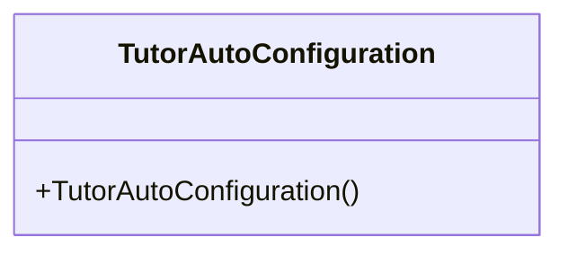

│                   ├── 📁 **contract**
│                   │   ├── 📁 **models**
│                   │   └── 📁 **util**
│                   ├── 📁 **controller**
│                   │   └── 📄 **EffectMappingController.java**  (1.6 KB, 2026-09-25 09:09:35)

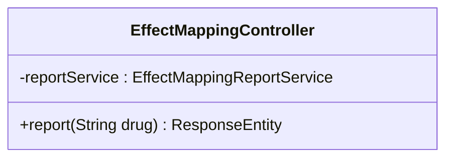

│                   ├── 📁 **domain**
│                   │   ├── 📄 **AssessmentInterruption.java**  (4.7 KB, 2026-09-19 21:03:22)

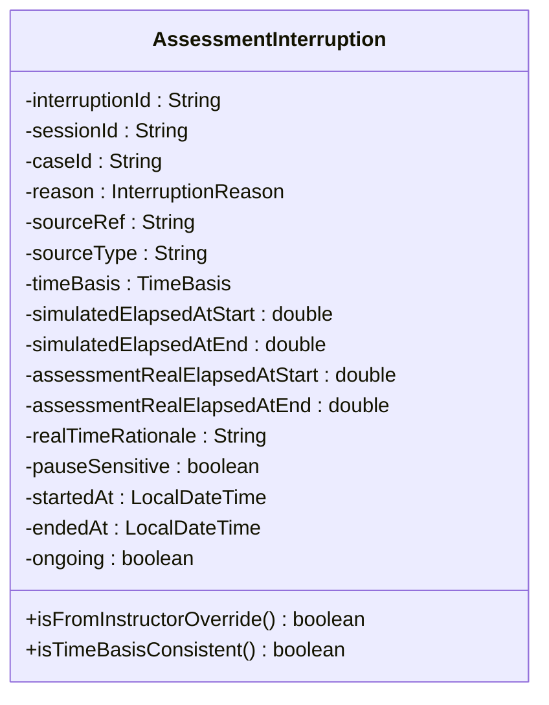

│                   │   ├── 📄 **AssessmentState.java**  (9.0 KB, 2026-09-20 08:07:40)

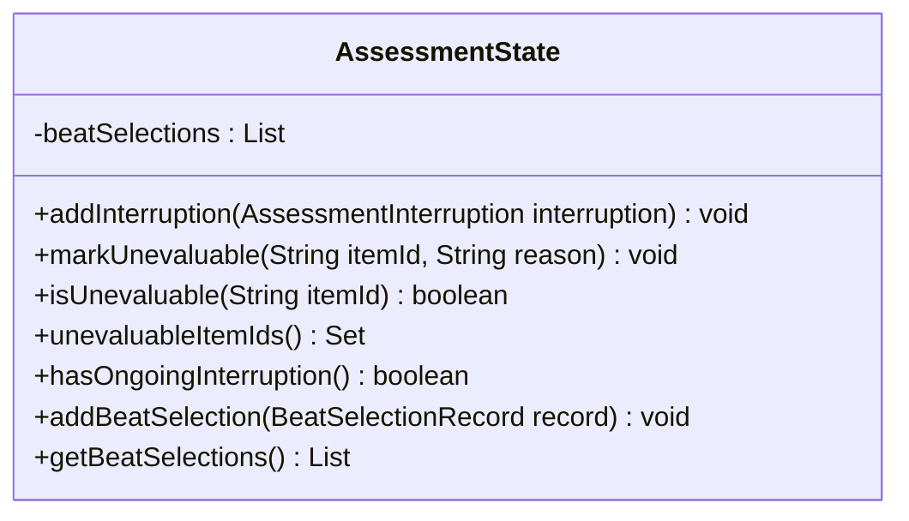

│                   │   ├── 📄 **BranchClinicalState.java**  (878.0 B, 2026-09-19 19:48:55)

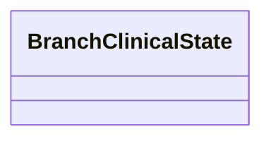

│                   │   ├── 📄 **CaseOutcomeBranch.java**  (1.1 KB, 2026-09-19 19:49:21)

```mermaid
classDiagram
    class CaseOutcomeBranch {
        ~branchId : ) private String
        ~clinicalState : ) private BranchClinicalState
        ~presentationMappingRef : ) private String
        ~trendLabels : ) private List<String>
    }
```

│                   │   ├── 📄 **ClinicalRule.java**  (1.9 KB, 2026-09-19 19:51:02)

```mermaid
classDiagram
    class ClinicalRule {
        ~ruleId : ) private String
        ~matchIntent : ) private String
        ~appliesWhenCurrentState : ) private String
        ~feedbackKey : ) private String
        ~assessmentTags : ) private List<String>
        ~appliesWhen : ) private Map<String, Object>
        ~evidenceRef : ) private String
    }
```

│                   │   ├── 📄 **ClinicalState.java**  (937.0 B, 2026-09-19 14:58:58)

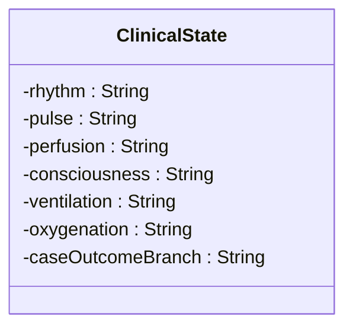

│                   │   ├── 📄 **EffectSpecStatic.java**  (850.0 B, 2026-09-19 19:47:40)

```mermaid
classDiagram
    class EffectSpecStatic {
        ~effectId : ) private String
        ~branchId : ) private String
    }
```

│                   │   ├── 📄 **Evidence.java**  (907.0 B, 2026-09-19 19:49:09)

```mermaid
classDiagram
    class Evidence {
        ~sourceClass : ) private String
        ~supportingGuidelineRefs : ) private List<String>
        ~evidenceManifestRefs : ) private List<String>
    }
```

│                   │   ├── 📄 **FallbackPath.java**  (2.5 KB, 2026-09-19 20:40:30)

```mermaid
classDiagram
    class FallbackPath {
        ~fallbackId : ) private String
        ~appliesWhenState : ) private String
        ~fallbackAction : ) private FallbackAction
    }
```

│                   │   ├── 📄 **InstructorOverride.java**  (3.0 KB, 2026-09-19 20:40:44)

```mermaid
classDiagram
    class InstructorOverride {
        ~overrideId : ) private String
        ~allowedWhen : ) private AllowedWhen
        ~requiresReason : ) private Boolean
        ~auditRequired : ) private Boolean
        ~triggersAssessmentInterruption : ) private Boolean
        ~interruptedCriteria : ) private List<String>
        ~interruptionResultPolicy : ) private String
        ~affectsFormativeScore : ) private Boolean
    }
```

│                   │   ├── 📄 **LearnerState.java**  (573.0 B, 2026-09-19 14:59:24)

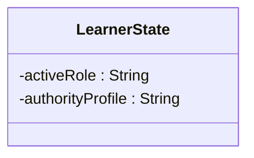

│                   │   ├── 📄 **LessonPlan.java**  (2.4 KB, 2026-09-19 20:43:16)

```mermaid
classDiagram
    class LessonPlan {
        ~lessonPlanId : ) private String
        ~lessonPlanVersion : ) private String
        ~caseId : ) private String
        ~targetAudience : ) private String
        ~estimatedDurationMin : ) private Integer
        ~learningObjectives : ) private List<String>
        ~instructorAuthorityProfile : ) private String
        ~eligibleForSummativeUse : ) private Boolean
        ~scenarioBeatsRef : ) private FileRef
        ~fallbackPathsRef : ) private FileRef
        ~instructorOverridesRef : ) private FileRef
        ~reviewStatus : ) private String
        ~reviewedBy : ) private String
        ~reviewedAt : ) private String
    }
```

│                   │   ├── 📄 **ProtocolState.java**  (602.0 B, 2026-09-19 14:59:12)

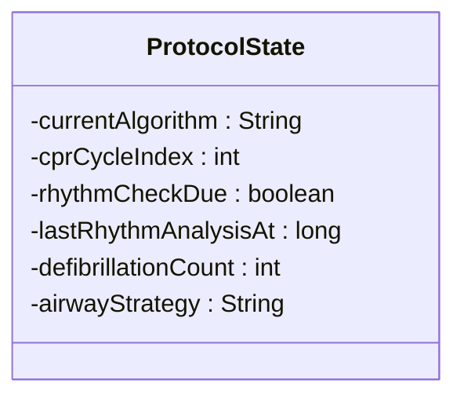

│                   │   ├── 📄 **Review.java**  (792.0 B, 2026-09-19 19:47:28)

```mermaid
classDiagram
    class Review {
        ~reviewStatus : ) private String
        ~reviewerId : ) private String
        ~reviewerRole : ) private String
        ~reviewDate : ) private String
        ~reviewComment : ) private String
    }
```

│                   │   └── 📄 **ScenarioBeat.java**  (5.8 KB, 2026-09-19 20:38:50)

```mermaid
classDiagram
    class ScenarioBeat {
        ~beatId : ) private String
        ~beatMode : ) private String
        ~sequenceHint : ) private Integer
        ~selectionGroup : ) private String
        ~selectionPriority : ) private Integer
        ~proposedEffect : ) private ProposedEffect
        ~caseOutcomeRef : ) private String
        ~eligibleForSummativeUse : ) private Boolean
        ~requiresExplicitLearnerNotice : ) private Boolean
        ~requiresEducationalRationale : ) private Boolean
        ~requiresMedicalReview : ) private Boolean
        ~applicableScenarios : ) private List<String>
        ~nonApplicableScenarios : ) private List<String>
        ~educationalRationale : ) private String
    }
```

│                   ├── 📁 **dto**
│                   ├── 📁 **effect**
│                   │   ├── 📄 **EffectMappingLoader.java**  (2.4 KB, 2026-09-25 09:02:13)

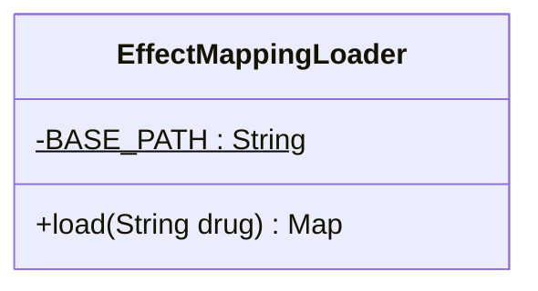

│                   │   └── 📄 **EffectMappingReportService.java**  (9.6 KB, 2026-09-25 09:02:14)

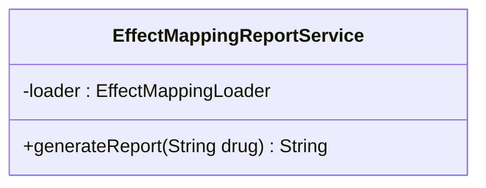

│                   ├── 📁 **engine**
│                   │   ├── 📄 **AttemptEventProcessor.java**  (3.7 KB, 2026-09-25 11:59:20)

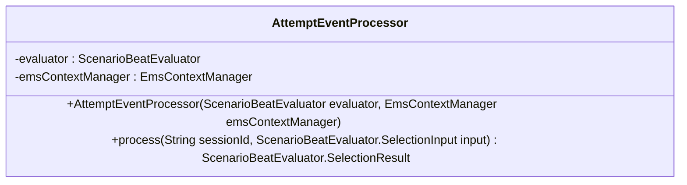

│                   │   └── 📄 **ScenarioBeatEvaluator.java**  (8.5 KB, 2026-09-19 20:54:17)

```mermaid
classDiagram
    class ScenarioBeatEvaluator {
        +init() void
        +select(SelectionInput input) SelectionResult
        -priority(ScenarioBeat b) int$
        -isDeterministic(ScenarioBeat beat) boolean$
        -triggerMatches(ScenarioBeat.Trigger t, SelectionInput in) boolean
        -effectAuthorized(ScenarioBeat.ProposedEffect pe, List<EffectSpec> allowed, Set<String> allowedKeys) boolean
    }
```

│                   ├── 📁 **feedback**
│                   │   └── 📄 **FeedbackMessageResolver.java**  (4.8 KB, 2026-09-19 16:25:51)
│                   ├── 📁 **integration**
│                   │   ├── 📄 **TutorAssessmentQueryService.java**  (2.3 KB, 2026-09-22 17:19:17)

```mermaid
classDiagram
    class TutorAssessmentQueryService {
        -assessmentEngine : AssessmentEngine
        +getBeatSelections(String sessionId) List<BeatSelectionView>
    }
    AssessmentQueryService <|.. TutorAssessmentQueryService
```

│                   │   ├── 📄 **TutorAttemptEventSink.java**  (8.2 KB, 2026-09-25 11:59:35)

```mermaid
classDiagram
    class TutorAttemptEventSink {
        -attemptEventProcessor : AttemptEventProcessor
        -assessmentEngine : AssessmentEngine
        -ruleRepository : RuleRepository
        -outcomeBranchExecutorProvider : ObjectProvider<OutcomeBranchExecutor>
        +onTransitionCommitted(AttemptEventContext context) void
        -applyProposedEffectIfNeeded(AttemptEventContext context, ScenarioBeatEvaluator.SelectionResult result) void
        -mapClinicalStateToVars(BranchClinicalState s) Map<String, Object>
    }
    AttemptEventSink <|.. TutorAttemptEventSink
```

│                   │   ├── 📄 **TutorClinicalRuleService.java**  (9.2 KB, 2026-09-23 16:25:12)

```mermaid
classDiagram
    class TutorClinicalRuleService {
        +validate(ClinicalRuleContext context) ValidationResult
        -evaluateAppliesWhen(ClinicalRule rule, ClinicalRuleContext context) boolean
        -convertEffects(ClinicalRule rule, String caseId) List<EffectSpec>
    }
    ClinicalRuleService <|.. TutorClinicalRuleService
```

│                   │   ├── 📄 **TutorStateTransitionHook.java**  (1.3 KB, 2026-09-19 14:54:12)

```mermaid
classDiagram
    class TutorStateTransitionHook {
        +beforeTransition(TransitionContext context) void
        +afterTransition(TransitionContext context) void
    }
    StateTransitionHook <|.. TutorStateTransitionHook
```

│                   │   └── 📄 **TutorTemporalEventSink.java**  (1.3 KB, 2026-09-19 14:54:12)

```mermaid
classDiagram
    class TutorTemporalEventSink {
        +onStateEntered(String sessionId, String stateId, long stateRevision) void
        +onStateExited(String sessionId, String stateId, long stateRevision) void
        +onEventEmitted(ClinicalEvent event) void
    }
    TemporalEventSink <|.. TutorTemporalEventSink
```

│                   ├── 📁 **manifest**
│                   │   ├── 📄 **AttemptManifest.java**  (3.9 KB, 2026-09-25 17:09:21)

```mermaid
classDiagram
    class AttemptManifest {
        -manifestId : String
        -sessionId : String
        -attemptId : String
        -caseId : String
        -caseVersion : String
        -planId : String
        -planVersion : String
        -schemaVersion : String
        -manifestHash : String
        -stateRevision : long
        -eventSequence : long
        -simulatedElapsedSeconds : double
        -assessmentRealElapsedSeconds : double
        -frozenAt : String
        -frozenBy : String
        -frozen : boolean
        -notes : String
        +isComplete() boolean
    }
```

│                   │   ├── 📄 **ManifestFreezer.java**  (8.2 KB, 2026-09-25 17:04:52)

```mermaid
classDiagram
    class ManifestFreezer {
        -CASE_BASE : String$
        -resourceLoader : ResourceLoader
        -clockService : ClockService
        -contextManager : EmsContextManager
        -reviewStatusResolver : CaseFileReviewStatusResolver
        +freeze(String sessionId, String caseId, String caseVersion, String planId, String planVersion, String schemaVersion, String frozenBy) AttemptManifest
        +freeze(String sessionId, String caseId, String caseVersion, String planId, String planVersion) AttemptManifest
        -assessmentRealElapsedSafe(String sessionId) double
        -elapsedSecondsSafe(String sessionId) double
        -resolveReviewStatusSafe(String caseId, String fileName) String
        -sha256Of(String location) String
    }
```

│                   │   ├── 📄 **ManifestService.java**  (5.9 KB, 2026-09-25 16:36:43)

```mermaid
classDiagram
    class ManifestService {
        -SCHEMA_BASE : String$
        -DEFAULT_CASE_VERSION : String$
        -DEFAULT_PLAN_ID : String$
        -DEFAULT_PLAN_VERSION : String$
        -DEFAULT_SCHEMA_VERSION : String$
        -freezer : ManifestFreezer
        -resourceLoader : ResourceLoader
        +buildAndFreeze(String emsSessionId, String attemptId, String caseId) AttemptManifest
        -computeManifestHash(AttemptManifest m) String
        -sha256Of(String location) String
        -abbreviate(String h) String$
    }
```

│                   │   └── 📄 **TutorAttemptStartedListener.java**  (1.5 KB, 2026-09-25 16:37:00)

```mermaid
classDiagram
    class TutorAttemptStartedListener {
        -manifestService : ManifestService
        -protocolBridge : ProtocolBridgeService
        +onAttemptStarted(AttemptStartedEvent evt) void
    }
```

│                   ├── 📁 **repository**
│                   │   ├── 📄 **LessonPlanRepository.java**  (10.2 KB, 2026-09-19 20:43:33)

```mermaid
classDiagram
    class LessonPlanRepository {
        +init() void
    }
```

│                   │   └── 📄 **RuleRepository.java**  (8.5 KB, 2026-09-19 19:50:20)

```mermaid
classDiagram
    class RuleRepository {
        +init() void
    }
```

│                   ├── 📁 **service**
│                   │   └── 📄 **AssessmentEngine.java**  (12.7 KB, 2026-09-21 17:01:51)

```mermaid
classDiagram
    class AssessmentEngine {
        -manifestFreezer : ManifestFreezer
        -clockService : ClockService
        +getOrCreateState(String sessionId) AssessmentState
        +getState(String sessionId) AssessmentState
        +clear(String sessionId) void
        +beginInterruption(String sessionId, String caseId, AssessmentInterruption.InterruptionReason reason, String sourceRef, String sourceType, AssessmentInterruption.TimeBasis timeBasis, String realTimeRationale, String> unevaluableItems) AssessmentInterruption
        +endInterruption(String sessionId, String interruptionId) AssessmentInterruption
        +recordInstructorOverride(String sessionId, String caseId, String overrideId, String> affectedItems) AssessmentInterruption
        +recordBeatSelection(String sessionId, ScenarioBeatEvaluator.SelectionResult result) AssessmentState.BeatSelectionRecord
        +freezeAttempt(String sessionId, String caseId, String caseVersion, String planId, String planVersion, String schemaVersion) AttemptManifest
        +getLastManifest(String sessionId) AttemptManifest
        -safeElapsed(String sessionId) double
        -safeAssessmentReal(String sessionId) double
    }
```

│                   └── 📁 **web**
└── 📁 **resources**
    └── 📁 **config**
        └── 📁 **acls**
            ├── 📁 **cases**
            │   ├── 📁 **stable_narrow**
            │   │   ├── 📄 **clinical_rules.yaml**  (2.6 KB, 2026-09-23 19:20:52)
            │   │   ├── 📄 **fallback_paths.yaml**  (467.0 B, 2026-09-20 13:24:42)
            │   │   ├── 📄 **instructor_overrides.yaml**  (865.0 B, 2026-09-25 13:06:06)
            │   │   ├── 📄 **lesson_plan.yaml**  (889.0 B, 2026-09-20 13:24:23)
            │   │   └── 📄 **scenario_beats.yaml**  (1.1 KB, 2026-09-22 17:03:15)
            │   └── 📁 **unstable_narrow_svt**
            │       ├── 📄 **clinical_rules.yaml**  (3.3 KB, 2026-09-23 16:25:38)
            │       ├── 📄 **fallback_paths.yaml**  (946.0 B, 2026-09-21 09:09:49)
            │       ├── 📄 **feedback_messages.yaml**  (868.0 B, 2026-09-21 09:28:15)
            │       ├── 📄 **instructor_overrides.yaml**  (885.0 B, 2026-09-25 13:08:23)
            │       ├── 📄 **lesson_plan.yaml**  (1.1 KB, 2026-09-21 09:09:20)
            │       └── 📄 **scenario_beats.yaml**  (1.6 KB, 2026-09-21 09:09:34)
            ├── 📁 **effects**
            │   └── 📄 **adenosine.yaml**  (9.7 KB, 2026-09-25 09:02:12)
            ├── 📁 **feedback**
            │   └── 📄 **feedback_messages.yaml**  (1.3 KB, 2026-09-24 10:58:17)
            └── 📁 **schema**
                ├── 📄 **_shared_schema.json**  (4.2 KB, 2026-09-19 19:34:50)
                ├── 📄 **assessment_rules_schema.json**  (2.5 KB, 2026-09-19 19:44:11)
                ├── 📄 **clinical_rules_schema.json**  (1.8 KB, 2026-09-19 19:37:43)
                ├── 📄 **directional_response_rules_schema.json**  (3.3 KB, 2026-09-19 19:45:06)
                ├── 📄 **effect_mapping_schema.json**  (6.1 KB, 2026-09-25 09:02:09)
                ├── 📄 **evidence_manifest_schema.json**  (3.2 KB, 2026-09-19 19:44:31)
                ├── 📄 **fallback_paths_schema.json**  (2.5 KB, 2026-09-19 19:43:22)
                ├── 📄 **instructor_overrides_schema.json**  (4.5 KB, 2026-09-19 19:43:48)
                ├── 📄 **lesson_plan_schema.json**  (2.1 KB, 2026-09-19 19:42:57)
                ├── 📄 **presentation_mapping_schema.json**  (2.2 KB, 2026-09-19 19:45:45)
                └── 📄 **scenario_beats_schema.json**  (5.1 KB, 2026-09-19 19:42:17)
