# 📁 项目结构：main

**根路径**: `D:\CaveSystem\Demos\ruoyi-ai\ruoyi-modules\ruoyi-ai-ems\src\main`

**生成时间**: 2026-09-25 17:14:58

├── 📁 **java**
│   └── 📁 **com**
│       └── 📁 **ruoyi**
│           └── 📁 **ems**
│               ├── 📁 **action**
│               │   ├── 📄 **ActionCategory.java**  (3.1 KB, 2026-08-29 10:09:15)

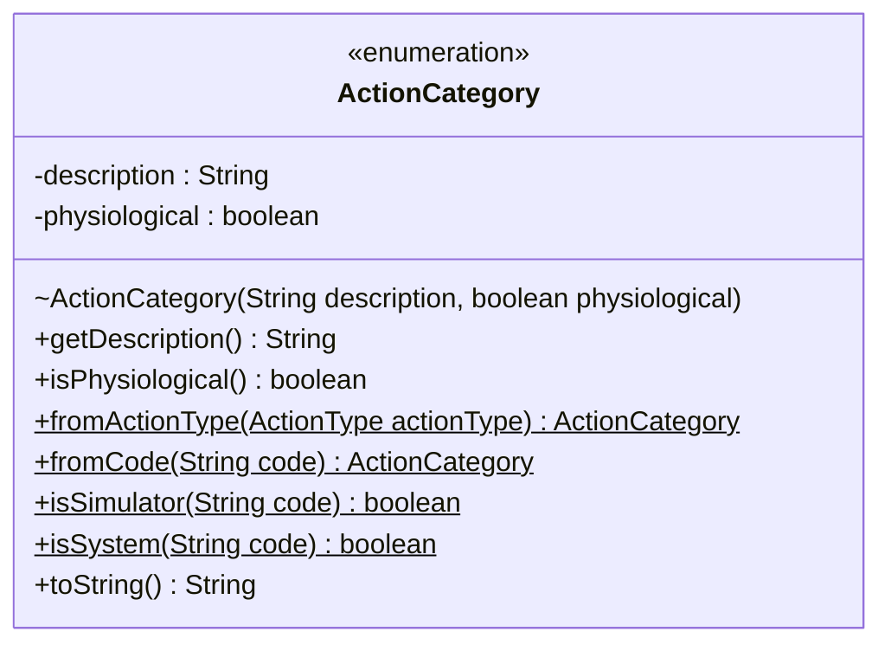

│               │   ├── 📄 **ActionType.java**  (6.6 KB, 2026-08-29 10:09:15)

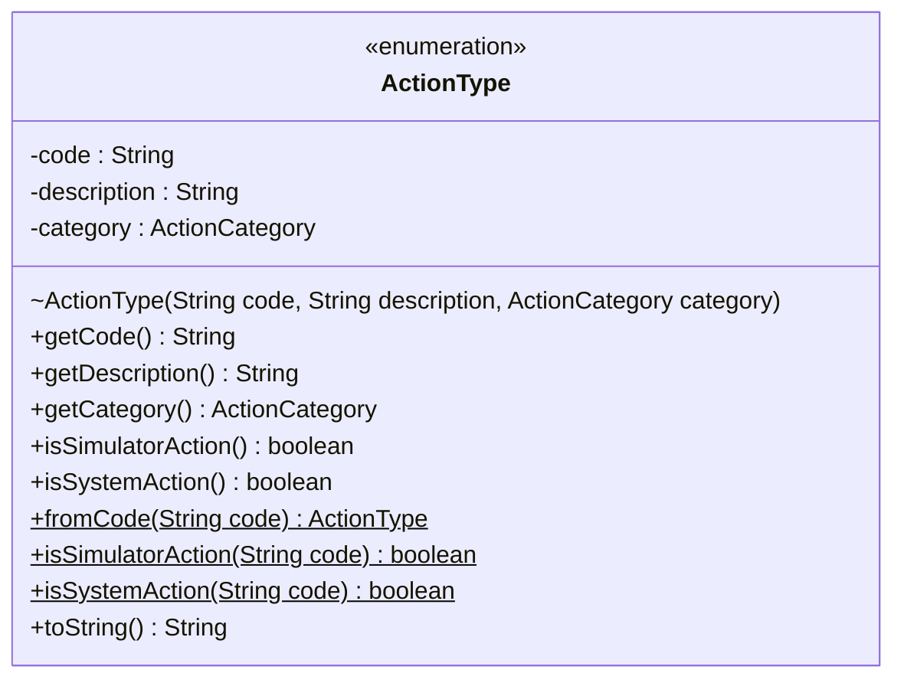

│               │   └── 📄 **SystemAction.java**  (4.2 KB, 2026-08-29 10:09:34)

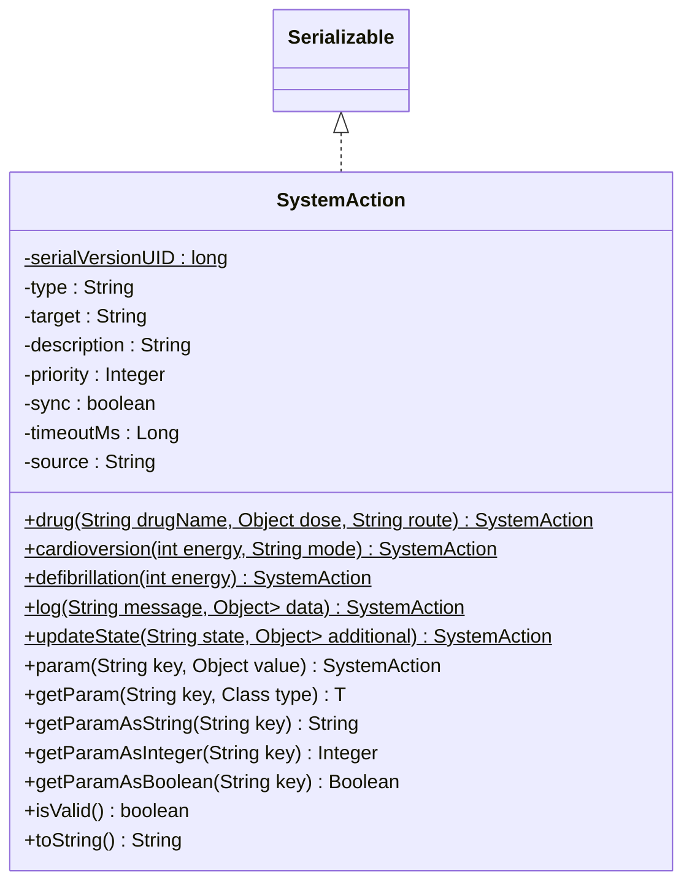

│               ├── 📁 **agent**
│               │   ├── 📁 **dto**
│               │   │   ├── 📄 **Action.java**  (959.0 B, 2026-09-01 15:56:33)

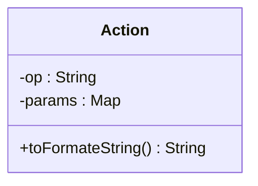

│               │   │   ├── 📄 **ActionRuntime.java**  (1.4 KB, 2026-09-01 13:29:33)

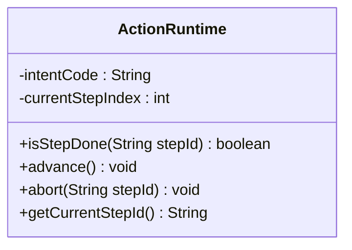

│               │   │   └── 📄 **Plan.java**  (1.0 KB, 2026-09-01 15:57:38)

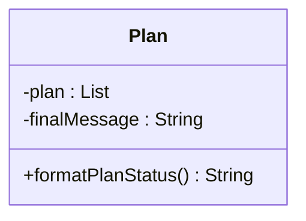

│               │   ├── 📄 **ExecutorAgentService.java**  (3.2 KB, 2026-09-01 16:09:41)

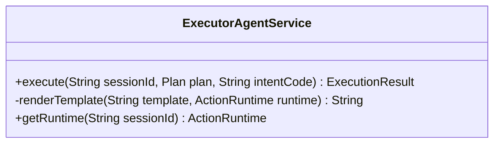

│               │   └── 📄 **PlannerAgentService.java**  (2.7 KB, 2026-09-01 16:04:31)

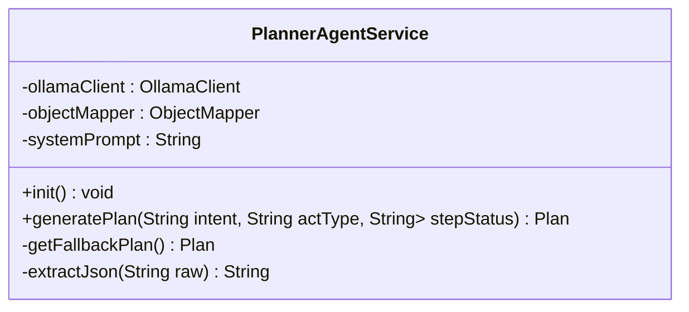

│               ├── 📁 **asr**
│               │   ├── 📁 **config**
│               │   ├── 📁 **model**
│               │   │   └── 📄 **AsrClient.java**  (10.8 KB, 2026-09-15 09:20:39)

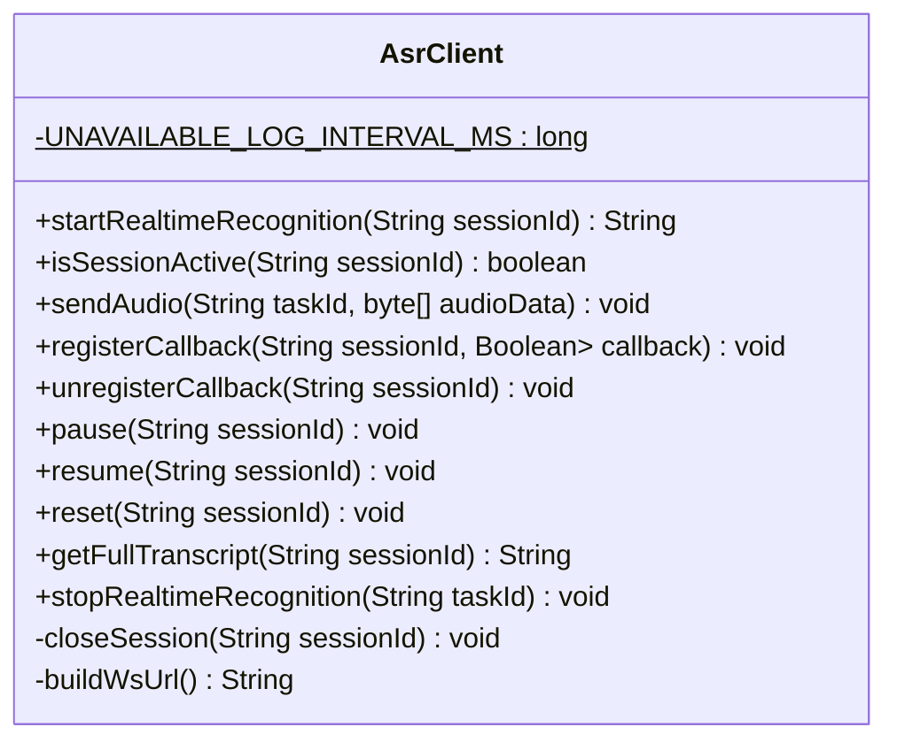

│               │   ├── 📁 **service**
│               │   │   └── 📄 **AsrTranscriptionService.java**  (4.3 KB, 2026-09-13 19:37:01)
│               │   ├── 📄 **AsrUnavailableException.java**  (679.0 B, 2026-09-15 09:19:22)

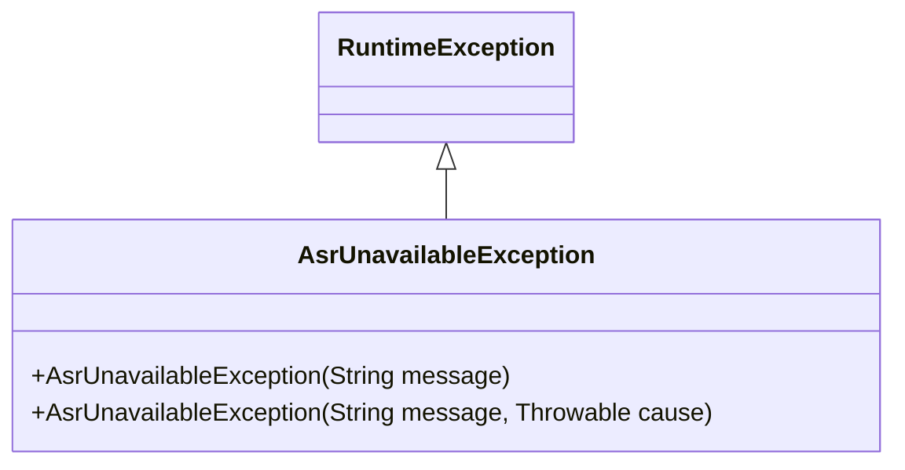

│               │   ├── 📄 **AsrWebSocketConfig.java**  (1.4 KB, 2026-09-13 20:06:09)

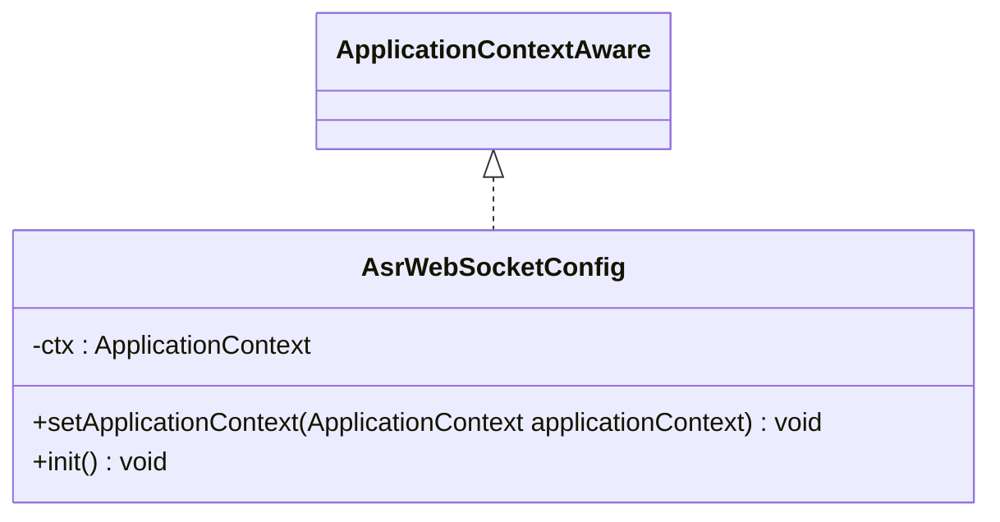

│               │   └── 📄 **AsrWebSocketHandler.java**  (22.8 KB, 2026-09-15 09:17:50)

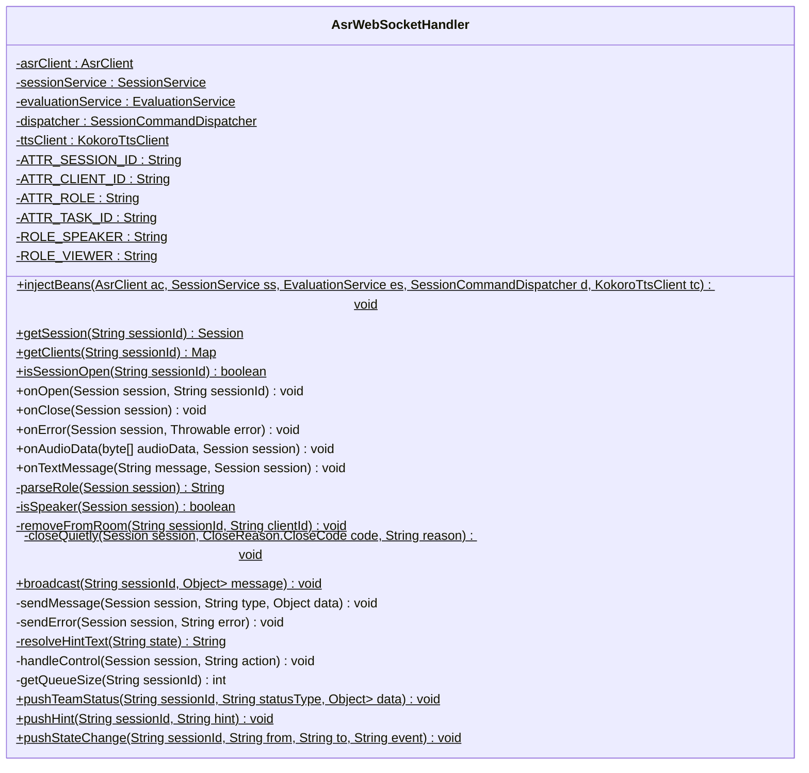

│               ├── 📁 **audit**
│               │   ├── 📄 **AttemptLogService.java**  (4.1 KB, 2026-09-23 11:37:46)

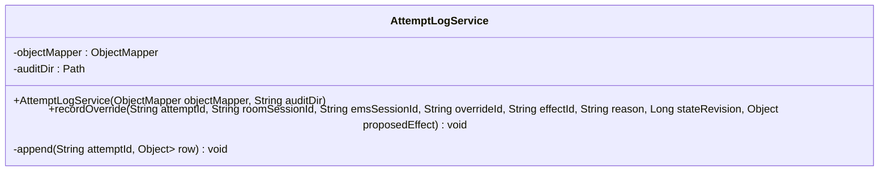

│               │   └── 📄 **AuditEventType.java**  (535.0 B, 2026-09-23 11:37:33)

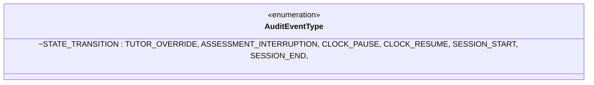

│               ├── 📁 **clock**
│               │   ├── 📁 **contract**
│               │   │   ├── 📄 **ClockEvent.java**  (462.0 B, 2026-09-24 08:54:58)

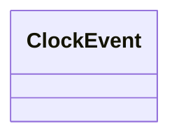

│               │   │   ├── 📄 **ClockEventListener.java**  (147.0 B, 2026-09-24 08:55:10)

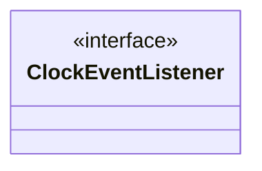

│               │   │   ├── 📄 **ClockEventType.java**  (147.0 B, 2026-09-24 08:54:43)

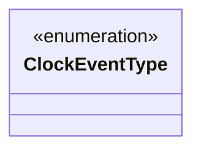

│               │   │   └── 📄 **ClockType.java**  (494.0 B, 2026-09-24 08:54:25)

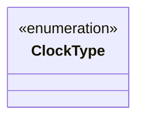

│               │   ├── 📁 **event**
│               │   │   └── 📄 **SimulationTickEvent.java**  (1021.0 B, 2026-09-23 19:54:02)

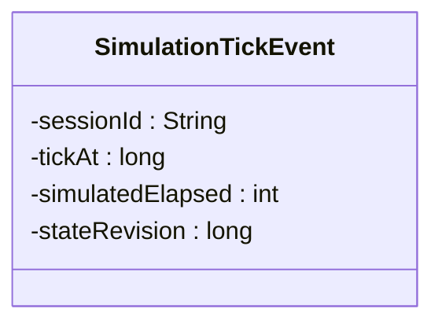

│               │   ├── 📄 **ClockEventLogger.java**  (1.6 KB, 2026-09-24 17:02:25)

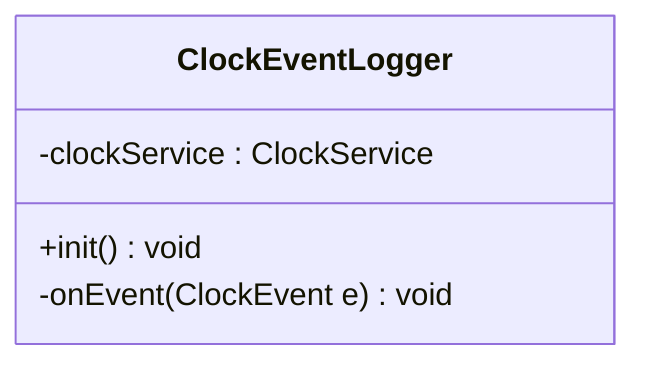

│               │   ├── 📄 **ClockService.java**  (19.8 KB, 2026-09-24 09:44:17)

```mermaid
classDiagram
    class ClockService {
        -contextManager : EmsContextManager
        -sessionService : SessionService
        -teamManager : TeamManager
        -eventPublisher : ApplicationEventPublisher
        +tick() void
        -processSessionTick(String sessionId) void
        -refreshStateDuration(String sessionId, CaseContext context) void
        +start(String sessionId) void
        -initializeLastInterventionTime(String sessionId) void
        +pause(String sessionId) void
        +resume(String sessionId) void
        +stop(String sessionId) void
        +isPaused(String sessionId) boolean
        +elapsedSeconds(String sessionId) double
        +assessmentRealElapsedSeconds(String sessionId) double
        +subscribe(ClockType type, ClockEventListener listener) void
        +unsubscribe(ClockType type, ClockEventListener listener) void
        +publish(ClockEvent event) void
        -triggerSystemRule(String sessionId, CaseContext context, TransitionRule rule) void
    }
```

│               │   └── 📄 **DrugClockService.java**  (4.7 KB, 2026-09-24 17:18:12)

```mermaid
classDiagram
    class DrugClockService {
        +ADENOSINE_RECHECK_WINDOW_MS : long$
        -clockService : ClockService
        -contextManager : EmsContextManager
        +init() void
        +isWithinAdenosineWindow(String sessionId) boolean
        -getAdenosineLastTime(String sessionId) Long
        -onDrugEvent(ClockEvent e) void
    }
```

│               ├── 📁 **config**
│               │   ├── 📁 **loader**
│               │   │   ├── 📄 **CaseIntentDefinitionsLoader.java**  (35.5 KB, 2026-09-22 21:47:38)

```mermaid
classDiagram
    class CaseIntentDefinitionsLoader {
        -resourceResolver : ResourcePatternResolver
        -objectMapper : ObjectMapper
        -caseCode : String
        -caseNameCn : String
        -routerDefaults : RouterDefaults
        -scoringDefinition : ScoringDefinition
        -loaded : boolean
        +CaseIntentDefinitionsLoader(ResourcePatternResolver resourceResolver)
        +init() void
        -loadGlobalIntents() void
        -loadAllCaseIntents() void
        -applyGlobalMetadata(IntentDictionary dict) void
        -loadDictionary(Resource resource) IntentDictionary
        -extractCaseMetadata(IntentDictionary dict, String simpleCaseId) void
        -loadLayer(IntentDictionary dict, boolean isGeneral) void
        -buildDomainMappings() void
        -buildRoutingMappings() void
        -buildCaseMappings() void
        -extractFullCaseIdFromPath(String path) String
        -extractSimpleCaseId(String fullCaseId) String
        -countSpecificIntentsInLayer(IntentDictionary dict) int
        +reloadAll() void
        +reloadCase(String caseId) void
        +loadIntentsForCase(String caseId) void
        -loadOneCaseResource(Resource resource, String caseId) void
        -findIntentNode(JsonNode root, String intentCode) JsonNode
        -removeSpecificIntentsForCase(String caseId) void
        -clearAllCaches() void
        +getSubDomainsByDomainCode(String domainCode) List<SubDomain>
        +getIntentsByDomain(String domainCode) List<IntentDefinition>
        +getIntent(String code) IntentDefinition
        +isValidIntentCode(String code) boolean
        +getAllIntentList() List<IntentDefinition>
        +getAllSubDomains() List<SubDomain>
        +getSubDomainByName(String domainName) SubDomain
        +getSubDomainByIntentCode(String intentCode) SubDomain
        +getIntentsBySubDomainName(String domainName) List<IntentDefinition>
        +getGeneralSubDomains() List<SubDomain>
        +getSpecificSubDomains() List<SubDomain>
        +getSubDomainCount() int
        +loadIntent(String caseType, String intentCode) IntentDefinition
        +getSpecificSubDomainsByCase(String caseId) List<SubDomain>
        +getCaseDefinitions(String caseId) List<SubDomain>
        +printSubDomainStats() void
        +getIntentsForCase(String caseId) List<IntentDefinition>
        +getIntentCodesForCase(String caseId) Set<String>
        +getAllCaseIds() Set<String>
        +getCaseMeta(String caseId) CaseMeta
        +getIntentWriterType(String intentCode) String
        +getIntentCodesByAct(String actType) Set<String>
        +getIntentMeta(String intentCode) IntentMeta
    }
```

│               │   │   ├── 📄 **CaseLoaderService.java**  (2.2 KB, 2026-09-07 09:13:26)

```mermaid
classDiagram
    class CaseLoaderService {
        +loadCaseFromClasspath(String path) CaseDefinition
        +loadCaseFromFile(String filePath) CaseDefinition
        +loadCaseByCaseId(String caseId) CaseDefinition
        +clearCache() void
    }
```

│               │   │   ├── 📄 **DerivationRuleLoader.java**  (13.4 KB, 2026-09-23 17:44:29)
│               │   │   ├── 📄 **EventLogDerivationLoader.java**  (6.6 KB, 2026-09-14 10:43:23)

```mermaid
classDiagram
    class EventLogDerivationLoader {
        -CONFIG_PATH : String$
        -loaded : boolean
        -resourceResolver : ResourcePatternResolver
        +init() void
        +load() void
        +reload() void
        +getRulesForCase(String caseType) List<Rule>
        +getAllRules() List<Rule>
        -validate(Rule r) boolean
        -inferMode(String target) String
    }
```

│               │   │   ├── 📄 **ExceptionRuleLoader.java**  (12.9 KB, 2026-09-18 09:43:01)

```mermaid
classDiagram
    class ExceptionRuleLoader {
        -GLOBAL : String$
        -loaded : boolean
        +loadAll() void
        +reloadAll() void
        +reloadCase(String caseId) void
        -doLoadAll() void
        -mergeWithGlobal(List<ExceptionRule> caseOnly) List<ExceptionRule>
        -extractCaseId(String path) String
        -dedupAndValidate(List<ExceptionRule> raw, String source) List<ExceptionRule>
        -validateRule(ExceptionRule rule, String source) void
        -validateModeFeedback(ExceptionRule.Feedback.ModeFeedback mf, String modeName, String ruleId) void
        +getRulesForCase(String caseType) List<ExceptionRule>
        +getGlobalRules() List<ExceptionRule>
        +getAllCaseIds() Set<String>
    }
```

│               │   │   ├── 📄 **IntentDictLoader.java**  (11.2 KB, 2026-09-13 21:03:57)

```mermaid
classDiagram
    class IntentDictLoader {
        -SUB_MIN_LEN : int$
        -SUB_MAX_LEN : int$
        -resourceLoader : ResourceLoader
        -objectMapper : ObjectMapper
        -loaded : boolean
        +IntentDictLoader(ResourceLoader resourceLoader, ObjectMapper objectMapper)
        +setDictPath(String dictPath) void
        +load() void
        +reloadAll() void
        -doLoad() void
        -clearAll() void
        -addPinyinSubstrings(String surface) void
        -readIntentMeta(JsonNode root) Map<String, IntentMeta>
        -parseHit(JsonNode item, IntentMeta> metaMap) InvertedHit
        +getExactMap() Map<String, List<InvertedHit>>
        +getPinyinMap() Map<String, Set<String>>
        +getAllSurfaces() Set<String>
        +getSurfacesByLen() Map<Integer, List<String>>
        +getSurfacesForIntent(String intentCode) Set<String>
        +getIntentCodes() Set<String>
        +getIntentMeta(String intentCode) IntentMetaInfo
        +getIntentToSurfacesMap() Map<String, Set<String>>
        +getIntentsWithoutSurface() Set<String>
    }
```

│               │   │   ├── 📄 **PhysiologyConfigLoader.java**  (11.1 KB, 2026-09-23 13:29:33)

```mermaid
classDiagram
    class PhysiologyConfigLoader {
        -BASE_DIR : String$
        -DEFAULT_VERSION : String$
        -FALLBACK_CASE : String$
        -SHARED_DIR : String$
        +loadFor(String caseType, String version) PhysiologyConfig
        +loadDrugIndications(String caseId) Map<String, DrugIndicationRule>
        -tryLoadIndications(String dir) Map<String, DrugIndicationRule>
        +loadCase(String caseId) PhysiologyConfig
        +loadDefault() PhysiologyConfig
        +getState(String caseId, String stateId) StatePhysiology
        +getInterventionStates(String caseId) Map<String, StatePhysiology>
        +evictCache(String caseId) void
        +evictAll() void
        -tryLoad(String caseType, String version) PhysiologyConfig
        -validate(PhysiologyConfig cfg, String path) void
        -sha256(byte[] bytes) String$
        -abbreviate(String hash) String$
    }
```

│               │   │   ├── 📄 **RuleCaseConfigValidator.java**  (1.1 KB, 2026-09-05 10:22:23)

```mermaid
classDiagram
    class RuleCaseConfigValidator {
        -ruleConfigLoader : RuleConfigLoader
        -stateMachineLoader : YamlStateMachineLoader
        -intentLoader : CaseIntentDefinitionsLoader
        +validate(String caseId, ResolvedCaseTypeConfig config) void
    }
    CaseConfigValidator <|.. RuleCaseConfigValidator
```

│               │   │   ├── 📄 **RuleConfigLoader.java**  (10.4 KB, 2026-09-05 10:24:19)

```mermaid
classDiagram
    class RuleConfigLoader {
        +loadAllRules() void
        +reloadAll() void
        +reloadCase(String caseId) void
        -loadGlobalRules() void
        -loadCaseRules() void
    }
```

│               │   │   ├── 📄 **VariableMetaLoader.java**  (30.2 KB, 2026-09-17 19:50:32)

```mermaid
classDiagram
    class VariableMetaLoader {
        -objectMapper : ObjectMapper
        -loaded : boolean
        -resourceResolver : ResourcePatternResolver
        +VariableMetaLoader()
        +load() void
        -loadGeneralVariables() void
        -loadAllSpecificVariables() void
        -loadSpecificVariablesFromFile(Resource resource) void
        -extractCaseTypeFromPath(String path) String
        -buildIndex() void
        -mergeGeneralToCase(String caseType) void
        -validateAllResetDefaults() void
        -validateResetDefaults(String caseType) void
        +getVariablesForCase(String caseType) Map<String, VariableMeta>
        +getMeta(String caseType, String varName) VariableMeta
        +resolveSlotToVariable(String caseType, String slotName) String
        +resolveSlotToVariable(String slotName) String
        +getGeneralSlotMappings() Map<String, String>
        +getSpecificSlotMappings(String caseType) Map<String, String>
        +getResetDefaults(String caseType) Map<String, Object>
        +getResetDefault(String caseType, String varName) Object
        +hasResetDefaults(String caseType) boolean
        -resolveByParentPrefix(String caseType, String varName) VariableMeta
        +checkWritePermission(String caseType, String varName, String writer) boolean
        +validateValue(String caseType, String varName, Object value) boolean
        +validateStateMachine(String caseType, ResolvedCaseTypeConfig config) void
        +extractVariables(String expression) Set<String>
        +reload() void
        +reloadCase(String caseType) void
        +getAllCaseTypesWithSpecificVariables() Set<String>
        +getGeneralVariables() Map<String, VariableMeta>
        +getVariableWriters(String caseType, String varName) Set<String>
        +getVariablesByWriter(String caseType, String writer) Set<String>
        +validateVariableWriters(String caseType, Set<String>> intentToWrites, String> intentToWriterType) List<String>
    }
```

│               │   │   └── 📄 **YamlStateMachineLoader.java**  (41.0 KB, 2026-09-16 22:06:11)

```mermaid
classDiagram
    class YamlStateMachineLoader {
        -resourceResolver : ResourcePatternResolver
        -variableMetaManager : VariableMetaLoader
        -loaded : boolean
        +YamlStateMachineLoader(ResourcePatternResolver resourceResolver, VariableMetaLoader variableMetaManager)
        +init() void
        +reloadAll() void
        +loadAllConfigs() void
        -resolveConfig(String caseId, StateMachineConfig> allConfigs) ResolvedCaseTypeConfig
        -topologicalSort(Set<String> caseIds) List<String>
        -dfsTopological(String caseId, Set<String> caseIds, Set<String> visited, Set<String> visiting, List<String> sorted) void
        -buildInheritanceChain(String caseId) List<String>
        +getConfig(String caseType) ResolvedCaseTypeConfig
        +getInheritanceChain(String caseType) List<String>
        +getLoadedCaseTypes() Set<String>
        +exists(String caseType) boolean
        +getConfigSummary() Map<String, String>
        +getConfigs() Map<String, ResolvedCaseTypeConfig>
        +reload() void
        +reloadCase(String caseType) void
        +getEntryTransitions(String caseType, String state) List<TransitionRule>
        +generateMermaid(String caseType, boolean isfull) String
        +generatePhaseSubgraph(String caseType, String phaseId) String
        -sanitizeEdgeLabel(String s) String
        -findPhaseRecursive(List<PhaseDefinition> phases, String phaseId) PhaseDefinition
        -buildLeafSubgraph(ResolvedCaseTypeConfig config, PhaseDefinition phase) String
        -buildContainerSubgraph(PhaseDefinition container) String
        -buildMermaid(ResolvedCaseTypeConfig config, boolean isfull) String
        -collectLeafStateIds(PhaseDefinition node, String topId, Set<String> excludes, String> stateToTop, int[] counter) void
        -registerLeafStates(PhaseDefinition leaf, String topId, Set<String> excludes, String> stateToTop) int
        -resolveTopPhase(String stateOrPhase, String> stateToTop, Set<String> excludes, ResolvedCaseTypeConfig config) String
        -escape(String s) String
        +buildPhaseOverviewMermaid(ResolvedCaseTypeConfig config) String
        -buildFlatMermaid(ResolvedCaseTypeConfig config) String
        +getAllStateIds() Set<String>
        +getStateIdsForCase(String caseType) Set<String>
        +getTransitionsFromState(String caseType, String state) List<TransitionRule>
        +getOnEnterRules(String caseType, String state) List<String>
        +getAllOnEnterRules(String caseType) Map<String, List<String>>
        +getInitialState(String caseType) String
        +getEndStates(String caseType) Set<String>
        +getParent(String caseType) String
        +getAlwaysAllowedIntents(String caseType) Set<String>
        +getGlobalEventIntents(String caseType) Set<String>
        +getIntentToStateMapping(String caseType) Map<String, String>
        +getResetVarsOnArrival(String caseType) List<String>
    }
```

│               │   ├── 📁 **spi**
│               │   │   └── 📄 **CaseConfigValidator.java**  (590.0 B, 2026-09-02 19:43:25)

```mermaid
classDiagram
    class CaseConfigValidator {
        <<interface>>
    }
```

│               │   ├── 📄 **CaseDefinition.java**  (3.2 KB, 2026-09-07 09:05:40)

```mermaid
classDiagram
    class CaseDefinition {
        -caseId : String
        -caseName : String
        -version : String
        -parent : String
        -description : String
        -stateDescriptions : Map<String, String>
        -initialization : Initialization
        -stateMachine : StateMachine
        -variables : List<VariableDefinition>
        -slotMappings : Map<String, String>
        -rules : List<RuleDefinition>
        -reflexRules : List<ReflexRuleDefinition>
        -physiology : Map<String, PhysiologyDefinition>
        -onEnterRules : Map<String, List<String>>
        -external : External
    }
```

│               │   ├── 📄 **CaseState.java**  (5.2 KB, 2026-08-29 10:22:48)

```mermaid
classDiagram
    class CaseState {
        -serialVersionUID : long$
        -code : String
        -name : String
        -description : String
        -type : StateType
        -onEntryAction : String
        -onExitAction : String
        -onDoAction : String
        -timeoutSeconds : Integer
        -timeoutEvent : String
        -timeoutAction : String
        -displayOrder : Integer
        -styleClass : String
        -icon : String
        -group : String
        -tags : String
        -visible : boolean
        -allowRollback : boolean
        +isInitial() boolean
        +isEnd() boolean
        +isError() boolean
        +hasTimeout() boolean
        +hasOnEntryAction() boolean
        +hasOnExitAction() boolean
        +getDisplayName() String
        +toString() String
    }
    Serializable <|.. CaseState
```

│               │   ├── 📄 **MultiAgentConfig.java**  (7.0 KB, 2026-08-26 07:44:23)

```mermaid
classDiagram
    class MultiAgentConfig {
        -chatServiceFactory : ChatServiceFactory
        -chatModelService : IChatModelService
        -MODEL_ASSESSMENT : String$
        -MODEL_DECISION : String$
        -MODEL_SAFETY : String$
        -MODEL_FEEDBACK : String$
        -MODEL_EXTRACTION : String$
        -MODEL_REPORT : String$
        -MODEL_DEFAULT : String$
        +MultiAgentConfig(ChatServiceFactory chatServiceFactory, IChatModelService chatModelService)
        -buildChatModel(String modelName, Double temperature, String seed) ChatModel
        +defaultChatModel() ChatModel
        +assessmentChatModel() ChatModel
        +decisionChatModel() ChatModel
        +safetyChatModel() ChatModel
        +feedbackChatModel() ChatModel
        +extractionChatModel() ChatModel
        +reportChatModel() ChatModel
        +throttledAssessmentChatModel(ChatModel model) ChatModel
        +throttledDecisionChatModel(ChatModel model) ChatModel
        +throttledSafetyChatModel(ChatModel model) ChatModel
        +throttledFeedbackChatModel(ChatModel model) ChatModel
        +throttledExtractionChatModel(ChatModel model) ChatModel
        +throttledReportChatModel(ChatModel model) ChatModel
        +assessmentAgent(ChatModel model) AssessmentAgent
        +decisionAgent(ChatModel model) DecisionAgent
        +safetyAgent(ChatModel model) SafetyAgent
        +feedbackAgent(ChatModel model) FeedbackAgent
        +supervisorAgent(AssessmentAgent assessmentAgent, DecisionAgent decisionAgent, SafetyAgent safetyAgent, FeedbackAgent feedbackAgent) SupervisorAgent
    }
```

│               │   ├── 📄 **RedisConfig.java**  (2.2 KB, 2026-08-30 18:13:11)

```mermaid
classDiagram
    class RedisConfig {
        +redisTemplate(RedisConnectionFactory connectionFactory) RedisTemplate<String, Object>
    }
```

│               │   ├── 📄 **ResolvedCaseTypeConfig.java**  (20.1 KB, 2026-09-16 20:56:35)

```mermaid
classDiagram
    class ResolvedCaseTypeConfig {
        -code : String
        -caseName : String
        -version : String
        -parent : String
        -initialState : String
        -stateDescriptions : Map<String, String>
        -initialPhase : String
        -allowUnlistedTransitions : boolean
        -defaultTransitionAction : String
        +getOverviewExcludeStates() Set<String>
        +setOverviewExcludeStates(Set<String> v) void
        +getStateDescription(String stateCode) String
        +hasState(String stateCode) boolean
        +isEndState(String stateCode) boolean
        +isInitialState(String stateCode) boolean
        +getTransitionsBySource(String sourceState) List<TransitionRule>
        +getAvailableIntents(String sourceState) Set<String>
        +buildPromptWhitelist(String currentState) Set<String>
        +findTransition(String sourceState, String intentCode) Optional<TransitionRule>
        +findTransitionByEvent(String sourceState, String eventCode) Optional<TransitionRule>
        +getStateCount() int
        +getTransitionCount() int
        +isGlobalEvent(String intentCode) boolean
        +getDefaultTargetState(String intentCode) String
        +getPhaseById(String phaseId) PhaseDefinition
        +getPhaseForState(String state) String
        +hasPhases() boolean
        +isOverviewHidden(String state) boolean
        +getLeafPhases() List<PhaseDefinition>
        -collectLeafPhases(PhaseDefinition phase, List<PhaseDefinition> out) void
        +getPhaseCount() int
        +rebuildStateToPhaseIndex() void
        -collectStateToPhaseIndex(PhaseDefinition phase, String> out) void
        +deepCopy() ResolvedCaseTypeConfig
        +builder() Builder$
    }
```

│               │   ├── 📄 **StateMachineConfig.java**  (601.0 B, 2026-09-07 10:44:34)

```mermaid
classDiagram
    class StateMachineConfig {
        -caseId : String
        -caseName : String
        -version : String
        -parent : String
        -description : String
        -stateMachine : StateMachineDefinition
        -stateDescriptions : Map<String, String>
        -onEnterRules : Map<String, List<String>>
    }
```

│               │   ├── 📄 **StateMachineDefinition.java**  (4.0 KB, 2026-09-16 20:48:27)

```mermaid
classDiagram
    class StateMachineDefinition {
        -initial : String
        -allowUnlistedTransitions : boolean
        -defaultTransitionAction : String
        -intentToStateMapping : Map<String, String>
        -globalEventIntents : Set<String>
        -alwaysAllowedIntents : Set<String>
        -states : List<String>
        -endStates : List<String>
        -transitions : List<TransitionRule>
        -initialPhase : String
        -phases : List<PhaseDefinition>
        +getOverviewExcludeStates() List<String>
        +setOverviewExcludeStates(List<String> v) void
        +getInitial() String
        +isAllowUnlistedTransitions() boolean
        +getDefaultTransitionAction() String
        +getIntentToStateMapping() Map<String, String>
        +getGlobalEventIntents() Set<String>
        +getAlwaysAllowedIntents() Set<String>
        +getStates() List<String>
        +getEndStates() List<String>
        +getTransitions() List<TransitionRule>
        +getInitialPhase() String
        +getPhases() List<PhaseDefinition>
        +setInitial(String initial) void
        +setAllowUnlistedTransitions(boolean allowUnlistedTransitions) void
        +setDefaultTransitionAction(String defaultTransitionAction) void
        +setIntentToStateMapping(String> intentToStateMapping) void
        +setGlobalEventIntents(Set<String> globalEventIntents) void
        +setAlwaysAllowedIntents(Set<String> alwaysAllowedIntents) void
        +setStates(List<String> states) void
        +setEndStates(List<String> endStates) void
        +setTransitions(List<TransitionRule> transitions) void
        +setInitialPhase(String initialPhase) void
        +setPhases(List<PhaseDefinition> phases) void
    }
```

│               │   ├── 📄 **StateType.java**  (6.1 KB, 2026-08-29 10:22:48)

```mermaid
classDiagram
    class StateType {
        <<enumeration>>
        -code : String
        -description : String
        -terminal : boolean
        -initial : boolean
        -transientState : boolean
        ~StateType(String code, String description, boolean terminal, boolean initial, boolean transientState)
        +fromCode(String code) StateType$
        +fromCodeOrDefault(String code, StateType defaultType) StateType$
        +fromDescription(String description) StateType$
        +isTerminal() boolean
        +isInitial() boolean
        +isTransient() boolean
        +isError() boolean
        +isChoice() boolean
        +isSubState() boolean
        +isEffectiveState() boolean
        +parse(String value) StateType$
        +toString() String
    }
```

│               │   ├── 📄 **ThrottledChatModel.java**  (1.6 KB, 2026-08-25 07:23:38)

```mermaid
classDiagram
    class ThrottledChatModel {
        -delegate : ChatModel
        -semaphore : Semaphore
        +ThrottledChatModel(ChatModel delegate, int maxConcurrent)
        +ThrottledChatModel(ChatModel delegate, Semaphore semaphore)
        +chat(List<ChatMessage> messages) ChatResponse
    }
    ChatModel <|.. ThrottledChatModel
```

│               │   ├── 📄 **TransitionConfig.java**  (4.9 KB, 2026-08-29 10:23:39)

```mermaid
classDiagram
    class TransitionConfig {
        -source : String
        -target : String
        -event : String
        -intentCode : String
        -guardExpression : String
        -guardBeanName : String
        -guardInstance : GuardInstance
        -actionExpression : String
        -actionBeanName : String
        -actionInstance : ActionInstance
        -systemActionType : String
        -systemActionParams : Map<String, Object>
        -priority : int
        -enabled : boolean
        -description : String
        +hasGuard() boolean
        +hasAction() boolean
        +hasSystemAction() boolean
        +isSystemEvent() boolean
        +fromRule(TransitionRule rule) TransitionConfig$
    }
```

│               │   └── 📄 **TransitionRule.java**  (6.8 KB, 2026-09-14 11:24:40)

```mermaid
classDiagram
    class TransitionRule {
        -source : String
        -target : String
        -intentCode : String
        -event : String
        -condition : String
        -action : String
        -systemActionType : String
        -systemActionParams : Map<String, Object>
        -priority : Integer
        -description : String
        -enabled : boolean
        -systemTrigger : boolean
        -deviation : boolean
        -exitReason : String
        -effects : List<EffectRule>
        +hasCondition() boolean
        +hasAction() boolean
        +isSystemEvent() boolean
        +getDisplayName() String
        +toString() String
        +hasIntent() boolean
        +hasEvent() boolean
        +hasSystemAction() boolean
        +getTriggerType() String
        +isUntriggerable() boolean
        +isSelfLoop() boolean
        +getStableTransitionId() String
    }
```

│               ├── 📁 **constant**
│               │   ├── 📄 **AllVarKeys.java**  (14.9 KB, 2026-09-24 16:26:36)

```mermaid
classDiagram
    class AllVarKeys {
        -AllVarKeys()
        +isValid(String name) boolean$
    }
```

│               │   ├── 📄 **AssertKeys.java**  (1016.0 B, 2026-09-24 16:26:36)

```mermaid
classDiagram
    class AssertKeys {
        +ASSERT_QRS_WIDTH : String$
        +ASSERT_RHYTHM_REGULAR : String$
        +ASSERT_RHYTHM_TYPE : String$
        +ASSERT_STABLE : String$
        -AssertKeys()
    }
```

│               │   ├── 📄 **CaseKeys.java**  (679.0 B, 2026-09-24 16:26:36)

```mermaid
classDiagram
    class CaseKeys {
        +CASE_EVENT_LOG : String$
        -CaseKeys()
    }
```

│               │   ├── 📄 **ClinicalKeys.java**  (3.0 KB, 2026-09-24 16:26:36)

```mermaid
classDiagram
    class ClinicalKeys {
        +CLINICAL_AGE : String$
        +CLINICAL_ALLERGIES : String$
        +CLINICAL_ASTHMA : String$
        +CLINICAL_AV_BLOCK : String$
        +CLINICAL_CARBAMAZEPINE : String$
        +CLINICAL_DIPYRIDAMOLE : String$
        +CLINICAL_GENDER : String$
        +CLINICAL_IS_PREGNANT : String$
        +CLINICAL_IS_WPW : String$
        +CLINICAL_MEDICATION_LIST : String$
        +CLINICAL_OBESITY : String$
        +CLINICAL_PAST_MEDICAL_HISTORY : String$
        +CLINICAL_POST_ROSC_COMPLETE : String$
        +CLINICAL_ROSC : String$
        +CLINICAL_ROSC_CONFIRMED : String$
        +CLINICAL_ROSC_STABILIZED : String$
        +CLINICAL_SICK_SINUS : String$
        +CLINICAL_THEOPHYLLINE : String$
        +CLINICAL_TRANSPLANT : String$
        +CLINICAL_WEIGHT_KG : String$
        -ClinicalKeys()
    }
```

│               │   ├── 📄 **DerivedKeys.java**  (2.0 KB, 2026-09-24 16:26:36)

```mermaid
classDiagram
    class DerivedKeys {
        +DERIVED_CARDIOVERSION_READY : String$
        +DERIVED_CPR_QUALITY_GOOD : String$
        +DERIVED_IS_NARROW_REGULAR_STABLE : String$
        +DERIVED_IS_SINUS_RHYTHM : String$
        +DERIVED_IS_UNSTABLE_NARROW_QRS : String$
        +DERIVED_QRS_WIDTH : String$
        +DERIVED_RHYTHM_REGULAR : String$
        +DERIVED_SHOCKABLE_RHYTHM : String$
        +DERIVED_STABLE : String$
        +DERIVED_UNSTABLE : String$
        -DerivedKeys()
    }
```

│               │   ├── 📄 **DeviceKeys.java**  (6.4 KB, 2026-09-24 16:26:36)

```mermaid
classDiagram
    class DeviceKeys {
        +DEVICE_AED_ON : String$
        +DEVICE_AIRWAY_DEVICE : String$
        +DEVICE_AIRWAY_MANEUVER : String$
        +DEVICE_AIRWAY_PATENT : String$
        +DEVICE_BVM_PLACED : String$
        +DEVICE_BVM_SEALED : String$
        +DEVICE_DEFIB_CHARGED : String$
        +DEVICE_DEFIB_CONNECTED : String$
        +DEVICE_DEFIB_ENERGY : String$
        +DEVICE_DEFIB_MODE : String$
        +DEVICE_DEFIB_PADS_ATTACHED : String$
        +DEVICE_DEFIB_PADS_POSITION : String$
        +DEVICE_DEFIB_SYNC_MODE : String$
        +DEVICE_ECG12LEAD_DONE : String$
        +DEVICE_ECG_DEVICE_NAME : String$
        +DEVICE_ECG_LEAD_LABEL : String$
        +DEVICE_ECG_LEAD_PLACED : String$
        +DEVICE_ECG_POWER : String$
        +DEVICE_ECG_RECORDED : String$
        +DEVICE_ETT_CUFF_INFLATED : String$
        +DEVICE_ETT_DEPTH : String$
        +DEVICE_ETT_PLACED : String$
        +DEVICE_GLUCOMETER_READY : String$
        +DEVICE_IO_ESTABLISHED : String$
        +DEVICE_IO_LOCATION : String$
        +DEVICE_IV_ESTABLISHED : String$
        +DEVICE_IV_LOCATION : String$
        +DEVICE_LAST_CHARGE_ENERGY : String$
        +DEVICE_LAST_SHOCK_ENERGY : String$
        +DEVICE_LAST_SHOCK_SYNC : String$
        +DEVICE_LEADS_CONNECTED : String$
        +DEVICE_LEADS_PLACED : String$
        +DEVICE_MONITOR_CONNECTED : String$
        +DEVICE_NPA_PLACED : String$
        +DEVICE_NPA_SIZE : String$
        +DEVICE_OXYGEN_DEVICE : String$
        +DEVICE_OXYGEN_FLOW : String$
        +DEVICE_PACER_CAPTURE : String$
        +DEVICE_PACER_MODE : String$
        +DEVICE_PACER_ON : String$
        +DEVICE_PACER_RATE : String$
        +DEVICE_PACER_THRESHOLD : String$
        +DEVICE_SGA_PLACED : String$
        +DEVICE_SGA_TYPE : String$
        +DEVICE_SHAVE_DONE : String$
        +DEVICE_SHAVE_SITE : String$
        +DEVICE_STRIP_READY : String$
        +DEVICE_SUCTION_READY : String$
        +DEVICE_V1POSITION : String$
        +DEVICE_V2POSITION : String$
        +DEVICE_V3POSITION : String$
        +DEVICE_V4POSITION : String$
        +DEVICE_V5POSITION : String$
        +DEVICE_V6POSITION : String$
        -DeviceKeys()
    }
```

│               │   ├── 📄 **EvaluationKeys.java**  (2.3 KB, 2026-09-24 16:26:36)

```mermaid
classDiagram
    class EvaluationKeys {
        +EVALUATION_CPR_QUALITY_SCORE : String$
        +EVALUATION_ERROR_COUNT : String$
        +EVALUATION_LEADERSHIP_SCORE : String$
        +EVALUATION_MAJOR_ERROR_COUNT : String$
        +EVALUATION_MAJOR_ERRORS : String$
        +EVALUATION_MEDICATION_SCORE : String$
        +EVALUATION_MINOR_ERROR_COUNT : String$
        +EVALUATION_MINOR_ERRORS : String$
        +EVALUATION_OVERALL_SCORE : String$
        +EVALUATION_RHYTHM_INTERPRETATION_SCORE : String$
        +EVALUATION_TEAMWORK_SCORE : String$
        +EVALUATION_TIME_TO_FIRST_DEFIB : String$
        +EVALUATION_TIME_TO_FIRST_INTERVENTION : String$
        +EVALUATION_TIME_TO_ROSC : String$
        -EvaluationKeys()
    }
```

│               │   ├── 📄 **InterventionFields.java**  (972.0 B, 2026-09-24 16:32:39)

```mermaid
classDiagram
    class InterventionFields {
        +SEP : String$
        +STATUS : String$
        +LAST_TIME : String$
        +COUNT : String$
        +TOTAL_DOSE : String$
        +LAST_DOSE : String$
        +LAST_ROUTE : String$
        +EFFECT : String$
        +FLUSH_DONE : String$
        -InterventionFields()
    }
```

│               │   ├── 📄 **InterventionKeys.java**  (5.8 KB, 2026-09-24 16:26:36)

```mermaid
classDiagram
    class InterventionKeys {
        +INTERVENTION_ADENOSINE : String$
        +INTERVENTION_ADENOSINE_DOSE_SEQUENCE : String$
        +INTERVENTION_ADENOSINE_GIVEN : String$
        +INTERVENTION_AMIODARONE : String$
        +INTERVENTION_ASPIRIN : String$
        +INTERVENTION_ATROPINE : String$
        +INTERVENTION_CARDIOVERSION : String$
        +INTERVENTION_CPR : String$
        +INTERVENTION_DEFIB : String$
        +INTERVENTION_DILTIAZEM : String$
        +INTERVENTION_DOPAMINE : String$
        +INTERVENTION_DRUG_RESPONSE : String$
        +INTERVENTION_EPINEPHRINE : String$
        +INTERVENTION_ESMOLOL : String$
        +INTERVENTION_FLUID : String$
        +INTERVENTION_INTUBATION : String$
        +INTERVENTION_LAST_DRUG : String$
        +INTERVENTION_LAST_DRUG_DOSE : String$
        +INTERVENTION_LAST_DRUG_ROUTE : String$
        +INTERVENTION_LAST_DRUG_TIME : String$
        +INTERVENTION_LIDOCAINE : String$
        +INTERVENTION_MAGNESIUM : String$
        +INTERVENTION_METOPROLOL : String$
        +INTERVENTION_NALOXONE : String$
        +INTERVENTION_NITRO : String$
        +INTERVENTION_NOREPINEPHRINE : String$
        +INTERVENTION_PACING : String$
        +INTERVENTION_RHYTHM_CONFIRMED : String$
        +INTERVENTION_RHYTHM_CONVERTED : String$
        +INTERVENTION_SALINE_FLUSH_DONE : String$
        +INTERVENTION_SECOND_LINE_FAILED : String$
        +INTERVENTION_SEDATION : String$
        +INTERVENTION_SGA : String$
        +INTERVENTION_SODIUM_BICARBONATE : String$
        +INTERVENTION_TTM : String$
        +INTERVENTION_VAGAL : String$
        +INTERVENTION_VASOPRESSIN : String$
        -InterventionKeys()
    }
```

│               │   ├── 📄 **OtherKeys.java**  (1.1 KB, 2026-09-24 16:26:36)

```mermaid
classDiagram
    class OtherKeys {
        +SCENARIO_ADENOSINE_12MG_SUCCESS : String$
        +SCENARIO_ADENOSINE_6MG_SUCCESS : String$
        -OtherKeys()
    }
```

│               │   ├── 📄 **PhysKeys.java**  (8.1 KB, 2026-09-24 16:26:36)

```mermaid
classDiagram
    class PhysKeys {
        +PHYS_ACUTE_HEART_FAILURE : String$
        +PHYS_ALTERED_MENTAL_STATUS : String$
        +PHYS_ANXIETY : String$
        +PHYS_BLOOD_GLUCOSE : String$
        +PHYS_BP_LOCATION : String$
        +PHYS_BREATHING_PRESENT : String$
        +PHYS_CAPILLARY_REFILL : String$
        +PHYS_CHEST_PAIN : String$
        +PHYS_CHEST_PAIN_TYPE : String$
        +PHYS_CONSCIOUSNESS : String$
        +PHYS_DIAPHORESIS : String$
        +PHYS_DIASTOLIC_BP : String$
        +PHYS_ECG_DELTA_WAVE : String$
        +PHYS_ECG_ST_DEPRESSION : String$
        +PHYS_ECG_ST_ELEVATION : String$
        +PHYS_ECG_ST_ELEVATION_LEADS : String$
        +PHYS_ECG_TINVERSION : String$
        +PHYS_ECG_VOLTAGE : String$
        +PHYS_ETCO2 : String$
        +PHYS_ETCO2TREND : String$
        +PHYS_FLUSHING : String$
        +PHYS_GCS_EYE : String$
        +PHYS_GCS_MOTOR : String$
        +PHYS_GCS_TOTAL : String$
        +PHYS_GCS_VERBAL : String$
        +PHYS_GLUCOSE_UNIT : String$
        +PHYS_GRIP_LEFT : String$
        +PHYS_GRIP_RIGHT : String$
        +PHYS_HAS_PULSE : String$
        +PHYS_HEADACHE : String$
        +PHYS_HEART_RATE : String$
        +PHYS_HYPOTENSION_SBP_LT90 : String$
        +PHYS_ISCHEMIC_CHEST_PAIN : String$
        +PHYS_MEAN_ARTERIAL_PRESSURE : String$
        +PHYS_NAUSEA : String$
        +PHYS_ON_OXYGEN : String$
        +PHYS_ORIENTATION_PERSON : String$
        +PHYS_ORIENTATION_PLACE : String$
        +PHYS_ORIENTATION_TIME : String$
        +PHYS_PA_CO2 : String$
        +PHYS_PA_O2 : String$
        +PHYS_PERIPHERAL_PULSE : String$
        +PHYS_PR_INTERVAL : String$
        +PHYS_PULSE_PRESSURE : String$
        +PHYS_PULSE_SITE : String$
        +PHYS_PUPIL_LEFT : String$
        +PHYS_PUPIL_RIGHT : String$
        +PHYS_PUPIL_SIZE : String$
        +PHYS_PUPILS : String$
        +PHYS_QRS_DURATION : String$
        +PHYS_QTC : String$
        +PHYS_RESPIRATORY_PATTERN : String$
        +PHYS_RESPIRATORY_RATE : String$
        +PHYS_RESPONSIVENESS : String$
        +PHYS_RHYTHM : String$
        +PHYS_RHYTHM_REGULARITY : String$
        +PHYS_RHYTHM_SOURCE : String$
        +PHYS_RR_INTERVAL_JITTER : String$
        +PHYS_SCENE_SAFETY : String$
        +PHYS_SHOCK_SIGNS : String$
        +PHYS_SHORTNESS_OF_BREATH : String$
        +PHYS_SKIN_COLOR : String$
        +PHYS_SKIN_CONDITION : String$
        +PHYS_SKIN_MOISTURE : String$
        +PHYS_SKIN_TEMPERATURE : String$
        +PHYS_SPO2 : String$
        +PHYS_SYMPTOMS_PRESENT : String$
        +PHYS_SYSTOLIC_BP : String$
        +PHYS_TEMPERATURE : String$
        +PHYS_THROAT_NECK_DISCOMFORT : String$
        +PHYS_TRANSIENT_COMPLETE_AV_BLOCK : String$
        +PHYS_VENTILATION_MODE : String$
        -PhysKeys()
    }
```

│               │   ├── 📄 **ProcessKeys.java**  (22.7 KB, 2026-09-24 16:26:36)

```mermaid
classDiagram
    class ProcessKeys {
        +PROCESS_ACKNOWLEDGED : String$
        +PROCESS_AED_REQUESTED : String$
        +PROCESS_AED_REQUESTED_TO : String$
        +PROCESS_AIRWAY_SECRETION : String$
        +PROCESS_ALGORITHM_BRANCH : String$
        +PROCESS_ALL_CLEAR_FOR_SHOCK : String$
        +PROCESS_ANTICOAGULANT_DRUG : String$
        +PROCESS_ANTICOAGULATION_ASSESSED : String$
        +PROCESS_ANTICOAGULATION_DECISION_TRIGGERED : String$
        +PROCESS_APHASIA : String$
        +PROCESS_APHASIA_SEVERITY : String$
        +PROCESS_APPROACH_ACTION : String$
        +PROCESS_ARM_DRIFT_CHECKED : String$
        +PROCESS_ARM_DRIFT_DURATION_SEC : String$
        +PROCESS_ASSISTANCE_REQUESTED : String$
        +PROCESS_ASSISTANCE_TYPE : String$
        +PROCESS_BALANCE_CHECKED : String$
        +PROCESS_BLS_SURVEY_COMPLETE : String$
        +PROCESS_BP_MEASURED : String$
        +PROCESS_BREATHING_TECHNIQUE : String$
        +PROCESS_CARDIOVERSION_PERFORMED : String$
        +PROCESS_CARDIOVERSION_WITHOUT_SEDATION : String$
        +PROCESS_CASE_TYPE : String$
        +PROCESS_CHEST_EXPOSED : String$
        +PROCESS_CHEST_RECOIL : String$
        +PROCESS_CLEAR_FOR_ANALYSIS : String$
        +PROCESS_CLEAR_FOR_SHOCK : String$
        +PROCESS_COMPRESSION_CONTINUOUS : String$
        +PROCESS_COMPRESSION_DEPTH : String$
        +PROCESS_COMPRESSION_DEPTH_AVG : String$
        +PROCESS_COMPRESSION_PAUSED : String$
        +PROCESS_COMPRESSION_RATE : String$
        +PROCESS_COMPRESSION_RATE_AVG : String$
        +PROCESS_CONSCIOUSNESS_CHECKED : String$
        +PROCESS_CONSULT_CALLED : String$
        +PROCESS_CONTRAINDICATION_BLOCK_TRIGGERED : String$
        +PROCESS_CONTRAINDICATIONS_CHECKED : String$
        +PROCESS_COORDINATION_CHECKED : String$
        +PROCESS_CPR_CYCLES : String$
        +PROCESS_CPR_FRACTION : String$
        +PROCESS_CPR_INTERRUPTION_DURATION : String$
        +PROCESS_CPR_INTERRUPTIONS : String$
        +PROCESS_CPR_START_TIME : String$
        +PROCESS_CPR_STOP_TIME : String$
        +PROCESS_CURRENT_STATE : String$
        +PROCESS_DEFIB_ATTEMPTS_BEFORE_ROSC : String$
        +PROCESS_DEVIATION_FLAG : String$
        +PROCESS_DEVIATION_REASON : String$
        +PROCESS_DRUG_INDUCED_VF_ALERT_SHOWN : String$
        +PROCESS_DRUGS_BEFORE_ROSC : String$
        +PROCESS_ECG_ARTIFACT_ID : String$
        +PROCESS_ECG_CONSENT : String$
        +PROCESS_ECG_EXPLAINED : String$
        +PROCESS_ECG_INTERPRETATION : String$
        +PROCESS_ECG_RECORDED : String$
        +PROCESS_ECG_REPORTED : String$
        +PROCESS_EMERGENCY_CARDIOVERSION_PERFORMED : String$
        +PROCESS_EMERGENCY_MODE : String$
        +PROCESS_ENVIRONMENT_SAFE : String$
        +PROCESS_ERROR_FIXED : String$
        +PROCESS_ERROR_OCCURRED : String$
        +PROCESS_ERROR_TYPE : String$
        +PROCESS_ETA : String$
        +PROCESS_FACE_DROOP_CHECKED : String$
        +PROCESS_FAMILY_CHECKED : String$
        +PROCESS_FINAL_RHYTHM : String$
        +PROCESS_FIRST_CONTACT_TIME : String$
        +PROCESS_FIRST_DEFIB_TIME : String$
        +PROCESS_FIRST_DRUG_TIME : String$
        +PROCESS_FIRST_ECGTIME : String$
        +PROCESS_GRIP_SYMMETRY_CHECKED : String$
        +PROCESS_HANDOFF_DONE : String$
        +PROCESS_HANDOFF_FORMAT : String$
        +PROCESS_HEMODYNAMIC_DETERIORATION_ALERT : String$
        +PROCESS_HEMODYNAMICS_ASSESSED : String$
        +PROCESS_HISTORY_COLLECTED : String$
        +PROCESS_HOSPITAL_ARRIVAL_TIME : String$
        +PROCESS_HOSPITAL_NOTIFIED : String$
        +PROCESS_HPI : String$
        +PROCESS_HR_MEASURED : String$
        +PROCESS_INITIAL_RHYTHM : String$
        +PROCESS_INSTABILITY_TRIGGERED : String$
        +PROCESS_LAST_ERROR : String$
        +PROCESS_LAST_FLUSH_TIME : String$
        +PROCESS_LAST_INTERVENTION_TIME : String$
        +PROCESS_LAST_SHOCK_TIME : String$
        +PROCESS_LKW_TIME : String$
        +PROCESS_LKW_WITNESS : String$
        +PROCESS_MEDICATION_CONTEXT : String$
        +PROCESS_NEGLECT_PRESENT : String$
        +PROCESS_NEGLECT_SIGNS : String$
        +PROCESS_NO_CONTACT_DURING_ANALYSIS : String$
        +PROCESS_OPERATION_STARTED : String$
        +PROCESS_OPERATION_STATUS : String$
        +PROCESS_OPERATION_TYPE : String$
        +PROCESS_OXIMETRY_MEASURED : String$
        +PROCESS_PATIENT_MOVEMENT : String$
        +PROCESS_PATIENT_REPORT : String$
        +PROCESS_PATIENT_SECURED : String$
        +PROCESS_PATIENT_STABLE : String$
        +PROCESS_PATIENT_STILL : String$
        +PROCESS_PATIENT_UNSTABLE : String$
        +PROCESS_PEA_ASYSTOLE_ALERT_SHOWN : String$
        +PROCESS_POST_SHOCK_ELAPSED : String$
        +PROCESS_PREV_STATE : String$
        +PROCESS_QRS_WIDTH_CHECKED : String$
        +PROCESS_REASSESSED : String$
        +PROCESS_REPEATED_PHRASE : String$
        +PROCESS_RETURN_TO_PARENT : String$
        +PROCESS_RHYTHM_AT_ROSC : String$
        +PROCESS_RHYTHM_INTERPRETATION_REQUESTED : String$
        +PROCESS_RHYTHM_REGULARITY_CHECKED : String$
        +PROCESS_ROSC_TIME : String$
        +PROCESS_SAFETY_CLEARED : String$
        +PROCESS_SCENE_EXIT_TIME : String$
        +PROCESS_SEDATION_ASSESSED : String$
        +PROCESS_SESSION_CLOCK_STATUS : String$
        +PROCESS_SESSION_START_TIME : String$
        +PROCESS_SHOCK_COUNT : String$
        +PROCESS_SHOCK_DONE : String$
        +PROCESS_SHOCK_ENERGY_SEQUENCE : String$
        +PROCESS_SHOCK_OUTCOME_SEQUENCE : String$
        +PROCESS_SHOCK_TIMING : String$
        +PROCESS_SPEECH_CHECKED : String$
        +PROCESS_STATE_DURATION : String$
        +PROCESS_STATE_ENTER_TIME : String$
        +PROCESS_STEP_CLEAR_ANNOUNCED : String$
        +PROCESS_STEP_DEFIB_CHARGED : String$
        +PROCESS_STEP_ENERGY_SELECTED : String$
        +PROCESS_STEP_SEDATION_GIVEN : String$
        +PROCESS_STEP_SYNC_MODE_REQUESTED : String$
        +PROCESS_STIMULUS_TYPE : String$
        +PROCESS_STRAPS_COUNT : String$
        +PROCESS_STRATEGY_OVERRIDDEN : String$
        +PROCESS_STRETCHER_LOADED : String$
        +PROCESS_STROKE_ALERT_ACTIVATED : String$
        +PROCESS_STROKE_SIDE : String$
        +PROCESS_STROKE_TEAM_NOTIFIED : String$
        +PROCESS_SUBSTANCE_FREQUENCY : String$
        +PROCESS_SUBSTANCE_USE : String$
        +PROCESS_SUCTION_DONE : String$
        +PROCESS_SUSPECTED_ACIDOSIS : String$
        +PROCESS_SUSPECTED_HYPERKALEMIA : String$
        +PROCESS_SUSPECTED_HYPOTHERMIA : String$
        +PROCESS_SUSPECTED_HYPOVOLEMIA : String$
        +PROCESS_SUSPECTED_PE : String$
        +PROCESS_SUSPECTED_RHYTHM : String$
        +PROCESS_SUSPECTED_TAMPONADE : String$
        +PROCESS_SUSPECTED_TENSION_PNEUMOTHORAX : String$
        +PROCESS_SUSPECTED_TOXICITY : String$
        +PROCESS_SYMPTOMS : String$
        +PROCESS_TEAM_ROLES_ASSIGNED : String$
        +PROCESS_TERMINATE_RESUSCITATION : String$
        +PROCESS_TERMINATION_DOCUMENTED : String$
        +PROCESS_TIME_ELAPSED_SINCE_LAST_INTERVENTION : String$
        +PROCESS_TIME_RECORDED : String$
        +PROCESS_TIMEOUT_OCCURRED : String$
        +PROCESS_TIMEOUT_RESOLVED : String$
        +PROCESS_TOTAL_INTERVENTIONS : String$
        +PROCESS_TRANSFER_METHOD : String$
        +PROCESS_TRANSPORT_READY : String$
        +PROCESS_TRANSPORT_STARTED : String$
        +PROCESS_TRANSPORT_TARGET : String$
        +PROCESS_TREATMENT_RESULT_REPORTED : String$
        +PROCESS_TUTOR_WARNING : String$
        +PROCESS_TUTOR_WARNING_AT : String$
        +PROCESS_UNSYNCHRONIZED_SHOCK_VF_ALERT_SHOWN : String$
        +PROCESS_VAGAL_EFFECT_OBSERVED : String$
        +PROCESS_VAGAL_MANEUVER_PERFORMED : String$
        +PROCESS_VAGAL_SKIPPED_WARNING : String$
        +PROCESS_VENTILATION_DONE : String$
        +PROCESS_VENTILATION_RATE : String$
        +PROCESS_VISION_DEFICIT : String$
        +PROCESS_VISION_FIELD_CUT : String$
        +PROCESS_WPW_ALERT_SHOWN : String$
        +PROCESS_WPW_ALERT_TRIGGERED : String$
        -ProcessKeys()
    }
```

│               │   └── 📄 **ReportKeys.java**  (1.2 KB, 2026-09-24 16:26:36)

```mermaid
classDiagram
    class ReportKeys {
        +REPORT_CONSCIOUSNESS : String$
        +REPORT_DIASTOLIC_BP : String$
        +REPORT_HEART_RATE : String$
        +REPORT_RESPIRATORY_RATE : String$
        +REPORT_SPO2 : String$
        +REPORT_SYSTOLIC_BP : String$
        -ReportKeys()
    }
```

│               ├── 📁 **context**
│               │   ├── 📄 **AclsInternalVars.java**  (1.1 KB, 2026-09-25 13:08:41)

```mermaid
classDiagram
    class AclsInternalVars {
        -AclsInternalVars()
        +isInternal(String varName) boolean$
    }
```

│               │   ├── 📄 **ClassificationContext.java**  (12.2 KB, 2026-09-11 19:26:11)

```mermaid
classDiagram
    class ClassificationContext {
        -caseId : String
        -caseDisplayName : String
        -sessionId : String
        -currentState : String
        -currentStateDescription : String
        -sessionMode : String
        -traineeName : String
        -variables : Map<String, Object>
        -variablesDescription : String
        -availableIntentsDescription : String
        -lastIntent : String
        -lastIntentResult : IntentCommand
        -scenario : String
        -availableIntents : Set<String>
        -globalEventIntents : Set<String>
        -elapsedSeconds : int
        -clockStatus : String
        -extra : Map<String, Object>
        -intentHistoryDisplay : List<String>
        -lastIntentDisplay : String
        -teamStatusSummary : String
        +empty() ClassificationContext$
        +getRecentDialogs(int n) List<DialogTurn>
        +getLastDialog() DialogTurn
        +buildContextPrompt() String
        +toDebugString() String
        -getIntentDisplayName(String intentCode) String
        -formatTime(int seconds) String
        -formatSet(Set<String> set) String
    }
```

│               │   ├── 📄 **EmsContextManager.java**  (51.4 KB, 2026-09-25 12:01:01)

```mermaid
classDiagram
    class EmsContextManager {
        +FALLBACK_INITIAL_STATE : String$
        -MAX_DERIVATION_DEPTH : int$
        -STACK_DEPTH_WARN_THRESHOLD : int$
        -metaManager : VariableMetaLoader
        -messageSender : WebSocketMessageSender
        -derivationService : DerivationService
        -wsRegistry : com.ruoyi.ems.room.ws.WsSessionRegistry
        -filterBroadcastVars(Object> vars) Map<String, Object>
        +getOrCreate(String sessionId) CaseContext
        +seedInitialStateIfAbsent(String sessionId, String initialState) boolean
        +getSnapshot(String sessionId) CaseContext
        +getReadOnlySnapshot(String sessionId) CaseContext
        +clearDefaultCache() void
        +getVariableDefault(String caseType, String varName) Object
        -resolveDefault(String caseType, String varName) Object
        -updateWithVersion(String sessionId, Object> updates, long expectedVersion, String caller) boolean
        -doUpdateWithVersion(String sessionId, Object> updates, long expectedVersion, String caller, boolean allowDerivation) boolean
        -shouldTriggerDerivation(Set<String> changedKeys) boolean
        -refreshDerivedLocked(String sessionId, CaseContext ctx) void
        -doRefreshDerivedLocked(String sessionId, CaseContext ctx) void
        -isRecognizedVarPrefix(String varName) boolean
        +setVarWithVersion(String sessionId, String varName, Object value, String writer, long expectedVersion) boolean
        +batchSetVarsWithVersion(String sessionId, Object> varMap, String writer, long expectedVersion) boolean
        +updateCurrentPhysiology(String sessionId, StatePhysiology physiology, long expectedVersion) boolean
        +getCurrentPhysiology(String sessionId) StatePhysiology
        +advanceEventSequence(String sessionId) long
        +setInternalVarNoVersion(String sessionId, String varName, Object value) boolean
        +updatePhaseRuntime(String sessionId, PhaseRuntime phaseRuntime, long expectedVersion) boolean
        +getPhaseRuntime(String sessionId) PhaseRuntime
        +updateConversationState(String sessionId, IntentCommand lastIntentResult, String appendHistoryIntentCode, ClassificationContext.DialogTurn appendTurn) boolean
        +advanceClock(String sessionId) boolean
        +resetVariables(String sessionId, List<String> varNames, String writer) boolean
        +applyResetDefaults(String sessionId, String caseType, String writer) boolean
        +applyResetDefaults(String sessionId, String caseType) boolean
        -ensureInitialState(String sessionId) void
        +getExtractionMemory(String sessionId) Map<String, Object>
        +updateExtractionMemory(String sessionId, Object> memory, long expectedVersion) boolean
        +getModifiedVariables(String sessionId) Set<String>
        +clearModifiedVariables(String sessionId) void
        +clearContext(String sessionId) void
        +setClockRunning(String sessionId, boolean running) boolean
    }
```

│               │   └── 📄 **MapWriteHelper.java**  (6.9 KB, 2026-09-14 13:03:55)

```mermaid
classDiagram
    class MapWriteHelper {
        -MAX_RETRY : int$
        -contextManager : EmsContextManager
        +mutateMap(String sessionId, String mapKey, String writer, Object>> mutator) boolean
        +appendEvent(String sessionId, String code, String writer, Object> params) boolean
        +setFlatVars(String sessionId, Object> vars, String writer) boolean
        -deepCopyMap(Object src) Map<String, Object>
    }
```

│               ├── 📁 **controller**
│               │   ├── 📄 **AgentTestController.java**  (1.6 KB, 2026-09-01 14:00:11)

```mermaid
classDiagram
    class AgentTestController {
        -plannerAgentService : PlannerAgentService
        -executorAgentService : ExecutorAgentService
        +test(AgentTestRequest request) ResponseEntity<?>
    }
    class AgentTestRequest {
        -sessionId : String
        -intentCode : String
        -actType : String
        -userInput : String
    }
```

│               │   ├── 📄 **AssessmentDebugController.java**  (3.0 KB, 2026-09-25 08:41:15)

```mermaid
classDiagram
    class AssessmentDebugController {
        -assessmentQueryServiceProvider : ObjectProvider<AssessmentQueryService>
        -reloadServiceProvider : ObjectProvider<CaseConfigReloadService>
        +AssessmentDebugController(ObjectProvider<AssessmentQueryService> assessmentQueryServiceProvider, ObjectProvider<CaseConfigReloadService> reloadServiceProvider)
        +getBeatSelections(String sessionId) List<BeatSelectionView>
        +reloadCase(String caseId) Map<String, Object>
        +reloadAll() Map<String, Object>
    }
```

│               │   ├── 📄 **EvaluationController.java**  (7.1 KB, 2026-08-29 21:04:27)

```mermaid
classDiagram
    class EvaluationController {
        -evaluationService : EvaluationService
        -sessionService : SessionService
        -scoringEngine : ScoringEngine
        -extractionService : ProcessTranscriptor
        +EvaluationController(EvaluationService evaluationService, SessionService sessionService, ScoringEngine scoringEngine, ProcessTranscriptor extractionService)
        ~triggerEvaluation(String sessionId) ) public R<EmsEvaluation>
        ~getEvaluation(String sessionId) ) public R<EmsEvaluation>
        ~manualScore(String transcript) ) public R<ScoreResult>
        ~getAgentTrace(String sessionId) ) public R<Object>
    }
```

│               │   ├── 📄 **ReportController.java**  (5.3 KB, 2026-08-24 12:00:16)

```mermaid
classDiagram
    class ReportController {
        -reportService : ReportService
        +ReportController(ReportService reportService)
        ~getReport(String sessionId) ) public R<String>
        ~getComparisonReport(String[] sessionIds) ) public R<String>
        ~exportMarkdown(String sessionId) ) public ResponseEntity<String>
        ~exportTxt(String sessionId) ) public ResponseEntity<String>
    }
```

│               │   ├── 📄 **RoomController.java**  (7.8 KB, 2026-09-15 09:51:26)

```mermaid
classDiagram
    class RoomController {
        -roomService : RoomService
        +create(CreateRoomRequest req) R<CreateRoomResponse>
        +end(String sessionId, String reason) R<Void>
        +destroy(String sessionId) R<Void>
        +list(String caseId, String state) R<List<RoomSummary>>
        +detail(String sessionId) R<RoomDetail>
        +join(String sessionId, JoinRequest req) R<JoinResponse>
    }
```

│               │   └── 📄 **SessionController.java**  (18.5 KB, 2026-09-16 21:57:08)

```mermaid
classDiagram
    class SessionController {
        -sessionService : SessionService
        -intentRegistry : CaseIntentDefinitionsLoader
        ~startSession(String scenarioId, String traineeName, String mode) ) public R<EmsSession>
        +endSession(String sessionId) R<Void>
        +getContext(String sessionId) R<Map<Object, Object>>
        +getTranscript(String sessionId) R<String>
        +getStateInfo(String sessionId, String caseType) R<Map<String, Object>>
        +getVariables(String sessionId) R<Map<String, Object>>
        +getDefaultVariables(String caseType) R<Map<String, Object>>
        +receiveTranscript(String sessionId, String transcript) R<Void>
        +getSessionStatus(String sessionId) R<Map<String, Object>>
        +getCurrentState(String sessionId) R<String>
        +getTransitionHistory(String sessionId) R<List<Map<String, Object>>>
        +getLiveMermaid(String sessionId) R<String>
        +getMermaidCode(String caseId) R<String>
        +getDefinitions(String caseId) R<List<SubDomain>>
        -deepCopyAndProcessDefinitions(List<SubDomain> original) List<SubDomain>
        +getNodeEntryConditions(String sessionId, String nodeId) R<Map<String, Object>>
        +getPhaseSubgraph(String sessionId, String caseType, String phaseId) R<Map<String, String>>
    }
```

│               ├── 📁 **dispatcher**
│               │   └── 📄 **SessionCommandDispatcher.java**  (5.5 KB, 2026-09-05 09:00:15)

```mermaid
classDiagram
    class SessionCommandDispatcher {
        +destroy() void
        +submit(CommandTask task, String> processor) void
        +interruptSession(String sessionId) boolean
        +evictSession(String sessionId) void
        +getQueueSize(String sessionId) int
        +getActiveSessionCount() int
    }
```

│               ├── 📁 **domain**
│               │   ├── 📁 **dto**
│               │   │   ├── 📄 **.gitkeep**  (0.0 B, 2026-08-23 07:20:19)
│               │   │   ├── 📄 **ClinicalAction.java**  (1.2 KB, 2026-08-23 07:23:47)

```mermaid
classDiagram
    class ClinicalAction {
        -seq : Integer
        -timestamp : Integer
        -actor : String
        -actionType : String
        -detail : String
        -value : String
        -result : String
        -sourceText : String
    }
```

│               │   │   ├── 📄 **CommandTask.java**  (463.0 B, 2026-09-05 08:51:17)

```mermaid
classDiagram
    class CommandTask {
        -sessionId : String
        -transcript : String
        -webSocketSession : Session
        -timestamp : long
        -retryCount : int
    }
```

│               │   │   ├── 📄 **ExecutionOutcome.java**  (2.5 KB, 2026-09-25 14:24:50)

```mermaid
classDiagram
    class ExecutionOutcome {
        -success : boolean
        -responseText : String
        -errorMessage : String
        -validation : ValidationResult
        -failureKind : String
        -contextUpdates : Map<String, Object>
        -animations : List<String>
        +ExecutionOutcome()
        +success(String text, ValidationResult vr) ExecutionOutcome$
        +failure(String kind, String errMsg, ValidationResult vr) ExecutionOutcome$
        +isSuccess() boolean
        +setSuccess(boolean success) void
        +getResponseText() String
        +setResponseText(String responseText) void
        +getErrorMessage() String
        +setErrorMessage(String errorMessage) void
        +getValidation() ValidationResult
        +setValidation(ValidationResult validation) void
        +getFailureKind() String
        +setFailureKind(String failureKind) void
        +getContextUpdates() Map<String, Object>
        +setContextUpdates(Object> contextUpdates) void
        +getAnimations() List<String>
        +setAnimations(List<String> animations) void
    }
```

│               │   │   ├── 📄 **MultiAgentEvaluationResult.java**  (1.0 KB, 2026-08-23 10:14:23)

```mermaid
classDiagram
    class MultiAgentEvaluationResult {
        -agentFusionScore : Integer
        -ruleScore : Integer
        -finalScore : Integer
        -pass : Boolean
        -criticalErrors : List<String>
        -agentOutputs : Map<String, AgentOutput>
        -warnings : List<String>
        -draftReport : String
    }
```

│               │   │   ├── 📄 **RuleConfig.java**  (233.0 B, 2026-09-05 10:18:51)

```mermaid
classDiagram
    class RuleConfig {
        -caseId : String
        -rules : List<RuleDefinition>
    }
```

│               │   │   ├── 📄 **ScenarioJudgment.java**  (990.0 B, 2026-08-23 13:14:31)

```mermaid
classDiagram
    class ScenarioJudgment {
        -heartRateGt150 : Boolean
        -pulsePresent : Boolean
        -unstableSigns : List<String>
        -qrsWidth : String
        -rhythmRegularity : String
        -wpwSyndrome : Boolean
        -stable : Boolean
    }
```

│               │   │   ├── 📄 **ScoreResult.java**  (759.0 B, 2026-08-23 07:29:59)

```mermaid
classDiagram
    class ScoreResult {
        -score : Integer
        -pass : Boolean
        -criticalErrors : List<String>
        -warnings : List<String>
        -dimensionScores : Map<String, Integer>
    }
```

│               │   │   ├── 📄 **TeamPerformance.java**  (718.0 B, 2026-08-30 13:19:55)

```mermaid
classDiagram
    class TeamPerformance {
        -actions : List<ClinicalAction>
        -judgments : ScenarioJudgment
        -rawTranscript : String
        -intentResult : IntentCommand
    }
```

│               │   │   ├── 📄 **TeamStatePushMessage.java**  (2.1 KB, 2026-08-31 09:41:04)

```mermaid
classDiagram
    class TeamStatePushMessage {
        -type : String
        -sessionId : String
        -teamState : TeamState
        -memberUpdate : MemberUpdate
        -report : TeamReport
        -timestamp : long
    }
```

│               │   │   ├── 📄 **TeamStatusEvent.java**  (247.0 B, 2026-09-06 07:28:12)

```mermaid
classDiagram
    class TeamStatusEvent {
        -sessionId : String
        -statusType : String
        -data : Map<String, Object>
    }
```

│               │   │   └── 📄 **WebSocketPushEvent.java**  (208.0 B, 2026-09-06 07:28:05)

```mermaid
classDiagram
    class WebSocketPushEvent {
        -sessionId : String
        -type : String
        -data : Object
    }
```

│               │   ├── 📁 **entity**
│               │   │   ├── 📄 **.gitkeep**  (0.0 B, 2026-08-23 07:20:19)
│               │   │   ├── 📄 **EmsActionEvent.java**  (562.0 B, 2026-08-23 07:31:33)

```mermaid
classDiagram
    class EmsActionEvent {
        -sessionId : String
        -seq : Integer
        -timestamp : Integer
        -actor : String
        -actionType : String
        -detail : String
        -value : String
        -result : String
        -sourceText : String
    }
```

│               │   │   ├── 📄 **EmsActionTrace.java**  (562.0 B, 2026-08-23 07:31:19)

```mermaid
classDiagram
    class EmsActionTrace {
        -sessionId : String
        -fromState : String
        -toState : String
        -event : String
        -triggerAction : String
        -triggerText : String
        -timestamp : LocalDateTime
    }
```

│               │   │   ├── 📄 **EmsAgentEvaluation.java**  (1.4 KB, 2026-08-23 08:50:33)

```mermaid
classDiagram
    class EmsAgentEvaluation {
        -sessionId : String
        -agentName : String
        -agentScore : Integer
        -traceLog : String
        -hasCriticalViolation : Boolean
        -deleted : Integer
    }
```

│               │   │   ├── 📄 **EmsEvaluation.java**  (1.5 KB, 2026-08-23 09:22:17)

```mermaid
classDiagram
    class EmsEvaluation {
        -sessionId : String
        -totalScore : Integer
        -isPass : Boolean
        -reportText : String
        -agentFusionScore : Integer
        -createTime : LocalDateTime
        -createdAt : LocalDateTime
        -updatedAt : LocalDateTime
        -deleted : Integer
    }
```

│               │   │   ├── 📄 **EmsScenario.java**  (625.0 B, 2026-08-30 17:48:41)

```mermaid
classDiagram
    class EmsScenario {
        -name : String
        -difficulty : String
        -guideVersion : String
        -configJson : String
        -description : String
    }
```

│               │   │   └── 📄 **EmsSession.java**  (846.0 B, 2026-08-24 09:44:23)

```mermaid
classDiagram
    class EmsSession {
        -scenarioId : String
        -traineeName : String
        -mode : String
        -status : String
        -createTime : LocalDateTime
        -startTime : LocalDateTime
        -endTime : LocalDateTime
        -audioFilePath : String
        -transcript : String
    }
```

│               │   ├── 📁 **ExceptionRule**
│               │   │   └── 📄 **ExceptionRule.java**  (1.8 KB, 2026-09-18 09:41:34)

```mermaid
classDiagram
    class ExceptionRule {
        -id : String
        -description : String
        -phase : String
        -triggerIntent : String
        -condition : String
        -severity : String
        -unityStateName : String
        -effects : List<EffectRule>
        -jumpTo : String
        -feedback : Feedback
        -keepCurrent : Boolean
    }
```

│               │   ├── 📁 **ExceptionsConfig**
│               │   │   └── 📄 **ExceptionsConfig.java**  (243.0 B, 2026-09-18 09:12:46)

```mermaid
classDiagram
    class ExceptionsConfig {
        -exceptions : List<ExceptionRule>
    }
```

│               │   ├── 📁 **TeachingMode**
│               │   │   └── 📄 **TeachingMode.java**  (532.0 B, 2026-09-18 09:10:34)

```mermaid
classDiagram
    class TeachingMode {
        <<enumeration>>
    }
```

│               │   ├── 📁 **vo**
│               │   │   └── 📄 **EmsSessionVo.java**  (793.0 B, 2026-08-23 22:05:16)

```mermaid
classDiagram
    class EmsSessionVo {
        -serialVersionUID : long$
        -id : String
        -scenarioId : String
        -traineeName : String
        -mode : String
        -status : String
        -createTime : LocalDateTime
        -startTime : LocalDateTime
        -endTime : LocalDateTime
        -audioFilePath : String
        -transcript : String
        -createdAt : LocalDateTime
        -updatedAt : LocalDateTime
    }
    Serializable <|.. EmsSessionVo
```

│               │   ├── 📄 **AttemptLog.java**  (1.2 KB, 2026-09-23 11:27:18)

```mermaid
classDiagram
    class AttemptLog {
        -attemptId : String
        -roomSessionId : String
        -emsSessionId : String
        -eventType : String
        -action : String
        -detail : String
        -stateRevision : Long
        -createdBy : String
        -createdAt : LocalDateTime
    }
```

│               │   ├── 📄 **CaseContext.java**  (18.8 KB, 2026-09-19 21:06:35)

```mermaid
classDiagram
    class CaseContext {
        -sessionId : String
        -caseType : String
        -currentState : String
        -lastUpdateTime : LocalDateTime
        -sessionStartTime : LocalDateTime
        -currentPhysiology : StatePhysiology
        -phaseRuntime : PhaseRuntime
        -version : long
        -eventSequence : long
        -lastIntentResult : IntentCommand
        -contextManager : EmsContextManager
        -elapsedSeconds : int
        -clockStatus : String
        +CaseContext(String sessionId)
        +copy() CaseContext
        +tick() void
        +resetTimer() void
        +pauseClock() void
        +resumeClock() void
        +isClockRunning() boolean
        +getElapsedSeconds() int
        +advanceEventSequence() long
        +getEventSequence() long
        +addDialogTurn(ClassificationContext.DialogTurn turn) void
        +getRecentDialogs(int n) List<ClassificationContext.DialogTurn>
        +clearDialogs() void
        +getVar(String key, Class<T> type) <T> T
        -resolveDefaultValue(String key) Object
        +setVar(String key, Object value, String writer) void
        +setVar(String key, Object value) void
        +setVars(Object> varMap, String writer) void
        +getVariablesSnapshot() Map<String, Object>
        +hasVar(String key) boolean
        +removeVar(String key) void
        +clearVars() void
        +getPrimaryPhase() String
        +hasPhaseRuntime() boolean
        +ensurePhaseRuntime() PhaseRuntime
        +addIntentHistory(String intentCode) void
        +getRecentIntentHistory(int n) List<String>
        +clearIntentHistory() void
        +getModifiedVariablesAsMap() Map<String, Object>
        +getModifiedVariableNames() Set<String>
        +clearModifiedFlags() void
    }
```

│               │   ├── 📄 **ContextSnapshot.java**  (3.8 KB, 2026-08-29 10:13:19)

```mermaid
classDiagram
    class ContextSnapshot {
        -currentState : String
        -caseType : String
        -phaseDescription : String
        -secondsSinceLastIntervention : Integer
        +getCurrentStateDisplayName() String
        +isIntentAllowed(String intentCode) boolean
        +getKeyVariables() Map<String, Object>
        +getKeyVariablesAsString() String
        +getAllowedIntentsAsString() String
        +isEmpty() boolean
        +empty() ContextSnapshot$
    }
```

│               │   ├── 📄 **DecisionResult.java**  (1.7 KB, 2026-08-29 10:13:12)

```mermaid
classDiagram
    class DecisionResult {
        -fromState : String
        -toState : String
        -eventCode : String
        -accepted : boolean
        -rejectionReason : String
        -isBlocked : boolean
        -blockedReason : String
        -context : CaseContext
        -actions : List<SystemAction>
        -isGlobalEvent : boolean
        -globalEventCode : String
        +success(String from, String to, String event, CaseContext ctx, List<SystemAction> actions) DecisionResult$
        +rejected(String from, String reason, CaseContext ctx) DecisionResult$
        +globalEvent(String from, String eventCode, CaseContext ctx) DecisionResult$
    }
```

│               │   ├── 📄 **DerivationRule.java**  (460.0 B, 2026-09-07 15:29:21)

```mermaid
classDiagram
    class DerivationRule {
        -target : String
        -type : String
        -description : String
        -expression : String
        -dependencies : List<String>
    }
```

│               │   ├── 📄 **DerivationsConfig.java**  (171.0 B, 2026-09-07 15:29:13)

```mermaid
classDiagram
    class DerivationsConfig {
        -derivations : List<DerivationRule>
    }
```

│               │   ├── 📄 **DrugEnum.java**  (7.0 KB, 2026-09-09 13:39:17)

```mermaid
classDiagram
    class DrugEnum {
        <<enumeration>>
        +code : String
        +chineseName : String
        +extraAliases : List<String>
        +adultMaxDose : Double
        +pedMaxDose : Double
        +totalMaxDose : Double
        ~DrugEnum(String code, String chineseName, List<String> extraAliases, Double adultMaxDose, Double pedMaxDose, Double totalMaxDose)
        +fromCode(String code) DrugEnum$
        +fromChineseName(String name) DrugEnum$
        +getAllCodes() Set<String>$
        +buildAliasMap() Map<String, String>$
        +getSortedAliases() List<String>$
        +matchDrugCode(String rawText) String$
    }
```

│               │   ├── 📄 **Drugs.java**  (10.2 KB, 2026-09-23 13:31:54)

```mermaid
classDiagram
    class Drugs {
        -INTERVENTION_VAR_KEYS : Map<String, String>$
        -Drugs()
        +getAllDrugCodes() Set<String>$
        +getDrugCodesSorted() List<String>$
        +getAliasMap() Map<String, String>$
        +getDrugCodeByAlias(String alias) String$
        +matchDrugCode(String rawText) String$
        +getMaxDose(String drugCode, String caseType) Double$
        +getAdultMaxDose(String drugCode) Double$
        +getPediatricMaxDose(String drugCode) Double$
        +getTotalMaxDose(String drugCode) Double$
        +isKnownDrug(String drugCode) boolean$
        +validateDose(String drugCode, String doseStr) String$
        +validateDose(String drugCode, String doseStr, String caseType) String$
        +isValidDose(String drugCode, String doseStr) boolean$
        +isValidDose(String drugCode, String doseStr, String caseType) boolean$
        +getChineseName(String drugCode) String$
        +parseDoseValue(String dose) double$
        +getEffectId(String drugCode, String dose) String$
        +getInterventionVarKey(String drugCode) String$
        +hasInterventionMap(String drugCode) boolean$
        +findBadInterventionVarKeys() List<String>$
        +getInterventionDrugCodes() Set<String>$
    }
```

│               │   ├── 📄 **EvolutionRule.java**  (4.8 KB, 2026-09-23 21:27:36)

```mermaid
classDiagram
    class EvolutionRule {
        -rhythm : String
        -variable : String
        -afterSeconds : long
        -delta : Float
        -id : String
        -description : String
        -branch : String
        -appliesWhen : String
        -stopWhen : String
        -perTick : Boolean
        -bounds : Bounds
        -operation : String
        -value : Object
    }
```

│               │   ├── 📄 **ExecutionResult.java**  (3.9 KB, 2026-09-01 15:48:21)

```mermaid
classDiagram
    class ExecutionResult {
        -success : boolean
        -blocked : boolean
        -blockReason : String
        -requiresStateTransition : boolean
        -eventCode : String
        -systemActions : List<SystemAction>
        -responseText : String
        -roleInstructions : Map<String, String>
        -errorMessage : String
        -variableUpdates : Map<String, Object>
        -assignedMember : TeamMember
        -executorType : IntentExecutor.ExecutorType
        +success(String response) ExecutionResult$
        +successWithTransition(String response, String eventCode) ExecutionResult$
        +successWithAction(String response, List<SystemAction> actions) ExecutionResult$
        +successWithTeam(String response, TeamMember member) ExecutionResult$
        +rejected(String reason) ExecutionResult$
        +blocked(String reason) ExecutionResult$
        +toFormattedString() String
    }
```

│               │   ├── 📄 **IntentCommand.java**  (9.9 KB, 2026-09-17 10:35:26)

```mermaid
classDiagram
    class IntentCommand {
        -intentCode : String
        -slots : Map<String, Object>
        -confidence : Double
        -rawText : String
        -valid : boolean
        -reason : String
        -actType : String
        -errorMessage : String
        -classifyMode : String
        -candidates : List<IntentCandidate>
        -matchedDefinition : IntentDefinition
        -matchedSubDomain : SubDomain
        -source : String
        -matchDetail : Object
        -classifySource : String
        -sentenceIndex : Integer
        -llmRawResponse : String
        +keywordHit(String intentCode, String asrText, String source, IntentDefinition definition) IntentCommand$
        +keywordHit(String intentCode, String asrText, String source) IntentCommand$
        +vectorHit(String intentCode, double score, String source, IntentDefinition definition) IntentCommand$
        +vectorHit(String intentCode, double score, String source) IntentCommand$
        +llmResult(String intentCode, String source, IntentDefinition definition) IntentCommand$
        +llmResult(String intentCode, String source) IntentCommand$
        +noMatch(String source) IntentCommand$
        +noMatch(String source, String errorMessage) IntentCommand$
        +success(String intentCode, Object> parameters, Double confidence, List<IntentCandidate> candidates, IntentDefinition definition) IntentCommand$
        +invalid(String rawText, String errorMessage) IntentCommand$
        +isValid() boolean
        +isKeywordHit() boolean
        +isVectorHit() boolean
        +isLlmResult() boolean
        +isMatched() boolean
        +getTopCandidateCode() String
        +setSlots(Object> slots) void
        +getSlots() Map<String, Object>
        +formatIntentAndParameters() String
    }
```

│               │   ├── 📄 **MedicationCategory.java**  (936.0 B, 2026-09-08 21:07:17)

```mermaid
classDiagram
    class MedicationCategory {
        <<enumeration>>
        -nameCn : String
        -description : String
        ~MedicationCategory(String nameCn, String description)
    }
```

│               │   ├── 📄 **OperationEffect.java**  (886.0 B, 2026-09-23 13:18:06)

```mermaid
classDiagram
    class OperationEffect {
        -variable : String
        -type : String
        -value : Float
        -steps : Integer
        -jumpTo : String
        -unityStateName : String
        -transitionDuration : Integer
        -target : String
        -delta : float
        -duration : Integer
        -recovery : Integer
        -curve : String
        +setVariableAlias(String v) void
        +setTargetAlias(String t) void
    }
```

│               │   ├── 📄 **PhaseCheckResult.java**  (4.8 KB, 2026-09-16 11:00:57)

```mermaid
classDiagram
    class PhaseCheckResult {
        -level : Level
        -primaryPhase : String
        -message : String
        -hitPhaseId : String
        +pass(String primaryPhase, Set<String> activePhases) PhaseCheckResult$
        +warn(String primaryPhase, Set<String> activePhases, String hitPhaseId, String message) PhaseCheckResult$
        +block(String primaryPhase, Set<String> activePhases, String hitPhaseId, String message) PhaseCheckResult$
        +isPassed() boolean
        +isWarned() boolean
        +isBlocked() boolean
        +getActivePhasesView() Set<String>
    }
```

│               │   ├── 📄 **PhaseDefinition.java**  (8.0 KB, 2026-09-16 21:13:01)

```mermaid
classDiagram
    class PhaseDefinition {
        -id : String
        -displayName : String
        -priority : Integer
        -states : List<String>
        -children : List<PhaseDefinition>
        -aliases : List<String>
        -entryIntents : List<String>
        -entryCondition : String
        -exitCondition : String
        -allowedIntents : List<String>
        -softWarnIntents : List<String>
        -requiresPhases : List<String>
        -lock : PhaseLockConfig
        -hardBlock : Boolean
        +hasChildren() boolean
        +isLeaf() boolean
        +isLockEnabled() boolean
        +isHardBlockEnabled() boolean
        +containsState(String state) boolean
        +containsEntryIntent(String intentCode) boolean
        +containsAllowedIntent(String intentCode) boolean
        +containsSoftWarnIntent(String intentCode) boolean
        +getDisplayName() String
        +toString() String
    }
```

│               │   ├── 📄 **PhaseLockConfig.java**  (289.0 B, 2026-09-16 10:53:06)

```mermaid
classDiagram
    class PhaseLockConfig {
        -enabled : Boolean
        -durationMs : Long
        -releaseIntents : List<String>
        -releaseCondition : String
    }
```

│               │   ├── 📄 **PhaseRuntime.java**  (3.1 KB, 2026-09-16 10:58:36)

```mermaid
classDiagram
    class PhaseRuntime {
        -primaryPhase : String
        -primaryPhaseSince : long
        -lockedPhase : String
        -lockUntil : long
        -lastTransitionIntent : String
        -revision : int
        +copy() PhaseRuntime
        +isLocked() boolean
        +clearLock() void
    }
```

│               │   ├── 📄 **PhysiologyConfig.java**  (899.0 B, 2026-09-21 12:19:11)

```mermaid
classDiagram
    class PhysiologyConfig {
        -configVersion : String
        -configHash : String
        -defaultTransitionDuration : int
        -rhythmMapping : Map<String, String>
        -statePhysiology : Map<String, StatePhysiology>
        -operationEffects : Map<String, List<OperationEffect>>
        -evolutionRules : List<EvolutionRule>
    }
```

│               │   ├── 📄 **RuleDefinition.java**  (363.0 B, 2026-09-05 10:20:11)

```mermaid
classDiagram
    class RuleDefinition {
        -id : String
        -intent : String
        -allowedStates : List<String>
        -conditions : List<String>
        -denyMessage : String
        -priority : int
    }
```

│               │   ├── 📄 **ScoringRules.java**  (227.0 B, 2026-08-29 07:56:45)

```mermaid
classDiagram
    class ScoringRules {
        -compareWith : String
        -tolerance : Integer
        -mapping : Map<String, Object>
    }
```

│               │   ├── 📄 **StatePhysiology.java**  (1.7 KB, 2026-09-21 13:27:42)

```mermaid
classDiagram
    class StatePhysiology {
        ~heartRate : ) private Float
        ~systolicBp : ) private Float
        ~diastolicBp : ) private Float
        ~spo2 : ) private Float
        ~etco2 : ) private Float
        ~respiratoryRate : ) private Float
        ~consciousness : ) private String
        ~rhythm : ) private String
        -arrhythmiaType : String
        -prInterval : Float
        ~qrsDuration : ) private Float
        -qtInterval : Float
        -stElevation : Float
        -stDepression : Float
        -bpRiseTime : Float
        -bpFallTime : Float
        -dicroticNotchDepth : Float
        ~transitionDuration : ) private Integer
    }
```

│               │   └── 📄 **VariableMeta.java**  (5.8 KB, 2026-09-14 10:56:46)

```mermaid
classDiagram
    class VariableMeta {
        -name : String
        -type : String
        -min : Integer
        -max : Integer
        -unit : String
        -description : String
        -category : String
        -source : String
        -persistence : Boolean
        -scoring : Boolean
        -applicableTo : List<String>
        -items : Map<String, Object>
        -variableType : String
        -requiredKeys : List<String>
        +getEnumLabel(String value) String
        +renderReadable(Object rawValue) String
    }
```

│               ├── 📁 **effect**
│               │   ├── 📄 **DrugIndicationEvaluator.java**  (3.8 KB, 2026-09-23 13:25:17)

```mermaid
classDiagram
    class DrugIndicationEvaluator {
        +CORRECT : String$
        +WRONG_MINOR : String$
        +WRONG_CRITICAL : String$
        -configLoader : PhysiologyConfigLoader
        -evaluator : SpELExpressionEvaluator
        +resolve(String caseId, String drugCode, CaseContext ctx) String
        -hitAny(List<String> exprs, CaseContext ctx, String drug, String level) boolean
        -hitAll(List<String> exprs, CaseContext ctx, String drug, String level) boolean
        -evalBoolean(String expr, CaseContext ctx, String drug, String level) boolean
    }
```

│               │   ├── 📄 **EffectBranch.java**  (1.5 KB, 2026-09-23 21:33:18)

```mermaid
classDiagram
    class EffectBranch {
        <<enumeration>>
        -defaultCondition : String
        ~EffectBranch(String defaultCondition)
        +getDefaultCondition() String
        +from(String s) EffectBranch$
    }
```

│               │   ├── 📄 **EffectManager.java**  (15.2 KB, 2026-09-23 21:33:22)

```mermaid
classDiagram
    class EffectManager {
        -configLoader : PhysiologyConfigLoader
        +EffectManager(PhysiologyConfigLoader configLoader)
        +triggerEffect(String effectKey, String condition, EffectBranch branch, CaseContext context) void
        +triggerEffect(String effectKey, String condition, CaseContext context) void
        +triggerEffect(String effectKey, CaseContext context) void
        +triggerEffect(String sessionId, String caseId, String effectKey) void
        +getCurrentModifiers(String sessionId) Map<String, Integer>
        -isEnumShift(ActiveEffect effect) boolean
        -calculateCurrentDelta(ActiveEffect effect, long now) int
        +clearEffects(String sessionId) void
        -lookupTemplates(List<OperationEffect>> all, String effectKey, String condition) List<OperationEffect>
        -buildActiveEffects(List<OperationEffect> templates, long now, EffectBranch branch) List<ActiveEffect>
    }
```

│               │   └── 📄 **EvolutionRuleEvaluator.java**  (14.3 KB, 2026-09-23 22:07:34)

```mermaid
classDiagram
    class EvolutionRuleEvaluator {
        -WRITER : String$
        -configLoader : PhysiologyConfigLoader
        -contextManager : EmsContextManager
        -spel : SpELExpressionEvaluator
        +onTick(SimulationTickEvent event) void
        -doOnTick(SimulationTickEvent event) void
        -branchMatches(EvolutionRule rule, String currentBranch, String sessionId) boolean
        -computeNewValue(EvolutionRule rule, CaseContext ctx, String varName, Object> writes) Object
        -resolveRuleId(EvolutionRule rule) String
        -evaluate(String expression, CaseContext ctx) boolean
        -readString(CaseContext ctx, String key) String
        +clearSession(String sessionId) void
    }
```

│               ├── 📁 **engine**
│               │   ├── 📁 **extraction**
│               │   │   ├── 📄 **ProcessTranscriptor.java**  (17.5 KB, 2026-09-18 16:26:43)

```mermaid
classDiagram
    class ProcessTranscriptor {
        -intentService : IntentClassificationService
        -parameterExtractor : ParameterExtractor
        -contextManager : EmsContextManager
        -configLoader : YamlStateMachineLoader
        -variableDescriptionProvider : VariableDescriptionProvider
        -intentDescriptionProvider : IntentDescriptionProvider
        -caseIntentDefinitionsLoader : CaseIntentDefinitionsLoader
        -teamManager : TeamManager
        -sentenceSplitter : SentenceSplitter
        -pragmaticClassifier : RuleBasedPragmaticClassifier
        +ProcessTranscriptor(IntentClassificationService intentService, ParameterExtractor parameterExtractor, EmsContextManager contextManager, YamlStateMachineLoader configLoader, VariableDescriptionProvider variableDescriptionProvider, IntentDescriptionProvider intentDescriptionProvider, CaseIntentDefinitionsLoader caseIntentDefinitionsLoader, TeamManager teamManager, SentenceSplitter sentenceSplitter, RuleBasedPragmaticClassifier pragmaticClassifier)
        +prepareForStart(String sessionId) boolean
        +processTranscriptMulti(Session session, String transcript, String caseId) List<IntentCommand>
        +processTranscriptMulti(String sessionId, String transcript, String caseId) List<IntentCommand>
        -doProcessTranscriptMulti(String sessionId, String transcript, String caseId) List<IntentCommand>
        -doExtractParametersAndWriteback(IntentCommand cmd, String sessionId) void
        -processSingleSentence(Session session, String sentence, String caseId) IntentCommand
        +processTranscript(Session session, String transcript, String caseId) IntentCommand
        -processTranscriptInternal(Session session, String transcript, String caseId) IntentCommand
        -classifyWithoutContext(String transcript) IntentCommand
        -extractSessionId(Session session) String
        -buildClassificationContext(CaseContext caseContext, String caseId) ClassificationContext
        -formatIntentDisplay(String intentCode) String
    }
```

│               │   │   └── 📄 **PromptTemplates.java**  (9.7 KB, 2026-08-23 08:12:59)

```mermaid
classDiagram
    class PromptTemplates {
        +EXTRACTION_SYSTEM : String$
        +EXTRACTION_USER_TEMPLATE : String$
        +EXTRACTION_FEW_SHOT_EXAMPLES : String$
        +EXTRACTION_SYSTEM_WITH_FEW_SHOT : String$
        +EXTRACTION_USER_COMPACT_TEMPLATE : String$
        +DIAGNOSTIC_PROMPT : String$
        +buildExtractionPrompt(String transcript, boolean useFewShot) String$
        +buildCompactExtractionPrompt(String transcript) String$
        +buildDiagnosticPrompt(String transcript, String extractedJson) String$
        -PromptTemplates()
    }
```

│               │   ├── 📁 **fsm**
│               │   │   ├── 📁 **actions**
│               │   │   │   ├── 📄 **.gitkeep**  (0.0 B, 2026-08-23 07:20:19)
│               │   │   │   ├── 📄 **CardioversionAction.java**  (2.1 KB, 2026-08-23 13:06:38)

```mermaid
classDiagram
    class CardioversionAction {
        +execute(String> context) void
    }
    Action <|.. CardioversionAction
```

│               │   │   │   └── 📄 **DrugAdministrationAction.java**  (1.7 KB, 2026-08-23 12:26:26)

```mermaid
classDiagram
    class DrugAdministrationAction {
        +execute(String> context) void
    }
    Action <|.. DrugAdministrationAction
```

│               │   │   ├── 📁 **builder**
│               │   │   ├── 📁 **config**
│               │   │   ├── 📁 **facade**
│               │   │   ├── 📁 **guards**
│               │   │   │   ├── 📄 **.gitkeep**  (0.0 B, 2026-08-23 07:20:19)
│               │   │   │   ├── 📄 **QrsWidthGuard.java**  (1.3 KB, 2026-08-23 13:05:39)

```mermaid
classDiagram
    class QrsWidthGuard {
        +evaluate(String> context) boolean
    }
    Guard <|.. QrsWidthGuard
```

│               │   │   │   └── 📄 **StabilityGuard.java**  (1.9 KB, 2026-08-23 13:04:50)

```mermaid
classDiagram
    class StabilityGuard {
        +evaluate(String> context) boolean
    }
    Guard <|.. StabilityGuard
```

│               │   │   ├── 📁 **interceptors**
│               │   │   │   ├── 📄 **.gitkeep**  (0.0 B, 2026-08-23 07:20:19)
│               │   │   │   └── 📄 **TraceInterceptor.java**  (2.0 KB, 2026-08-23 12:28:12)

```mermaid
classDiagram
    class TraceInterceptor {
        +postStateChange(String> state, Message<String> message, String> transition, String> stateMachine, String> rootStateMachine) void
    }
    StateMachineInterceptorAdapter <|-- TraceInterceptor
```

│               │   │   ├── 📁 **listeners**
│               │   │   │   └── 📄 **TraceListener.java**  (769.0 B, 2026-08-23 13:07:50)

```mermaid
classDiagram
    class TraceListener {
        +stateChanged(String> from, String> to) void
    }
    StateMachineListenerAdapter <|-- TraceListener
```

│               │   │   ├── 📁 **mapper**
│               │   │   ├── 📁 **node**
│               │   │   │   ├── 📄 **IntentRule.java**  (2.3 KB, 2026-09-02 13:07:39)

```mermaid
classDiagram
    class IntentRule {
        -intentCode : String
        -condition : String
        -eventTemplate : String
        -priority : int
        +matches(String code, Object> params) boolean
        +buildEvent(Object> params) String
        -isSimpleType(Object obj) boolean
    }
```

│               │   │   │   └── 📄 **StateNode.java**  (1.1 KB, 2026-08-30 13:19:55)

```mermaid
classDiagram
    class StateNode {
        <<interface>>
    }
```

│               │   │   ├── 📄 **ACLSEvents.java**  (830.0 B, 2026-08-23 11:35:07)

```mermaid
classDiagram
    class ACLSEvents {
        <<enumeration>>
    }
```

│               │   │   └── 📄 **ACLSStates.java**  (1.0 KB, 2026-08-23 11:35:45)

```mermaid
classDiagram
    class ACLSStates {
        <<enumeration>>
    }
```

│               │   ├── 📁 **guidance**
│               │   │   ├── 📄 **GuidanceHint.java**  (791.0 B, 2026-08-23 08:40:22)

```mermaid
classDiagram
    class GuidanceHint {
        -sessionId : String
        -state : ACLSStates
        -level : GuidanceService.GuidanceLevel
        -text : String
        -idleSeconds : long
        -timestamp : LocalDateTime
    }
```

│               │   │   └── 📄 **GuidanceService.java**  (9.6 KB, 2026-08-23 08:13:57)

```mermaid
classDiagram
    class GuidanceService {
        -GUIDANCE_CACHE_PREFIX : String$
        -LEVEL1_WAIT_SECONDS : int$
        -LEVEL2_WAIT_SECONDS : int$
        -LEVEL3_WAIT_SECONDS : int$
        -scenarioService : ScenarioService
        -redisTemplate : RedisTemplate<String, Object>
        -lastActionTimeCache : Map<String, LocalDateTime>
        +GuidanceService(ScenarioService scenarioService, Object> redisTemplate)
        +getHint(String sessionId, ACLSStates currentState, long idleSeconds) GuidanceHint
        +getHint(String sessionId, ACLSStates currentState) GuidanceHint
        +recordAction(String sessionId) void
        -getIdleSeconds(String sessionId) long
        -loadHintsForState(String sessionId, String stateName) List<String>
        +clearSessionCache(String sessionId) void
    }
```

│               │   ├── 📁 **multiagent**
│               │   │   ├── 📁 **agents**
│               │   │   │   ├── 📄 **AssessmentAgent.java**  (3.2 KB, 2026-08-25 08:10:28)

```mermaid
classDiagram
    class AssessmentAgent {
        +AssessmentAgent(String name, ChatModel chatModel, Double temperature)
        #buildPrompt(AgentInput input) String
        #parseResponse(String response) AgentOutput
        -toJson(Object obj) String
    }
    BaseAgent <|-- AssessmentAgent
```

│               │   │   │   ├── 📄 **DecisionAgent.java**  (3.6 KB, 2026-08-25 08:11:09)

```mermaid
classDiagram
    class DecisionAgent {
        +DecisionAgent(String name, ChatModel chatModel, Double temperature)
        #buildPrompt(AgentInput input) String
        #parseResponse(String response) AgentOutput
        -toJson(Object obj) String
    }
    BaseAgent <|-- DecisionAgent
```

│               │   │   │   ├── 📄 **FeedbackAgent.java**  (2.4 KB, 2026-08-25 08:10:50)

```mermaid
classDiagram
    class FeedbackAgent {
        +FeedbackAgent(String name, ChatModel chatModel, Double temperature)
        #buildPrompt(AgentInput input) String
        #parseResponse(String response) AgentOutput
        -toJson(Object obj) String
    }
    BaseAgent <|-- FeedbackAgent
```

│               │   │   │   └── 📄 **SafetyAgent.java**  (2.9 KB, 2026-08-25 08:12:07)

```mermaid
classDiagram
    class SafetyAgent {
        +SafetyAgent(String name, ChatModel chatModel, Double temperature)
        #buildPrompt(AgentInput input) String
        #parseResponse(String response) AgentOutput
        -toJson(Object obj) String
    }
    BaseAgent <|-- SafetyAgent
```

│               │   │   ├── 📁 **dto**
│               │   │   │   ├── 📄 **AgentInput.java**  (2.9 KB, 2026-08-23 09:48:44)

```mermaid
classDiagram
    class AgentInput {
        -sessionId : String
        -performance : TeamPerformance
        -traces : List<Map<String, Object>>
        -scenarioConfig : Map<String, Object>
        -currentState : String
        -traineeName : String
        -mode : String
        -extraData : Map<String, Object>
        +getActions() List<?>
        +getJudgments() Object
        +isTeachMode() boolean
        +isExamMode() boolean
        +getExtraData(String key, Class<T> type) <T> T
        +putExtraData(String key, Object value) void
        +toString() String
    }
```

│               │   │   │   ├── 📄 **AgentOutput.java**  (2.9 KB, 2026-08-23 10:27:11)

```mermaid
classDiagram
    class AgentOutput {
        -agentName : String
        -score : Integer
        -reasoning : String
        -detailedFindings : Map<String, Object>
        -warnings : List<String>
        -recommendations : List<String>
        -hasCriticalViolation : Boolean
        -criticalViolations : List<String>
        -trace : String
        -subScores : Map<String, Integer>
        +isPass() boolean
        +merge(List<AgentOutput> outputs) AgentOutput$
        +toString() String
    }
```

│               │   │   │   └── 📄 **MultiSupervisorResult.java**  (1.6 KB, 2026-08-23 10:27:11)

```mermaid
classDiagram
    class MultiSupervisorResult {
        -fusedScore : Double
        -hasCriticalViolation : Boolean
        -aggregatedRecommendations : List<String>
        -aggregatedWarnings : List<String>
        -agentOutputs : Map<String, AgentOutput>
        -totalTimeMs : Long
        +getAgentOutput(String agentName) AgentOutput
        +isPass() boolean
        +toString() String
    }
```

│               │   │   ├── 📁 **prompts**
│               │   │   │   ├── 📄 **AssessmentPrompt.java**  (1.3 KB, 2026-08-23 07:38:16)

```mermaid
classDiagram
    class AssessmentPrompt {
        +SYSTEM : String$
    }
```

│               │   │   │   ├── 📄 **DecisionPrompt.java**  (1.2 KB, 2026-08-23 07:38:23)

```mermaid
classDiagram
    class DecisionPrompt {
        +SYSTEM : String$
    }
```

│               │   │   │   ├── 📄 **FeedbackPrompt.java**  (1.0 KB, 2026-08-23 07:38:38)

```mermaid
classDiagram
    class FeedbackPrompt {
        +SYSTEM : String$
    }
```

│               │   │   │   └── 📄 **SafetyPrompt.java**  (1.3 KB, 2026-08-23 07:38:31)

```mermaid
classDiagram
    class SafetyPrompt {
        +SYSTEM : String$
    }
```

│               │   │   ├── 📁 **supervisor**
│               │   │   │   ├── 📄 **FusionStrategy.java**  (341.0 B, 2026-08-23 10:59:46)

```mermaid
classDiagram
    class FusionStrategy {
        <<interface>>
    }
```

│               │   │   │   ├── 📄 **SupervisorAgent.java**  (5.7 KB, 2026-08-23 10:27:11)

```mermaid
classDiagram
    class SupervisorAgent {
        -name : String
        -description : String
        -subAgents : List<Agent>
        -executionStrategy : ExecutionStrategy
        -fusionStrategy : FusionStrategy
        -timeout : Duration
        -executor : ExecutorService
        +SupervisorAgent(String name, String description, List<Agent> subAgents, ExecutionStrategy executionStrategy, FusionStrategy fusionStrategy, Duration timeout)
        +execute(AgentInput input) SupervisorResult
        -executeParallel(AgentInput input) Map<String, AgentOutput>
        -executeSequential(AgentInput input) Map<String, AgentOutput>
        +shutdown() void
    }
```

│               │   │   │   ├── 📄 **SupervisorResult.java**  (977.0 B, 2026-08-23 11:02:12)

```mermaid
classDiagram
    class SupervisorResult {
        -fusedScore : Double
        -hasCriticalViolation : Boolean
        -aggregatedRecommendations : List<String>
        -aggregatedWarnings : List<String>
        -agentOutputs : Map<String, AgentOutput>
        -totalTimeMs : Long
    }
```

│               │   │   │   └── 📄 **WeightedFusionStrategy.java**  (3.1 KB, 2026-08-23 09:51:00)

```mermaid
classDiagram
    class WeightedFusionStrategy {
        -DEFAULT_WEIGHT : double$
        +fuse(AgentOutput> outputs) SupervisorResult
    }
    FusionStrategy <|.. WeightedFusionStrategy
```

│               │   │   ├── 📄 **Agent.java**  (534.0 B, 2026-08-23 10:27:11)

```mermaid
classDiagram
    class Agent {
        <<interface>>
        ~getDescription() String
    }
```

│               │   │   ├── 📄 **AgentInputExtra.java**  (467.0 B, 2026-08-23 07:59:37)

```mermaid
classDiagram
    class AgentInputExtra {
        -agentOutputs : Map<String, Object>
        -scenarioConfig : Map<String, Object>
        -extra : Map<String, Object>
    }
```

│               │   │   └── 📄 **BaseAgent.java**  (3.9 KB, 2026-08-25 07:24:30)

```mermaid
classDiagram
    class BaseAgent {
        #name : String
        #description : String
        #chatModel : ChatModel
        #temperature : Double
        #BaseAgent(String name, String description, ChatModel chatModel, Double temperature)
        +getName() String
        +getDescription() String
        +execute(AgentInput input) AgentOutput
        #buildTrace(AgentInput input, String response, long startTime) String
        #buildFallbackOutput(String error) AgentOutput
        #safeList(List<T> list) <T> List<T>
    }
    Agent <|.. BaseAgent
```

│               │   ├── 📁 **scorer**
│               │   │   ├── 📁 **rules**
│               │   │   │   └── 📄 **.gitkeep**  (0.0 B, 2026-08-23 07:20:19)
│               │   │   └── 📄 **ScoringEngine.java**  (10.0 KB, 2026-08-23 07:41:27)

```mermaid
classDiagram
    class ScoringEngine {
        -PASS_THRESHOLD : int$
        -MAX_SCORE : int$
        +evaluate(TeamPerformance performance) ScoreResult
        -detectFatalErrors(TeamPerformance performance, ScoreResult result) void
        -evaluateAssessment(TeamPerformance performance, ScoreResult result) int
        -evaluateSequence(TeamPerformance performance, ScoreResult result) int
        -evaluateDosage(TeamPerformance performance, ScoreResult result) int
        -evaluateCommunication(TeamPerformance performance, ScoreResult result) int
    }
```

│               │   ├── 📄 **AttemptOutcome.java**  (2.4 KB, 2026-09-25 14:24:28)

```mermaid
classDiagram
    class AttemptOutcome {
        -newState : String
        -validation : ValidationResult
        -failureKind : FailureKind
        -failureReason : String
        -AttemptOutcome(String newState, ValidationResult validation, FailureKind failureKind, String failureReason)
        +success(String newState, ValidationResult vr) AttemptOutcome$
        +noMatch(ValidationResult vr) AttemptOutcome$
        +tutorBlock(ValidationResult vr, String reason) AttemptOutcome$
        +arbiterBlock(ValidationResult vr, String reason) AttemptOutcome$
        +exception(ValidationResult vr, String reason) AttemptOutcome$
        +isSuccess() boolean
        +getNewState() String
        +getValidation() ValidationResult
        +getFailureKind() FailureKind
        +getFailureReason() String
    }
```

│               │   ├── 📄 **PhaseManager.java**  (32.3 KB, 2026-09-17 09:24:13)

```mermaid
classDiagram
    class PhaseManager {
        -evaluator : SpELExpressionEvaluator
        -contextManager : EmsContextManager
        -MAX_RETRY : int$
        +initialize(String sessionId, ResolvedCaseTypeConfig config) void
        +checkConsistency(String sessionId, CaseContext ctx, IntentCommand command, ResolvedCaseTypeConfig config) PhaseCheckResult
        -buildConflictMessage(ResolvedCaseTypeConfig config, PhaseDefinition currentPhase, String intentCode) String
        +updateAfterTransition(String sessionId, ResolvedCaseTypeConfig config, String newState, String intentCode) String
        +reEvaluate(String sessionId, ResolvedCaseTypeConfig config) String
        +getPrimaryPhase(CaseContext ctx) String
        -generateCandidates(ResolvedCaseTypeConfig config, CaseContext ctx, String currentState, String intentCode) Set<PhaseDefinition>
        -filterByRequires(Set<PhaseDefinition> candidates, PhaseRuntime runtime) Set<PhaseDefinition>
        -selectPrimary(Set<PhaseDefinition> candidates, PhaseRuntime runtime, ResolvedCaseTypeConfig config, CaseContext ctx, String intentCode) String
        -orderByConfig(ResolvedCaseTypeConfig config, List<PhaseDefinition> candidates) List<PhaseDefinition>
        -computeActiveIds(Set<PhaseDefinition> candidates, String primary) Set<String>
        -applyLock(String newPrimary, PhaseRuntime runtime, ResolvedCaseTypeConfig config, long now) void
        -checkLockChange(PhaseRuntime runtime, ResolvedCaseTypeConfig config, String newPrimary) boolean
        -containsId(Set<PhaseDefinition> candidates, String id) boolean
        -pickHighestPriority(List<PhaseDefinition> phases) String
        -getPhaseByIdRecursive(ResolvedCaseTypeConfig config, String phaseId) PhaseDefinition
    }
```

│               │   ├── 📄 **RedisStatePersister.java**  (5.6 KB, 2026-09-02 13:07:39)

```mermaid
classDiagram
    class RedisStatePersister {
        -redisTemplate : RedisTemplate<String, String>
        -KEY_PREFIX : String$
        +persist(String> stateMachine, String contextObj) void
        +restore(String> stateMachine, String contextObj) StateMachine<String, String>
        +delete(String caseInstanceId) void
        +exists(String caseInstanceId) boolean
        +getSavedState(String caseInstanceId) String
        +refreshTTL(String caseInstanceId) void
        -buildKey(String caseInstanceId) String
    }
    StateMachinePersister <|.. RedisStatePersister
```

│               │   ├── 📄 **RuleMatcher.java**  (6.2 KB, 2026-08-30 20:22:42)

```mermaid
classDiagram
    class RuleMatcher {
        -configLoader : YamlStateMachineLoader
        -ruleEvaluator : IRuleEvaluator
        +RuleMatcher(YamlStateMachineLoader configLoader, IRuleEvaluator ruleEvaluator)
        +findMatchingRule(ResolvedCaseTypeConfig config, String currentState, IntentCommand command) TransitionRule
        +findSystemTriggerableRules(ResolvedCaseTypeConfig config, String currentState, CaseContext context) List<TransitionRule>
        +hasSystemTriggerableRules(ResolvedCaseTypeConfig config, String currentState, CaseContext context) boolean
        +getAvailableIntents(ResolvedCaseTypeConfig config, String currentState) Set<String>
    }
```

│               │   ├── 📄 **StateMachineBuilderFactory.java**  (12.6 KB, 2026-09-13 11:18:56)

```mermaid
classDiagram
    class StateMachineBuilderFactory {
        -applicationContext : ApplicationContext
        -contextManager : EmsContextManager
        -ruleEvaluator : IRuleEvaluator
        +getOrCreateBuilder(ResolvedCaseTypeConfig config) StateMachineBuilder.Builder<String, String>
        +buildMachine(ResolvedCaseTypeConfig config) StateMachine<String, String>
        +buildMachine(ResolvedCaseTypeConfig config, String caseInstanceId) StateMachine<String, String>
        +clearCache() void
        +clearCache(String caseType) void
        -buildStateMachine(ResolvedCaseTypeConfig config) StateMachineBuilder.Builder<String, String>
        -configureStates(String> builder, ResolvedCaseTypeConfig config) void
        -configureTransitions(String> builder, ResolvedCaseTypeConfig config) void
        -createGuard(TransitionRule rule) Guard<String, String>
        -createAction(TransitionRule rule) Action<String, String>
        -createSystemAction(TransitionRule rule) Action<String, String>
        -resolveInstanceId(String> context) String
        -persistCtxChanges(String instanceId, Object> beforeVars, CaseContext ctx) void
        +createBuilder() StateMachineBuilder.Builder<String, String>$
    }
```

│               │   ├── 📄 **StateMachineFacade.java**  (55.0 KB, 2026-09-25 14:27:42)

```mermaid
classDiagram
    class StateMachineFacade {
        -builderFactory : StateMachineBuilderFactory
        -persister : RedisStatePersister
        -contextManager : EmsContextManager
        -ruleEvaluator : IRuleEvaluator
        -redisTemplate : RedisTemplate<String, Object>
        -messageSender : WebSocketMessageSender
        -physiologyConfigLoader : PhysiologyConfigLoader
        -tutorBlockEnabled : boolean
        -clinicalRuleServiceProvider : ObjectProvider<ClinicalRuleService>
        -temporalEventSinkProvider : ObjectProvider<TemporalEventSink>
        -stateTransitionHookProvider : ObjectProvider<StateTransitionHook>
        -attemptEventSinkProvider : ObjectProvider<AttemptEventSink>
        -protocolBridgeService : ProtocolBridgeService
        -SESSION_CONTEXT_PREFIX : String$
        -SESSION_TIMEOUT_HOURS : long$
        +StateMachineFacade(StateMachineBuilderFactory builderFactory, RedisStatePersister persister, EmsContextManager contextManager, IRuleEvaluator ruleEvaluator, Object> redisTemplate, WebSocketMessageSender messageSender, PhysiologyConfigLoader physiologyConfigLoader, ObjectProvider<ClinicalRuleService> clinicalRuleServiceProvider, ObjectProvider<TemporalEventSink> temporalEventSinkProvider, ObjectProvider<StateTransitionHook> stateTransitionHookProvider, ObjectProvider<AttemptEventSink> attemptEventSinkProvider, ProtocolBridgeService protocolBridgeService, boolean tutorBlockEnabled)
        +getOrCreateMachine(String instanceId, ResolvedCaseTypeConfig config) StateMachine<String, String>
        +getCurrentState(String instanceId, ResolvedCaseTypeConfig config) String
        +getCurrentPhysiology(String instanceId, ResolvedCaseTypeConfig config) StatePhysiology
        +selectAndTransitionWithOutcome(String instanceId, ResolvedCaseTypeConfig config, String intentCode, CaseContext ctx) AttemptOutcome
        +selectAndTransition(String instanceId, ResolvedCaseTypeConfig config, String intentCode, CaseContext ctx) String
        ~doSelectAndTransition(String instanceId, ResolvedCaseTypeConfig config, String intentCode, CaseContext ctx, int depth) ) private String
        -applyTransitionEffects(String instanceId, TransitionRule rule, CaseContext ctx) void
        -pushPhysiologyUpdate(String instanceId, ResolvedCaseTypeConfig config, String stateId) void
        +pushStateChange(String sessionId, String from, String to, String event) void
        ~handleDefaultTransition(ResolvedCaseTypeConfig config, String intentCode, String> sm, String instanceId) ) private String
        -recordTransitionHistory(String sessionId, String fromState, String toState, String intentCode, boolean deviation) void
        -recordTutorDecisionAudit(String instanceId, String decisionType, String intentCode, CaseContext ctx, ValidationResult vr) void
        -logAuditTrail(String instanceId, String currentState, List<TransitionRule> matched, TransitionRule selected, Object> snapshot) void
        -extractVariableNames(String expression) Set<String>
        +transition(String instanceId, ResolvedCaseTypeConfig config, String eventCode) String
        -buildStateMachineBuilder(ResolvedCaseTypeConfig config) StateMachineBuilder.Builder<String, String>
        -restoreState(String> sm, String instanceId) void
        -persistState(String> sm, String instanceId) void
        +clearCache(String instanceId) void
        -fireClinicalRuleValidate(String instanceId, ResolvedCaseTypeConfig config, String intentCode, CaseContext ctx) ValidationResult
        -fireAttemptEventCommitted(String instanceId, ResolvedCaseTypeConfig config, String fromState, String toState, String intentCode, CaseContext ctx, ValidationResult vr) void
        -fireBeforeTransition(String instanceId, ResolvedCaseTypeConfig config, String fromState, String toState, String intentCode, CaseContext ctx) void
        -fireAfterTransition(String instanceId, ResolvedCaseTypeConfig config, String fromState, String toState, String intentCode, CaseContext ctx) void
        +reEvaluateOnContextChange(String instanceId, String changedVar) StateTransitionResult
        +reEvaluateWithIntent(String instanceId, String intentCode) StateTransitionResult
        +forceTransition(String sessionId, String targetState) boolean
        +forceTransition(String sessionId, String targetState, String reason) boolean
    }
```

│               │   ├── 📄 **StateTransitionResult.java**  (1.8 KB, 2026-09-23 17:54:17)

```mermaid
classDiagram
    class StateTransitionResult {
        -success : boolean
        -fromState : String
        -toState : String
        -reason : String
        -StateTransitionResult(boolean success, String fromState, String toState, String reason)
        +success(String fromState, String toState) StateTransitionResult$
        +noChange(String currentState, String reason) StateTransitionResult$
        +blocked(String currentState, String reason) StateTransitionResult$
        +hasChanged() boolean
    }
```

│               │   └── 📄 **TutorBlockedException.java**  (1.5 KB, 2026-09-25 14:25:16)

```mermaid
classDiagram
    class TutorBlockedException {
        -ruleId : String
        -severity : String
        -feedbackMessage : String
        -validation : ValidationResult
        +TutorBlockedException(ValidationResult vr, String feedbackMessage)
        +TutorBlockedException(String ruleId, String severity, String feedbackMessage)
        +getRuleId() String
        +getSeverity() String
        +getFeedbackMessage() String
        +getValidation() ValidationResult
    }
    RuntimeException <|-- TutorBlockedException
```

│               ├── 📁 **event**
│               │   ├── 📄 **CaseEvent.java**  (9.6 KB, 2026-08-29 10:18:19)

```mermaid
classDiagram
    class CaseEvent {
        <<enumeration>>
        -code : String
        -description : String
        -category : EventCategory
        ~CaseEvent(String code, String description, EventCategory category)
        +fromCode(String code) CaseEvent$
        +exists(String code) boolean$
        +isUserEvent() boolean
        +isGlobalEvent() boolean
        +isSystemEvent() boolean
        +isSimulatorEvent() boolean
        +isStateLifecycleEvent() boolean
        +toString() String
    }
```

│               │   ├── 📄 **EventCategory.java**  (5.8 KB, 2026-08-29 10:18:19)

```mermaid
classDiagram
    class EventCategory {
        <<enumeration>>
        -code : String
        -description : String
        -color : String
        -triggersTransition : boolean
        -isPhysiological : boolean
        -isInternal : boolean
        ~EventCategory(String code, String description, String color, boolean triggersTransition, boolean isPhysiological, boolean isInternal)
        +fromCode(String code) EventCategory$
        +fromCodeOrDefault(String code, EventCategory defaultCategory) EventCategory$
        +isUserDriven() boolean
        +isSystemDriven() boolean
        +isSimulatorDriven() boolean
        +isExternal() boolean
        +getColorWithoutHash() String
        +toString() String
    }
```

│               │   ├── 📄 **GlobalEventReceivedEvent.java**  (7.0 KB, 2026-08-29 10:18:36)

```mermaid
classDiagram
    class GlobalEventReceivedEvent {
        -caseInstanceId : String
        -intentCode : String
        -eventCode : String
        -currentState : String
        -rawText : String
        -slots : Map<String, Object>
        -timestamp : Instant
        -confidence : double
        -GlobalEventReceivedEvent(Builder builder)
        +builder() Builder$
        +of(String caseInstanceId, String intentCode, String eventCode, String currentState, String rawText, Object> slots) GlobalEventReceivedEvent$
        +isIntent(String code) boolean
        +isVitalSignReport() boolean
        +isSafetyRelated() boolean
        +isTeamRelated() boolean
        +getSlot(String key, Class<T> type) <T> T
        +getSlotAsString(String key) String
        +getSlotAsInteger(String key) Integer
        +getSlotAsBoolean(String key) Boolean
        +getVitalSignSlots() Map<String, Object>
    }
```

│               │   ├── 📄 **StateTransitionEvent.java**  (7.4 KB, 2026-08-29 10:18:29)

```mermaid
classDiagram
    class StateTransitionEvent {
        -caseInstanceId : String
        -fromState : String
        -toState : String
        -eventCode : String
        -intentCode : String
        -success : boolean
        -rejectionReason : String
        -timestamp : Instant
        -contextSnapshot : Map<String, Object>
        -StateTransitionEvent(Builder builder)
        +success(String caseInstanceId, String fromState, String toState, String eventCode, String intentCode, Object> snapshot) StateTransitionEvent$
        +success(String caseInstanceId, String fromState, String toState, String eventCode) StateTransitionEvent$
        +rejected(String caseInstanceId, String fromState, String eventCode, String intentCode, String reason) StateTransitionEvent$
        +builder() Builder$
        +isStateChanged() boolean
        +isEndState(String endState) boolean
        +isFromState(String state) boolean
        +isToState(String state) boolean
    }
```

│               │   ├── 📄 **TaskCompletedEvent.java**  (1.1 KB, 2026-09-24 17:08:36)

```mermaid
classDiagram
    class TaskCompletedEvent {
        -sessionId : String
        -member : TeamMember
        -success : boolean
        -report : String
        -intentCode : String
        +TaskCompletedEvent(String sessionId, TeamMember member, boolean success, String report)
        +TaskCompletedEvent(String sessionId, TeamMember member, boolean success, String report, String intentCode)
    }
    ApplicationEvent <|-- TaskCompletedEvent
```

│               │   ├── 📄 **TaskProgressUpdatedEvent.java**  (597.0 B, 2026-09-08 08:40:28)

```mermaid
classDiagram
    class TaskProgressUpdatedEvent {
        -sessionId : String
        -member : TeamMember
        -progress : double
        +TaskProgressUpdatedEvent(Object source, String sessionId, TeamMember member, double progress)
    }
    ApplicationEvent <|-- TaskProgressUpdatedEvent
```

│               │   └── 📄 **TaskStartedEvent.java**  (660.0 B, 2026-09-01 17:58:01)

```mermaid
classDiagram
    class TaskStartedEvent {
        -sessionId : String
        -member : TeamMember
        -task : String
        -durationSeconds : int
        +TaskStartedEvent(Object source, String sessionId, TeamMember member, String task, int durationSeconds)
    }
    ApplicationEvent <|-- TaskStartedEvent
```

│               ├── 📁 **exception**
│               │   ├── 📄 **ConfigurationException.java**  (388.0 B, 2026-08-29 10:13:57)

```mermaid
classDiagram
    class ConfigurationException {
        +ConfigurationException(String message)
        +ConfigurationException(String message, Throwable cause)
    }
    RuntimeException <|-- ConfigurationException
```

│               │   ├── 📄 **ExceptionEngine.java**  (6.0 KB, 2026-09-21 13:43:32)

```mermaid
classDiagram
    class ExceptionEngine {
        -ruleLoader : ExceptionRuleLoader
        -ruleEvaluator : IRuleEvaluator
        +ExceptionEngine(ExceptionRuleLoader ruleLoader, IRuleEvaluator ruleEvaluator)
        +evaluate(String caseType, String intentId, String phase, CaseContext ctx) List<ExceptionRule>
        -matchesPhase(ExceptionRule rule, String phase) boolean
        -matchesIntent(ExceptionRule rule, String intentId) boolean
        -matchesCondition(ExceptionRule rule, CaseContext ctx) boolean
        -severityWeight(String severity) int
    }
```

│               │   ├── 📄 **VariableAccessDeniedException.java**  (1.7 KB, 2026-08-29 10:14:11)

```mermaid
classDiagram
    class VariableAccessDeniedException {
        +VariableAccessDeniedException(String message)
        +VariableAccessDeniedException(String message, Throwable cause)
        +VariableAccessDeniedException(Throwable cause)
        +of(String varName, String writer) VariableAccessDeniedException$
        +of(String caseType, String varName, String writer) VariableAccessDeniedException$
    }
    RuntimeException <|-- VariableAccessDeniedException
```

│               │   └── 📄 **VariableValidationException.java**  (5.9 KB, 2026-08-30 20:44:19)

```mermaid
classDiagram
    class VariableValidationException {
        +VariableValidationException(String message)
        +VariableValidationException(String message, Throwable cause)
        +VariableValidationException(Throwable cause)
        +typeMismatch(String varName, Object value, String expectedType) VariableValidationException$
        +invalidEnumValue(String varName, Object value, List<VariableMeta.EnumOption> enumOptions) VariableValidationException$
        +outOfRange(String varName, Number value, Number min, Number max) VariableValidationException$
        +requiredNull(String varName) VariableValidationException$
        +invalidFormat(String varName, String value, String expectedFormat) VariableValidationException$
        +fromMeta(VariableMeta meta, Object value) VariableValidationException$
    }
    RuntimeException <|-- VariableValidationException
```

│               ├── 📁 **executor**
│               │   ├── 📁 **factory**
│               │   ├── 📁 **impl**
│               │   │   └── 📄 **TeamCoordinatorExecutor.java**  (8.5 KB, 2026-09-15 20:15:35)

```mermaid
classDiagram
    class TeamCoordinatorExecutor {
        -teamManager : TeamManager
        +execute(IntentCommand command, String sessionId) ExecutionResult
        -handleRoleAssignment(String sessionId, Object> slots) ExecutionResult
        -parseRoleFromText(String text) Map<String, String>
        -handleConfirmation(Object> slots) ExecutionResult
        -handleTimeReport(Object> slots) ExecutionResult
        -handleConsultation(Object> slots) ExecutionResult
        -handleStrategyCorrection(Object> slots) ExecutionResult
        +supports(IntentCommand command) boolean
        +getType() ExecutorType
    }
    IntentExecutor <|.. TeamCoordinatorExecutor
```

│               │   └── 📄 **IntentExecutor.java**  (956.0 B, 2026-08-31 08:58:32)

```mermaid
classDiagram
    class IntentExecutor {
        <<interface>>
    }
```

│               ├── 📁 **generator**
│               │   └── 📄 **VariableKeyGenerator.java**  (12.7 KB, 2026-09-14 11:56:36)

```mermaid
classDiagram
    class VariableKeyGenerator {
        +main(String[] args) void$
        -collectVariableFiles(File baseDir) List<File>$
        -generateAllKeysClass(Collection<VariableDef> vars) String$
        -toConstantName(String varName) String$
    }
```

│               ├── 📁 **intent**
│               │   ├── 📁 **classifier**
│               │   │   ├── 📄 **ActType.java**  (562.0 B, 2026-09-12 12:09:16)

```mermaid
classDiagram
    class ActType {
        <<enumeration>>
        -label : String
        ~ActType(String label)
        +label() String
    }
```

│               │   │   ├── 📄 **ActTypePrediction.java**  (841.0 B, 2026-09-10 21:28:43)

```mermaid
classDiagram
    class ActTypePrediction {
        +of(ActType actType, double confidence, String reason) ActTypePrediction$
    }
```

│               │   │   ├── 📄 **CascadeIntentClassifier.java**  (13.6 KB, 2026-09-17 17:34:12)

```mermaid
classDiagram
    class CascadeIntentClassifier {
        -routeClassifier : RouteIntentClassifier
        -keywordClassifier : KeywordIntentClassifier
        -vectorClassifier : VectorIntentClassifier
        -classifier : PragmaticClassifier
        -intentRegistry : CaseIntentDefinitionsLoader
        -normalizerClassifier : NormalizerClassifier
        -sentencePragmaticAnalyzer : SentencePragmaticAnalyzer
        +warmUp() void
        +getMode() String
        +classify(String asrText, ClassificationContext context) IntentCommand
        -resolveActType(String text, IntentCommand cmd, ActTypePrediction metaPrediction) String
        -looksLikeQuestion(String text) boolean
        -summarize(IntentCommand cmd) String
        -safe(String s) String
    }
    IntentClassifier <|.. CascadeIntentClassifier
```

│               │   │   ├── 📄 **DirectIntentClassifier.java**  (1.6 KB, 2026-09-17 10:35:26)

```mermaid
classDiagram
    class DirectIntentClassifier {
        -loader : CaseIntentDefinitionsLoader
        +warmUp() void
        +getMode() String
        +classify(String asrText, ClassificationContext context) IntentCommand
    }
    IntentClassifier <|.. DirectIntentClassifier
```

│               │   │   ├── 📄 **EmbeddingModelWrapper.java**  (5.6 KB, 2026-09-17 13:56:25)

```mermaid
classDiagram
    class EmbeddingModelWrapper {
        ~respJson) : ""..." :
        ~null : return
    }
    EmbeddingModelWrapper <|.. EmbeddingModelWrapper
```

│               │   │   ├── 📄 **ExampleBasedFallbackClassifier.java**  (6.7 KB, 2026-09-04 21:42:12)

```mermaid
classDiagram
    class ExampleBasedFallbackClassifier {
        -registry : CaseIntentDefinitionsLoader
        -SCORE_THRESHOLD : int$
        -KEYWORD_SCORE : int$
        -PATTERN_SCORE : int$
        -EXAMPLE_SCORE : int$
        +warmUp() void
        +classify(String asrText, ClassificationContext context) IntentCommand
        +classify(String asrText) IntentCommand
        +findBestDomain(String asrText) String
        +findBestDomain(String asrText, String actTypeConstraint) String
        +calculateMatchScore(String text, IntentDefinition def) int
        +getMode() String
    }
    IntentClassifier <|.. ExampleBasedFallbackClassifier
```

│               │   │   ├── 📄 **FallbackClassifier.java**  (5.9 KB, 2026-09-12 09:25:08)

```mermaid
classDiagram
    class FallbackClassifier {
        -registry : CaseIntentDefinitionsLoader
        +warmUp() void
        +classify(String asrText, ClassificationContext context) IntentCommand
        +classify(String asrText) IntentCommand
        -doClassify(String asrText, ClassificationContext context) IntentCommand
        -calculateMatchScore(String text, IntentDefinition def) int
        -determineActType(String text) String
        +getMode() String
    }
    IntentClassifier <|.. FallbackClassifier
```

│               │   │   ├── 📄 **IntentClassifier.java**  (635.0 B, 2026-09-04 21:40:30)

```mermaid
classDiagram
    class IntentClassifier {
        <<interface>>
        ~classify(String asrText) IntentCommand
    }
```

│               │   │   ├── 📄 **KeywordIntentClassifier.java**  (11.4 KB, 2026-09-17 12:26:04)

```mermaid
classDiagram
    class KeywordIntentClassifier {
        +init() void
        +warmUp() void
        -loadConfigs() void
        +getMode() String
        +classify(String asrText, ClassificationContext context) IntentCommand
        +getKeywordConfigMap() Map<String, KeywordConfig>
        +refreshConfigs() void
    }
    IntentClassifier <|.. KeywordIntentClassifier
```

│               │   │   ├── 📄 **NormalizerClassifier.java**  (5.5 KB, 2026-09-22 21:48:51)

```mermaid
classDiagram
    class NormalizerClassifier {
        -MIN_CONFIDENCE : double$
        -normalizer : IntentNormalizer
        -intentRegistry : CaseIntentDefinitionsLoader
        +getMode() String
        +warmUp() void
        +classify(String asrText, ClassificationContext context) IntentCommand
        -resolveAllowedIntents(ClassificationContext context) Set<String>
    }
    IntentClassifier <|.. NormalizerClassifier
```

│               │   │   ├── 📄 **OneStageClassifier.java**  (5.5 KB, 2026-09-04 21:51:55)

```mermaid
classDiagram
    class OneStageClassifier {
        -ollamaClient : OllamaClient
        -promptService : PromptTemplateService
        -registry : CaseIntentDefinitionsLoader
        -fallbackClassifier : ExampleBasedFallbackClassifier
        +warmUp() void
        +classify(String asrText, ClassificationContext context) IntentCommand
        -determineActType(String text) String
        -tryCorrectIntentCode(String code) String
        +getMode() String
    }
    IntentClassifier <|.. OneStageClassifier
```

│               │   │   ├── 📄 **PragmaticClassifier.java**  (243.0 B, 2026-09-10 21:29:01)

```mermaid
classDiagram
    class PragmaticClassifier {
        <<interface>>
    }
```

│               │   │   ├── 📄 **RouteIntentClassifier.java**  (9.1 KB, 2026-09-11 19:28:02)

```mermaid
classDiagram
    class RouteIntentClassifier {
        -loader : CaseIntentDefinitionsLoader
        -engine : RouteScoringEngine
        -warmedUp : boolean
        +getMode() String
        +classify(String asrText, ClassificationContext context) IntentCommand
        +warmUp() void
        -buildInput(String asrText, ClassificationContext ctx) RouteScoringEngine.RouteInput
        -toCommand(RouteScoringEngine.RouteResult result, String asrText) IntentCommand
        -buildReason(String mode, String code, double score) String
        -buildReject(String asrText, String errorMessage) IntentCommand
        -notEmpty(String s) boolean
        -mergeStringCollection(Object src, Set<String> dest) void
        -compileAll(List<String> regexes) int
    }
    IntentClassifier <|.. RouteIntentClassifier
```

│               │   │   ├── 📄 **RuleBasedPragmaticClassifier.java**  (8.3 KB, 2026-09-17 14:04:59)

```mermaid
classDiagram
    class RuleBasedPragmaticClassifier {
        -ACTION_WORDS : String$
        -OBJECT_WORDS : String$
        -GAP : String$
        +predict(String rawText) ActTypePrediction
        -normalize(String text) String$
    }
    PragmaticClassifier <|.. RuleBasedPragmaticClassifier
```

│               │   │   ├── 📄 **SentencePragmaticAnalyzer.java**  (7.0 KB, 2026-09-17 17:33:05)

```mermaid
classDiagram
    class SentencePragmaticAnalyzer {
        +analyze(String sentence) ActType
    }
```

│               │   │   ├── 📄 **TwoStageClassifier.java**  (19.5 KB, 2026-09-22 21:18:50)

```mermaid
classDiagram
    class TwoStageClassifier {
        -ollamaClient : OllamaClient
        -promptService : PromptTemplateService
        -registry : CaseIntentDefinitionsLoader
        -fallbackClassifier : ExampleBasedFallbackClassifier
        +warmUp() void
        -normalizeActType(String llmActType) String
        +classify(String asrText, ClassificationContext context) IntentCommand
        -filterCandidatesByCase(List<IntentDefinition> candidates, String caseId) List<IntentDefinition>
        -isValidIntentCodeForCase(String intentCode, String caseId) boolean
        -classifyDomain(String asrText, ClassificationContext context) DomainResult
        -correctDomainByActType(String actType, String asrText, ClassificationContext context) String
        -determineActType(String text) String
        -tryCorrectIntentCode(String code, String caseId) String
        +getMode() String
    }
    IntentClassifier <|.. TwoStageClassifier
```

│               │   │   ├── 📄 **UnmatchedAsrRecorder.java**  (9.5 KB, 2026-09-12 10:06:49)

```mermaid
classDiagram
    class UnmatchedAsrRecorder {
        +STAGE_ALL_FAILED : String$
        +STAGE_CASCADE_FAILED : String$
        +STAGE_TWO_STAGE_FAILED : String$
        -BLANK_LINES_BETWEEN : int$
        -jsonlPath : Path
        -humanPath : Path
        +UnmatchedAsrRecorder(String file, String humanFile)
        +record(String asrText, ClassificationContext context, String stage, String reason, String actType, String llmResponse) void
        +record(String asrText, ClassificationContext context, String stage, String reason, String actType) void
        +recordAllFailed(String asrText, ClassificationContext context, String reason, String actType, String llmResponse) void
        +recordTwoStageFailure(String asrText, ClassificationContext context, String reason, String actType, String llmResponse) void
        +recordTwoStageFailure(String asrText, ClassificationContext context, String reason, String actType) void
        +recordCascadeFailure(String asrText, ClassificationContext context, String reason, String actType) void
    }
```

│               │   │   └── 📄 **VectorIntentClassifier.java**  (21.5 KB, 2026-09-22 21:57:19)

```mermaid
classDiagram
    class VectorIntentClassifier {
        -intentRegistry : CaseIntentDefinitionsLoader
        -embeddingModel : EmbeddingModelWrapper
        -loadSource : String
        +VectorIntentClassifier(EmbeddingModelWrapper embeddingModel)
        +warmUp() void
        +init() void
        +destroy() void
        -loadCentroidsFromJson() boolean
        -loadConfigs() void
        -parseCentroidFromList(List<?> list) float[]
        -extractIntentsMap(Object> root) Map<String, Object>
        -computeCentroid(List<String> corpus) float[]
        -normalize(float[] vector) float[]
        -cosineSimilarity(float[] a, float[] b) double
        +getMode() String
        +classify(String asrText, ClassificationContext context) IntentCommand
        -filterByCase(List<IntentCandidate> candidates, String caseId) List<IntentCandidate>
        +getThreshold() double
        +setThreshold(double threshold) void
        +getCentroidMap() Map<String, float[]>
        +getLoadSource() String
        +refreshConfigs() void
    }
    IntentClassifier <|.. VectorIntentClassifier
```

│               │   ├── 📁 **client**
│               │   │   └── 📄 **OllamaClient.java**  (6.9 KB, 2026-09-12 17:26:22)

```mermaid
classDiagram
    class OllamaClient {
        -JSON_ENFORCEMENT : String$
        -MAX_ATTEMPTS : int$
        -chatModelService : IChatModelService
        -chatServiceFactory : ChatServiceFactory
        +chat(String systemPrompt, String userPrompt) String
        -doChat(String systemPrompt, String userPrompt, int attempt) String
        -enforceJson(String systemPrompt) String
        -isValidJson(String s) boolean
        -extractJson(String content) String
        -len(String s) int
        -truncate(String s, int max) String
    }
```

│               │   ├── 📁 **config**
│               │   │   ├── 📄 **IntentClassifierProperties.java**  (504.0 B, 2026-08-25 13:19:16)

```mermaid
classDiagram
    class IntentClassifierProperties {
        -mode : String
        -fallbackOnError : boolean
    }
```

│               │   │   └── 📄 **OllamaConfig.java**  (749.0 B, 2026-08-25 13:18:56)

```mermaid
classDiagram
    class OllamaConfig {
        -baseUrl : String
    }
```

│               │   ├── 📁 **controller**
│               │   │   └── 📄 **IntentController.java**  (928.0 B, 2026-08-30 13:19:55)

```mermaid
classDiagram
    class IntentController {
        -intentService : IntentClassificationService
        +classify(String asrText) IntentCommand
    }
```

│               │   ├── 📁 **dict**
│               │   │   ├── 📄 **IntentNormalizer.java**  (5.4 KB, 2026-09-12 16:07:57)

```mermaid
classDiagram
    class IntentNormalizer {
        -loader : IntentDictLoader
        -MIN_FUZZY_LEN : int$
        -MAX_FUZZY_DIST : int$
        -NGRAM_MIN : int$
        -NGRAM_MAX : int$
        -PINYIN_WEIGHT : double$
        -FUZZY_WEIGHT_STEP : double$
        +IntentNormalizer(IntentDictLoader loader)
        +normalize(String asrText) List<NormalizedMatch>
        -exactMatch(String text, NormalizedMatch> out) void
        -pinyinMatch(String text, NormalizedMatch> out) void
        -fuzzyMatch(String text, NormalizedMatch> out) void
        -putBest(NormalizedMatch> out, NormalizedMatch m) void
    }
```

│               │   │   ├── 📄 **InvertedDict.java**  (453.0 B, 2026-09-11 12:45:02)

```mermaid
classDiagram
    class InvertedDict {
        +dictVersion : String
        +model : String
        +stats : Stats
        +entries : java.util.Map<String, java.util.List<Object[]>>
    }
```

│               │   │   ├── 📄 **InvertedHit.java**  (277.0 B, 2026-09-11 15:43:21)

```mermaid
classDiagram
    class InvertedHit {
    }
```

│               │   │   ├── 📄 **PinyinUtil.java**  (4.5 KB, 2026-09-11 16:33:09)

```mermaid
classDiagram
    class PinyinUtil {
        -PinyinUtil()
        +toPinyin(String text) String$
        +editDistance(String a, String b) int$
    }
```

│               │   │   └── 📄 **TextNormalizer.java**  (1.3 KB, 2026-09-11 15:43:34)

```mermaid
classDiagram
    class TextNormalizer {
        -TextNormalizer()
        +normalize(String text) String$
        +splitClauses(String text) String[]$
        +toHalfWidth(String text) String$
    }
```

│               │   ├── 📁 **model**
│               │   │   ├── 📁 **routing**
│               │   │   │   ├── 📄 **ConfusionPair.java**  (358.0 B, 2026-09-11 18:36:21)

```mermaid
classDiagram
    class ConfusionPair {
        -with : String
        -mode : String
        -delta : Double
    }
```

│               │   │   │   ├── 📄 **EvidencePolicy.java**  (1.2 KB, 2026-09-11 18:37:25)

```mermaid
classDiagram
    class EvidencePolicy {
    }
```

│               │   │   │   ├── 📄 **HistoryWindow.java**  (408.0 B, 2026-09-11 18:36:33)

```mermaid
classDiagram
    class HistoryWindow {
        -seconds : int
    }
```

│               │   │   │   ├── 📄 **NegativePolicy.java**  (626.0 B, 2026-09-11 18:37:38)

```mermaid
classDiagram
    class NegativePolicy {
        -mode : String
    }
```

│               │   │   │   ├── 📄 **ObjSpec.java**  (388.0 B, 2026-09-11 18:36:08)

```mermaid
classDiagram
    class ObjSpec {
        -type : String
        -name : String
    }
```

│               │   │   │   ├── 📄 **RouteGuard.java**  (655.0 B, 2026-09-11 18:37:00)

```mermaid
classDiagram
    class RouteGuard {
    }
```

│               │   │   │   ├── 📄 **RouteGuardContext.java**  (648.0 B, 2026-09-11 18:36:46)

```mermaid
classDiagram
    class RouteGuardContext {
    }
```

│               │   │   │   ├── 📄 **RoutePipeline.java**  (277.0 B, 2026-09-11 18:38:05)

```mermaid
classDiagram
    class RoutePipeline {
        -order : List<String>
    }
```

│               │   │   │   ├── 📄 **RouterDefaults.java**  (1.2 KB, 2026-09-11 18:38:29)

```mermaid
classDiagram
    class RouterDefaults {
    }
```

│               │   │   │   ├── 📄 **RouteScoringEngine.java**  (12.6 KB, 2026-09-11 18:57:09)

```mermaid
classDiagram
    class RouteScoringEngine {
        -loader : CaseIntentDefinitionsLoader
        +route(RouteInput input) RouteResult
        -score(IntentDefinition intent, RouteInput input) Scored
        -guardPass(RouteGuard guard, RouteInput input) boolean
        -contextMatch(RouteGuardContext ctx, RouteInput input, boolean requireMode) boolean
        -resolveScopeText(String scope, RouteInput input) String
        -matchAny(List<String> regexes, String text) boolean
        -countHits(List<String> regexes, String text) int
        -computePrior(IntentDefinition intent, RouteInput input) double
        -applyConfusionPenalty(List<Scored> scored) void
    }
```

│               │   │   │   ├── 📄 **ScoringDefinition.java**  (2.6 KB, 2026-09-11 18:38:16)

```mermaid
classDiagram
    class ScoringDefinition {
    }
```

│               │   │   │   ├── 📄 **SlotSpec.java**  (698.0 B, 2026-09-11 18:37:13)

```mermaid
classDiagram
    class SlotSpec {
        -type : String
        -values : List<String>
        -required : boolean
        -weight : double
        -patterns : Map<String, List<String>>
    }
```

│               │   │   │   └── 📄 **TriggerConfig.java**  (565.0 B, 2026-09-11 18:37:50)

```mermaid
classDiagram
    class TriggerConfig {
        -regex : List<String>
        -slots : Map<String, SlotSpec>
    }
```

│               │   │   ├── 📄 **ActTypeRule.java**  (325.0 B, 2026-09-12 12:06:45)

```mermaid
classDiagram
    class ActTypeRule {
    }
```

│               │   │   ├── 📄 **AiPromptPair.java**  (1.5 KB, 2026-09-11 18:39:12)

```mermaid
classDiagram
    class AiPromptPair {
        -systemPrompt : String
        -userPrompt : String
    }
```

│               │   │   ├── 📄 **ExtractionConfig.java**  (793.0 B, 2026-09-18 19:50:21)

```mermaid
classDiagram
    class ExtractionConfig {
        -method : String
        -rules : Map<String, Object>
    }
```

│               │   │   ├── 📄 **ExtractionContext.java**  (2.7 KB, 2026-09-09 10:34:19)

```mermaid
classDiagram
    class ExtractionContext {
        -rawText : String
        -intentCode : String
        -caseContext : CaseContext
        -caseInstanceId : String
        -memoryCache : Map<String, Object>
        +ExtractionContext(String rawText, String intentCode, CaseContext caseContext, String caseInstanceId)
        -loadMemory() void
        +getRawText() String
        +getIntentCode() String
        +getCaseInstanceId() String
        +getMemory() Map<String, Object>
        +getFromMemory(String key) Object
        +putToMemory(String key, Object value) void
        +getVersion() long
        +getMemoryForSave() Map<String, Object>
    }
```

│               │   │   ├── 📄 **IntentCandidate.java**  (1.5 KB, 2026-09-11 19:28:39)

```mermaid
classDiagram
    class IntentCandidate {
        -intentCode : String
        -nameCn : String
        -confidence : Double
        -reason : String
        -score : Double
        -valid : Boolean
        +IntentCandidate(String intentCode, double score)
        +fromScore(String intentCode, double score) IntentCandidate$
        +getRankDescription(int rank) String
        +isValid() boolean
    }
```

│               │   │   ├── 📄 **IntentDefinition.java**  (7.8 KB, 2026-09-17 14:26:29)

```mermaid
classDiagram
    class IntentDefinition {
        -intentCode : String
        -nameCn : String
        -examples : List<String>
        -h : List<String>
        -obj : Obj
        -trg : Trg
        -out : Out
        -aliases : List<String>
        -layer : String
        -subDomain : String
        -domainCode : String
        -general : boolean
        -specific : boolean
        -caseCode : String
        +getAct() String
        +getKeywords() List<String>
        +getAllTriggers() Set<String>
        +getNegativeRegexes() Set<String>
        +getSlots() Map<String, SlotSpec>
        +hasExecution() boolean
        +hasExtraction() boolean
    }
```

│               │   │   ├── 📄 **IntentDictionary.java**  (1.7 KB, 2026-09-12 10:49:27)

```mermaid
classDiagram
    class IntentDictionary {
        -description : String
        -layers : List<Layer>
        -defaults : RouterDefaults
    }
```

│               │   │   ├── 📄 **Layer.java**  (286.0 B, 2026-08-25 13:20:16)

```mermaid
classDiagram
    class Layer {
        -layerCode : String
        -layerName : String
        -layerDescription : String
        -subDomains : List<SubDomain>
    }
```

│               │   │   ├── 📄 **ParamRule.java**  (1011.0 B, 2026-08-25 16:18:43)

```mermaid
classDiagram
    class ParamRule {
        -type : String
        -source : String
        -enumValues : List<String>
        -items : List<String>
        -unit : String
        -logic : String
    }
```

│               │   │   ├── 📄 **SubDomain.java**  (312.0 B, 2026-08-27 20:10:09)

```mermaid
classDiagram
    class SubDomain {
        -subDomainName : String
        -domainCode : String
        -subDomainDescription : String
        -intents : List<IntentDefinition>
        -extractionHint : String
    }
```

│               │   │   └── 📄 **Trg.java**  (451.0 B, 2026-09-12 17:50:14)

```mermaid
classDiagram
    class Trg {
        -regex : List<String>
        -slots : Map<String, Object>
        -evidencePolicy : EvidencePolicy
    }
```

│               │   ├── 📁 **parser**
│               │   │   ├── 📄 **AnticoagulantParser.java**  (1.2 KB, 2026-09-09 10:47:32)

```mermaid
classDiagram
    class AnticoagulantParser {
        +parse(ExtractionContext ctx) Map<String, Object>
    }
```

│               │   │   ├── 📄 **CardioversionParser.java**  (3.0 KB, 2026-09-23 16:08:30)

```mermaid
classDiagram
    class CardioversionParser {
        +parse(ExtractionContext ctx) Map<String, Object>
        +parseEmergency(ExtractionContext ctx) Map<String, Object>
        +parseDischarge(ExtractionContext ctx) Map<String, Object>
    }
```

│               │   │   ├── 📄 **ClearanceParser.java**  (1.2 KB, 2026-09-23 16:07:58)

```mermaid
classDiagram
    class ClearanceParser {
        +parse(ExtractionContext ctx) Map<String, Object>
    }
```

│               │   │   ├── 📄 **DeteriorationParser.java**  (1.7 KB, 2026-09-09 10:46:22)

```mermaid
classDiagram
    class DeteriorationParser {
        +parse(ExtractionContext ctx) Map<String, Object>
    }
```

│               │   │   ├── 📄 **DeviceParser.java**  (2.9 KB, 2026-09-23 16:07:42)

```mermaid
classDiagram
    class DeviceParser {
        +parseSync(ExtractionContext ctx) Map<String, Object>
        +parseEnergy(ExtractionContext ctx) Map<String, Object>
        +parseCharged(ExtractionContext ctx) Map<String, Object>
    }
```

│               │   │   ├── 📄 **DrugDoseParser.java**  (5.5 KB, 2026-09-09 14:02:39)

```mermaid
classDiagram
    class DrugDoseParser {
        +parseSaline(ExtractionContext ctx) Map<String, Object>
        +parseSequenceDrug(ExtractionContext ctx) Map<String, Object>
        +parseWeightBasedDrug(ExtractionContext ctx) Map<String, Object>
        -extractDose(String raw) String
        -parseStatus(String raw) String
    }
```

│               │   │   ├── 📄 **ErrorInterceptorParser.java**  (1.3 KB, 2026-09-09 10:46:47)

```mermaid
classDiagram
    class ErrorInterceptorParser {
        +parse(ExtractionContext ctx) Map<String, Object>
    }
```

│               │   │   ├── 📄 **ErrorParser.java**  (2.5 KB, 2026-09-09 10:46:34)

```mermaid
classDiagram
    class ErrorParser {
        +parseDrugInduced(ExtractionContext ctx) Map<String, Object>
        +parseShockInduced(ExtractionContext ctx) Map<String, Object>
        +parsePEA(ExtractionContext ctx) Map<String, Object>
    }
```

│               │   │   ├── 📄 **NegationAwareSymptomParser.java**  (6.1 KB, 2026-09-18 12:23:16)

```mermaid
classDiagram
    class NegationAwareSymptomParser {
        +extractSymptoms(ExtractionContext ctx) Map<String, Object>
        -isNegated(String text, String keyword) boolean
    }
```

│               │   │   ├── 📄 **OperationStatusParser.java**  (503.0 B, 2026-09-09 10:37:13)

```mermaid
classDiagram
    class OperationStatusParser {
        +parse(String rawText) String
    }
```

│               │   │   ├── 📄 **ResultParser.java**  (2.7 KB, 2026-09-23 16:08:59)

```mermaid
classDiagram
    class ResultParser {
        +parse(ExtractionContext ctx) Map<String, Object>
        +parseCardioversion(ExtractionContext ctx) Map<String, Object>
    }
```

│               │   │   ├── 📄 **RhythmParser.java**  (2.3 KB, 2026-09-23 16:08:45)

```mermaid
classDiagram
    class RhythmParser {
        +parseRegularity(ExtractionContext ctx) Map<String, Object>
        +parseGuess(ExtractionContext ctx) Map<String, Object>
        +parsePostShock(ExtractionContext ctx) Map<String, Object>
    }
```

│               │   │   ├── 📄 **SedationParser.java**  (2.6 KB, 2026-09-23 16:18:18)

```mermaid
classDiagram
    class SedationParser {
        +parse(ExtractionContext ctx) Map<String, Object>
    }
```

│               │   │   ├── 📄 **SymptomParser.java**  (1.7 KB, 2026-09-09 10:37:02)

```mermaid
classDiagram
    class SymptomParser {
        +extractSymptoms(ExtractionContext ctx) Map<String, Object>
    }
```

│               │   │   ├── 📄 **ThresholdParser.java**  (1.2 KB, 2026-09-09 10:36:43)

```mermaid
classDiagram
    class ThresholdParser {
        +parseQrsWidth(ExtractionContext ctx) Map<String, Object>
    }
```

│               │   │   ├── 📄 **VagalParser.java**  (740.0 B, 2026-09-09 10:45:45)

```mermaid
classDiagram
    class VagalParser {
        +parse(ExtractionContext ctx) Map<String, Object>
    }
```

│               │   │   └── 📄 **WpwParser.java**  (500.0 B, 2026-09-09 10:47:05)

```mermaid
classDiagram
    class WpwParser {
        +parse(ExtractionContext ctx) Map<String, Object>
    }
```

│               │   ├── 📁 **prompt**
│               │   │   └── 📄 **PromptTemplateService.java**  (15.5 KB, 2026-09-08 19:46:50)

```mermaid
classDiagram
    class PromptTemplateService {
        -intentLoader : CaseIntentDefinitionsLoader
        -oneStageSystemTemplate : String
        -oneStageUserTemplate : String
        -domainRouterSystemTemplate : String
        -domainRouterUserTemplate : String
        -fineClassifierSystemTemplate : String
        -fineClassifierUserTemplate : String
        -extractionSystemTemplate : String
        -extractionUserTemplate : String
        +init() void
        -loadTemplate(String path) String
        +buildDomainRouterSystemPrompt() String
        +buildDomainRouterUserPrompt(String asrText, ClassificationContext context) String
        +buildFineClassifierSystemPrompt(SubDomain domain) String
        +buildFineClassifierUserPrompt(String asrText, ClassificationContext context) String
        -getCandidateIntents(ClassificationContext context) List<IntentDefinition>
        -buildIntentList(List<IntentDefinition> intents) String
        +buildOneStageSystemPrompt(ClassificationContext context) String
        +buildOneStageUserPrompt(String asrText, ClassificationContext context) String
        +buildExtractionSystemPrompt(IntentCommand intent) String
        +buildExtractionUserPrompt(IntentCommand intent) String
        +buildExtractionPromptPair(IntentCommand intent) Map<String, String>
        -getExtractionSystemTemplate() String
        -getExtractionUserTemplate() String
        -serializeRules(ParamRule> rules) String
        -getDomainCode(SubDomain domain) String
        -formatIntentWithKeywords(IntentDefinition def) String
        +printDomainRouterPrompt() void
    }
```

│               │   ├── 📁 **registry**
│               │   ├── 📁 **service**
│               │   │   └── 📄 **IntentClassificationService.java**  (25.3 KB, 2026-09-17 11:06:42)

```mermaid
classDiagram
    class IntentClassificationService {
        -cascadeIntentClassifier : CascadeIntentClassifier
        -oneStageClassifier : OneStageClassifier
        -twoStageClassifier : TwoStageClassifier
        -fallbackClassifier : FallbackClassifier
        -properties : IntentClassifierProperties
        -intentRegistry : CaseIntentDefinitionsLoader
        -contextManager : EmsContextManager
        -sentenceSplitter : SentenceSplitter
        -unmatchedAsrRecorder : UnmatchedAsrRecorder
        +warmUp() void
        -preMergeAdjacent(List<String> sentences) List<String>
        -shouldPreMerge(String prev, String curr) boolean
        -bigrams(String s) Set<String>
        +classifyMulti(String asrText, ClassificationContext context) List<IntentCommand>
        -deduplicateSameIntent(List<IntentCommand> commands) List<IntentCommand>
        -isSameIntent(IntentCommand a, IntentCommand b) boolean
        +prepareForStart(String sessionId) boolean
        +classify(String asrText, ClassificationContext context) IntentCommand
        +classify(String asrText) IntentCommand
        -recordUnifiedFailure(String asrText, ClassificationContext context, IntentCommand cascadeResult, IntentCommand llmResult, IntentCommand fallbackResult) void
        -indent(String text, String prefix) String
        +loadCaseConfig(String caseId) void
        +reloadIntentDictionary(String caseId) void
        +getLoadStatus() String
        -enrichResult(IntentCommand raw, String rawText) IntentCommand
        -selectClassifier() IntentClassifier
        +setMode(String mode) void
    }
```

│               │   └── 📁 **utils**
│               │       ├── 📄 **DrugAliasRegistry.java**  (1.1 KB, 2026-09-09 10:10:20)

```mermaid
classDiagram
    class DrugAliasRegistry {
        +buildDrugPattern(String intentCode) String$
        -DrugAliasRegistry()
    }
```

│               │       ├── 📄 **IntentDescriptionProvider.java**  (1.5 KB, 2026-08-30 21:20:34)

```mermaid
classDiagram
    class IntentDescriptionProvider {
        -intentLoader : CaseIntentDefinitionsLoader
        +buildDescription(Set<String> intentCodes) String
        +buildPromptDescription(Set<String> intentCodes) String
    }
```

│               │       ├── 📄 **ParameterExtractor.java**  (44.5 KB, 2026-09-23 16:10:36)

```mermaid
classDiagram
    class ParameterExtractor {
        -chatModel : ChatModel
        -promptTemplateService : PromptTemplateService
        -contextManager : EmsContextManager
        -drugParser : DrugDoseParser
        -thresholdParser : ThresholdParser
        -symptomParser : NegationAwareSymptomParser
        -rhythmParser : RhythmParser
        -vagalParser : VagalParser
        -cardioversionParser : CardioversionParser
        -deteriorationParser : DeteriorationParser
        -errorParser : ErrorParser
        -errorInterceptorParser : ErrorInterceptorParser
        -wpwParser : WpwParser
        -resultParser : ResultParser
        -anticoagulantParser : AnticoagulantParser
        -deviceParser : DeviceParser
        -clearanceParser : ClearanceParser
        -sedationParser : SedationParser
        +ParameterExtractor(ChatModel chatModel, PromptTemplateService promptTemplateService, EmsContextManager contextManager, DrugDoseParser drugParser, ThresholdParser thresholdParser, NegationAwareSymptomParser symptomParser, RhythmParser rhythmParser, VagalParser vagalParser, CardioversionParser cardioversionParser, DeteriorationParser deteriorationParser, ErrorParser errorParser, ErrorInterceptorParser errorInterceptorParser, WpwParser wpwParser, ResultParser resultParser, AnticoagulantParser anticoagulantParser, DeviceParser deviceParser, ClearanceParser clearanceParser, SedationParser sedationParser)
        +extract(IntentCommand intentResult, String sessionId) Map<String, Object>
        -extractFromTrgSlots(SlotSpec> slots, String rawText) Map<String, Object>
        -matchSlot(SlotSpec spec, String rawText) Object
        -resolveTargetVar(String slotName) String
        -coerceSlotValue(String targetVar, Object rawValue) Object
        -saveExtractionMemory(String caseInstanceId, ExtractionContext ctx) void
        -resolveSpelIfNeeded(Object value, EvaluationContext context) Object
        -extractWithRegex(String rawText, ExtractionConfig config) Map<String, Object>
        -removeNullValues(Object> input) Map<String, Object>
        -parseJsonToMap(String rawResponse) Map<String, Object>
        -flattenNestedMap(Object> input) Map<String, Object>
    }
```

│               │       ├── 📄 **SentenceSplitter.java**  (4.5 KB, 2026-09-12 15:20:46)

```mermaid
classDiagram
    class SentenceSplitter {
        -MIN_LENGTH : int$
        -MAX_SENTENCE_LENGTH : int$
        -WHOLE_TEXT_THRESHOLD : int$
        +split(String rawText) List<String>
        +isSuspicious(String rawText, List<String> sentences) boolean
        -mergeShort(List<String> segments) List<String>
        -normalize(String text) String$
    }
```

│               │       ├── 📄 **TextCleaner.java**  (17.4 KB, 2026-09-04 21:08:28)

```mermaid
classDiagram
    class TextCleaner {
        -initialized : boolean
        +init() void
        +normalize(String text, boolean maskNumeric, boolean clean, boolean removePunct) String
        +clean(String text) String
        -cnNumToArabic(String text) String
        -parseCnNumber(String cn) String
        -replaceTermsWithNumbers(String text) String
        -replaceUnits(String text) String
        -deepClean(String text) String
        -removePunctuation(String text) String
        -applyJsonRules(String text) String
        +hasFillerWords(String text) boolean
    }
```

│               │       ├── 📄 **UnitAwareNumericExtractor.java**  (2.1 KB, 2026-09-09 10:50:52)

```mermaid
classDiagram
    class UnitAwareNumericExtractor {
        +extractWithDefault(ExtractionContext ctx, String unit, String defaultVal, int maxVal) String
    }
```

│               │       └── 📄 **VariableDescriptionProvider.java**  (6.3 KB, 2026-09-11 20:09:36)

```mermaid
classDiagram
    class VariableDescriptionProvider {
        -variableMetaManager : VariableMetaLoader
        +buildDescription(String caseId, CaseContext context) String
        -getDisplayName(VariableMeta meta) String
        -formatValue(Object value, VariableMeta meta) String
        -isInternalVariable(String varName) boolean
        -getGroup(VariableMeta meta) String
        -formatTime(int seconds) String
    }
```

│               ├── 📁 **listener**
│               ├── 📁 **mapper**
│               │   ├── 📄 **AttemptLogMapper.java**  (259.0 B, 2026-09-23 11:27:45)

```mermaid
classDiagram
    class AttemptLogMapper {
        <<interface>>
    }
    BaseMapper <|-- AttemptLogMapper
```

│               │   ├── 📄 **EmsAgentEvaluationMapper.java**  (1.0 KB, 2026-08-23 09:19:56)

```mermaid
classDiagram
    class EmsAgentEvaluationMapper {
        <<interface>>
    }
    BaseMapper <|-- EmsAgentEvaluationMapper
```

│               │   ├── 📄 **EmsEvaluationMapper.java**  (302.0 B, 2026-08-23 07:57:30)

```mermaid
classDiagram
    class EmsEvaluationMapper {
        <<interface>>
    }
    BaseMapper <|-- EmsEvaluationMapper
```

│               │   ├── 📄 **EmsScenarioMapper.java**  (296.0 B, 2026-08-23 07:57:03)

```mermaid
classDiagram
    class EmsScenarioMapper {
        <<interface>>
    }
    BaseMapper <|-- EmsScenarioMapper
```

│               │   ├── 📄 **EmsSessionMapper.java**  (491.0 B, 2026-08-23 22:03:52)

```mermaid
classDiagram
    class EmsSessionMapper {
        <<interface>>
    }
    BaseMapperPlus <|-- EmsSessionMapper
```

│               │   └── 📄 **SlotToVariableMapper.java**  (14.8 KB, 2026-09-13 10:29:33)

```mermaid
classDiagram
    class SlotToVariableMapper {
        -metaManager : VariableMetaLoader
        -contextManager : EmsContextManager
        -WRITER_CLASSIFIER : String$
        +mapSlotsToVariables(String caseInstanceId, Object> slots, CaseContext context) Map<String, Object>
        -writeToContext(String sessionId, CaseContext ctx, Object> writtenVars) void
        -resolveSlotToVariable(String caseType, String slotName) String
        -convertValue(Object rawValue, VariableMeta meta) Object
        -isTypeMatch(Object value, String targetType) boolean
        -convertToInteger(Object value) Integer
        -convertToLong(Object value) Long
        -convertToDouble(Object value) Double
        -convertToBoolean(Object value) Boolean
        -convertToDateTime(Object value) LocalDateTime
        -convertToList(Object value) List<?>
        -convertToMap(Object value) Map<String, Object>
        +mapSlotsToVariables(String caseInstanceId, Object> slots) Map<String, Object>
        +resolveMapping(String caseType, Object> slots) Map<String, String>
    }
```

│               ├── 📁 **npc**
│               │   ├── 📄 **Duty.java**  (967.0 B, 2026-09-08 08:37:13)

```mermaid
classDiagram
    class Duty {
        <<enumeration>>
        -displayName : String
        -description : String
        ~Duty(String displayName, String description)
    }
```

│               │   ├── 📄 **IVrClientService.java**  (769.0 B, 2026-09-08 08:47:30)

```mermaid
classDiagram
    class IVrClientService {
        <<interface>>
    }
```

│               │   ├── 📄 **MemberSlot.java**  (501.0 B, 2026-09-08 08:37:13)

```mermaid
classDiagram
    class MemberSlot {
        -title : String
        -name : String
        -duties : List<Duty>
    }
```

│               │   ├── 📄 **NpcEventBridge.java**  (1.6 KB, 2026-09-19 15:52:50)

```mermaid
classDiagram
    class NpcEventBridge {
        -npcBridge : NpcUnityBridgeService
        +onTaskStarted(TaskStartedEvent evt) void
        +onTaskProgress(TaskProgressUpdatedEvent evt) void
        +onTaskCompleted(TaskCompletedEvent evt) void
    }
```

│               │   ├── 📄 **NpcSpeakerResolver.java**  (6.3 KB, 2026-09-23 12:11:42)

```mermaid
classDiagram
    class NpcSpeakerResolver {
        -teamManager : TeamManager
        +setCurrentExecutor(String emsSessionId, String memberId) void
        +clearCurrentExecutor(String emsSessionId) void
        +resolveByText(String emsSessionId, String text) String
        -fallbackToCurrentExecutor(String emsSessionId, String text) String
        +resolveByAction(String emsSessionId, String action, Object> params) String
    }
```

│               │   ├── 📄 **NpcUnityBridgeService.java**  (4.9 KB, 2026-09-15 21:57:35)

```mermaid
classDiagram
    class NpcUnityBridgeService {
        -broadcaster : RoomBroadcaster
        -roomRegistry : RoomRegistry
        +pushSpawn(String emsSessionId, List<TeamMember> members) void
        +pushTask(String emsSessionId, TeamMember m, String phase, String report) void
        +pushDialogue(String emsSessionId, String npcId, String text, String ttsVoice, boolean interrupt) void
        +pushAction(String emsSessionId, String npcId, String action, Object> params, int durationSeconds) void
        +pushDespawn(String emsSessionId) void
        -broadcast(String emsSessionId, String type, Object> data) void
        -resolveRoomSessionId(String emsSessionId) String
    }
```

│               │   ├── 📄 **Status.java**  (351.0 B, 2026-09-09 07:08:12)

```mermaid
classDiagram
    class Status {
        <<enumeration>>
        -displayName : String
        ~Status(String displayName)
    }
```

│               │   ├── 📄 **TeamManager.java**  (14.3 KB, 2026-09-16 08:55:16)

```mermaid
classDiagram
    class TeamManager {
        -npcUnityBridge : NpcUnityBridgeService
        -eventPublisher : ApplicationEventPublisher
        +initTemplates() void
        +addTaskCompletionListener(Consumer<TaskCompletedEvent> listener) void
        +initializeTeam(String sessionId, TeamSize templateId) void
        -getOrCreate(String sessionId) TeamConfigInstance
        +getTeamMembers(String sessionId) List<TeamMember>
        +getTeamTemplateId(String sessionId) TeamSize
        +findMemberByName(String sessionId, String name) Optional<TeamMember>
        +findIdleMemberForDuty(String sessionId, Duty duty) Optional<TeamMember>
        +assignTaskForDuty(String sessionId, Duty duty, String task, int durationSeconds) boolean
        +assignTaskToMember(String sessionId, String memberId, String task, int durationSeconds) boolean
        +updateStatus(String sessionId) void
        -onTaskCompleted(TaskCompletedEvent event) void
        +generateReport(TeamMember member) String
        +getTeamStatusSummary(String sessionId) String
        +getTeamState(String sessionId) Map<String, Object>
        +resetTeam(String sessionId) void
        +clearTeam(String sessionId) void
        +getOrCreateChain(String sessionId, String intentCode, List<String> stepIds) ActionChainRuntime
        +getChain(String sessionId) ActionChainRuntime
        +removeChain(String sessionId) void
        +onClockPaused(ClockPausedEvent evt) void
        +onClockResumed(ClockResumedEvent evt) void
    }
```

│               │   ├── 📄 **TeamMember.java**  (9.8 KB, 2026-09-15 20:16:46)

```mermaid
classDiagram
    class TeamMember {
        -id : String
        -name : String
        -title : String
        -duties : List<Duty>
        -color : String
        -ttsVoice : String
        -status : Status
        -currentTask : String
        -taskStartTime : LocalDateTime
        -taskDuration : Integer
        -skillLevel : double
        -onDuty : boolean
        -taskProgress : double
        -interruptedReason : String
        -failReason : String
        -pausedAt : LocalDateTime
        -lastPushedBucket : int
        +isIdle() boolean
        +isExecuting() boolean
        +isAvailable() boolean
        +startTask(String task, int durationSeconds) boolean
        +forceStartTask(String task, int durationSeconds, String interruptReason) void
        -doStartTask(String task, int durationSeconds, String failReason) void
        +completeTask() void
        +failTask(String reason) void
        +failTask() void
        +cancelTask(String reason) void
        +cancelTask() void
        +recover() void
        +resetToIdle() void
        +isTaskTimeout() boolean
        +getTaskElapsedSeconds() long
        +tickProgress() void
        +getTaskProgress() double
        +setTaskProgress(double progress) void
        +getStatusDescription() String
        +getFullName() String
        +getTitleName() String
        +hasDuty(Duty duty) boolean
    }
```

│               │   ├── 📄 **TeamSize.java**  (2.1 KB, 2026-09-15 10:57:09)

```mermaid
classDiagram
    class TeamSize {
        <<enumeration>>
        -code : String
        -value : int
        -description : String
        ~TeamSize(String code, int value, String description)
        +getCode() String
        +getValue() int
        +getDescription() String
        +fromCode(String code) TeamSize$
        +fromValue(Integer value) TeamSize$
        +defaultSize() TeamSize$
    }
```

│               │   ├── 📄 **TeamTemplate.java**  (3.2 KB, 2026-09-08 08:37:13)

```mermaid
classDiagram
    class TeamTemplate {
        -id : String
        -description : String
        -slots : List<MemberSlot>
        +china3Man() TeamTemplate$
        +china4Man() TeamTemplate$
        +china5Man() TeamTemplate$
    }
```

│               │   └── 📄 **VrClientService.java**  (3.4 KB, 2026-09-18 21:45:03)

```mermaid
classDiagram
    class VrClientService {
        -kokoroTtsClient : KokoroTtsClient
        -npcBridge : NpcUnityBridgeService
        -speakerResolver : NpcSpeakerResolver
        +sendAction(String sessionId, String action, Object> params, String speech, int durationSeconds) CompletableFuture<Void>
        +sendSpeech(String sessionId, String text) void
        +sendSpeech(String sessionId, String npcId, String text) void
        +sendAnimation(String sessionId, String animation, int durationSeconds) void
        +sendAnimation(String sessionId, String npcId, String animation, int durationSeconds) void
        +isClientConnected(String sessionId) boolean
        -resolveNpcId(Object> params) String
    }
    IVrClientService <|.. VrClientService
```

│               ├── 📁 **orchestrator**
│               │   ├── 📁 **model**
│               │   │   ├── 📄 **ActionChainConfig.java**  (4.1 KB, 2026-09-06 19:12:10)

```mermaid
classDiagram
    class ActionChainConfig {
        +ActionChainConfig(String type, List<StepConfig> steps, List<String>> preconditions, OnCompleteConfig onComplete, OnErrorConfig onError, Boolean enabled)
    }
```

│               │   │   ├── 📄 **ActionChainRuntime.java**  (3.8 KB, 2026-09-01 16:56:52)

```mermaid
classDiagram
    class ActionChainRuntime {
        -intentCode : String
        -stepIds : List<String>
        -currentStepIndex : int
        -stepStatusMap : Map<String, StepStatus>
        -stepResults : Map<String, Object>
        +ActionChainRuntime(String intentCode, List<String> stepIds)
        +isStepDone(String stepId) boolean
        +getCurrentStepId() String
        +getCurrentStepStatus() StepStatus
        +advance() void
        +updateStepStatus(String stepId, StepStatus status) void
        +isAllStepsDone() boolean
        +reset() void
        +getStepStatusSummary() Map<String, String>
    }
```

│               │   │   ├── 📄 **ContinuousTaskConfig.java**  (558.0 B, 2026-08-31 20:49:16)

```mermaid
classDiagram
    class ContinuousTaskConfig {
        -enabled : Boolean
        -cycleDurationSeconds : Integer
        -loopCount : Integer
        -interruptOn : List<String>
        -autoReportIntervalSeconds : Integer
        -fatigueRotation : FatigueRotationConfig
    }
```

│               │   │   ├── 📄 **ErrorRecoveryConfig.java**  (256.0 B, 2026-08-31 20:50:05)

```mermaid
classDiagram
    class ErrorRecoveryConfig {
        -fallbackIntent : String
        -autoRetryCount : Integer
        -reassignTo : String
        -abortAndTrigger : String
    }
```

│               │   │   ├── 📄 **FatigueRotationConfig.java**  (276.0 B, 2026-08-31 20:49:34)

```mermaid
classDiagram
    class FatigueRotationConfig {
        -everyCycles : Integer
        -rotateDuty : String
    }
```

│               │   │   ├── 📄 **OrchestrationConfig.java**  (2.7 KB, 2026-09-06 19:14:33)

```mermaid
classDiagram
    class OrchestrationConfig {
        -version : String
        -caseType : String
        -description : String
        -preconditions : PreconditionConfig
        -stages : List<StageConfig>
        -continuousTask : ContinuousTaskConfig
        -errorRecovery : ErrorRecoveryConfig
        -postConditions : List<PostConditionConfig>
    }
```

│               │   │   ├── 📄 **PostConditionConfig.java**  (541.0 B, 2026-08-31 20:50:15)

```mermaid
classDiagram
    class PostConditionConfig {
        -condition : String
        -value : Object
        -spelCondition : String
        -triggerIntent : String
        -priority : String
    }
```

│               │   │   ├── 📄 **PreconditionConfig.java**  (531.0 B, 2026-08-31 20:48:53)

```mermaid
classDiagram
    class PreconditionConfig {
        -requiredIntents : List<String>
        -requiredState : Map<String, Object>
        -spelGuard : String
        -timeoutSeconds : Integer
        -onTimeoutAction : String
    }
```

│               │   │   ├── 📄 **StageConfig.java**  (463.0 B, 2026-08-31 20:50:28)

```mermaid
classDiagram
    class StageConfig {
        -id : String
        -type : String
        -timeoutSeconds : Integer
        -requiresAck : Boolean
        -tasks : List<TaskConfig>
        -task : TaskConfig
    }
```

│               │   │   ├── 📄 **StepStatus.java**  (343.0 B, 2026-09-01 16:56:38)

```mermaid
classDiagram
    class StepStatus {
        <<enumeration>>
    }
```

│               │   │   └── 📄 **TaskConfig.java**  (466.0 B, 2026-08-31 20:48:22)

```mermaid
classDiagram
    class TaskConfig {
        -refAtomic : String
        -actor : String
        -params : Map<String, Object>
        -spelParams : Map<String, String>
    }
```

│               │   └── 📁 **service**
│               │       └── 📄 **AtomicActionRegistry.java**  (5.1 KB, 2026-09-13 21:05:18)

```mermaid
classDiagram
    class AtomicActionRegistry {
        -loaded : boolean
        +load() void
        +reloadAll() void
        -doLoad() void
        +getMeta(String refAtomic) AtomicActionMeta
        +getDuration(String refAtomic) int
        +isAsync(String refAtomic) boolean
        +getVrAnimation(String refAtomic) String
        +getAllActionIds() Set<String>
        +getAllActions() Map<String, AtomicActionMeta>
        +exists(String refAtomic) boolean
    }
```

│               ├── 📁 **room**
│               │   ├── 📁 **dto**
│               │   │   ├── 📄 **ApiResponse.java**  (811.0 B, 2026-09-15 09:41:25)

```mermaid
classDiagram
    class ApiResponse {
        -code : int
        -message : String
        -data : T
        -ApiResponse(int code, String message, T data)
        +ok(T data) <T> ApiResponse<T>$
        +ok() <T> ApiResponse<T>$
        +fail(int code, String message) <T> ApiResponse<T>$
    }
```

│               │   │   ├── 📄 **CaseConfigDto.java**  (3.0 KB, 2026-09-21 12:07:15)

```mermaid
classDiagram
    class CaseConfigDto {
        -emsSessionId : String
        -roomSessionId : String
        -scenarioId : String
        -caseType : String
        -traineeName : String
        -mode : String
        -currentState : String
        -teamSize : TeamSize
        -members : List<TeamMemberDto>
        -initialVitals : Map<String, Object>
        -presetChanges : List<PresetChangeDto>
        -pulseInitialState : String
        -stateDescriptions : Map<String, String>
        -extras : Map<String, Object>
        -physiologyConfig : PhysiologyConfig
    }
```

│               │   │   ├── 📄 **CreateRoomRequest.java**  (661.0 B, 2026-09-15 09:49:10)

```mermaid
classDiagram
    class CreateRoomRequest {
        -caseId : String
        -templateId : String
        -creatorRole : String
        -sessionId : String
        -userId : String
    }
```

│               │   │   ├── 📄 **CreateRoomResponse.java**  (380.0 B, 2026-09-15 09:49:11)

```mermaid
classDiagram
    class CreateRoomResponse {
        -sessionId : String
        -caseId : String
        -templateId : String
        -state : String
        -creatorRole : String
        -wsToken : String
        -wsUrl : String
        -expiresInSeconds : long
    }
```

│               │   │   ├── 📄 **JoinRequest.java**  (222.0 B, 2026-09-15 09:42:08)

```mermaid
classDiagram
    class JoinRequest {
        -role : String
        -userId : String
    }
```

│               │   │   ├── 📄 **JoinResponse.java**  (307.0 B, 2026-09-15 09:42:19)

```mermaid
classDiagram
    class JoinResponse {
        -sessionId : String
        -role : String
        -wsToken : String
        -wsUrl : String
        -expiresInSeconds : long
        -state : String
    }
```

│               │   │   ├── 📄 **NpcActionResult.java**  (2.1 KB, 2026-09-15 10:50:42)

```mermaid
classDiagram
    class NpcActionResult {
        -requestId : String
        -npcId : String
        -actionCode : String
        -result : String
        -reason : String
        -startedAt : long
        -completedAt : long
        -actualDuration : float
        -simTime : float
        -simulated : boolean
        -outputs : Map<String, Object>
        -queryResult : QueryResultDto
    }
```

│               │   │   ├── 📄 **PresetChangeDto.java**  (415.0 B, 2026-09-15 10:39:05)

```mermaid
classDiagram
    class PresetChangeDto {
        -triggerType : String
        -atSeconds : Float
        -expression : String
        -event : String
        -targetVariable : String
        -pulseState : String
        -value : Object
        -transitionSeconds : Float
        -priority : Integer
        -once : Boolean
    }
```

│               │   │   ├── 📄 **RoomDetail.java**  (441.0 B, 2026-09-15 09:49:10)

```mermaid
classDiagram
    class RoomDetail {
        -sessionId : String
        -caseId : String
        -templateId : String
        -state : String
        -createdAt : long
        -lastActivityAt : long
        -pausedDuration : long
        -clients : List<Map<String, Object>>
    }
```

│               │   │   ├── 📄 **RoomSummary.java**  (400.0 B, 2026-09-15 09:49:11)

```mermaid
classDiagram
    class RoomSummary {
        -sessionId : String
        -caseId : String
        -templateId : String
        -state : String
        -clientCount : int
        -roles : List<String>
        -createdAt : long
        -lastActivityAt : long
    }
```

│               │   │   ├── 📄 **TeamMemberDto.java**  (1.2 KB, 2026-09-15 10:52:00)

```mermaid
classDiagram
    class TeamMemberDto {
        -memberId : String
        -title : String
        -name : String
        -duties : List<String>
        -human : boolean
        -color : String
        -ttsVoice : String
    }
```

│               │   │   └── 📄 **VitalValueDto.java**  (843.0 B, 2026-09-15 10:45:06)

```mermaid
classDiagram
    class VitalValueDto {
        -value : Object
        -unit : String
        -type : String
        -source : String
        -timestamp : long
    }
```

│               │   ├── 📁 **event**
│               │   │   ├── 📄 **ClockPausedEvent.java**  (253.0 B, 2026-09-15 11:39:09)

```mermaid
classDiagram
    class ClockPausedEvent {
    }
```

│               │   │   ├── 📄 **ClockResumedEvent.java**  (423.0 B, 2026-09-15 11:39:23)

```mermaid
classDiagram
    class ClockResumedEvent {
    }
```

│               │   │   ├── 📄 **EngineOfflineEvent.java**  (1.5 KB, 2026-09-15 10:49:29)

```mermaid
classDiagram
    class EngineOfflineEvent {
        +EngineOfflineEvent(String sessionId)
        +EngineOfflineEvent(String sessionId, String clientId, String reason)
    }
```

│               │   │   └── 📄 **StateMachineEndEvent.java**  (862.0 B, 2026-09-15 12:29:10)

```mermaid
classDiagram
    class StateMachineEndEvent {
        +StateMachineEndEvent(String emsSessionId, String finalState, String reason)
    }
```

│               │   ├── 📁 **model**
│               │   │   ├── 📄 **ClientConnection.java**  (1.4 KB, 2026-09-15 09:36:23)

```mermaid
classDiagram
    class ClientConnection {
        -clientId : String
        -role : Role
        -userId : String
        -session : Session
        -joinedAt : long
        -lastHeartbeatAt : AtomicLong
        -open : boolean
        +ClientConnection(String clientId, Role role, String userId, Session session)
        +touch() void
        +getLastHeartbeatAt() long
        +describe() String
    }
```

│               │   │   ├── 📄 **PhysiologyVariableCache.java**  (4.8 KB, 2026-09-15 10:52:53)

```mermaid
classDiagram
    class PhysiologyVariableCache {
        +DEFAULT_STALE_MS : long$
        +update(String emsSessionId, String varName, VitalValueDto value) void
        +updateAll(String emsSessionId, VitalValueDto> values) void
        +get(String emsSessionId, String varName) Optional<VitalValueDto>
        +getValue(String emsSessionId, String varName) Optional<Object>
        +getIfFresh(String emsSessionId, String varName, long maxAgeMs) Optional<VitalValueDto>
        +snapshot(String emsSessionId) Map<String, VitalValueDto>
        +getValues(String emsSessionId, Iterable<String> varNames) Map<String, Object>
        +isFresh(String emsSessionId, String varName, long maxAgeMs) boolean
        +isEmpty(String emsSessionId) boolean
        +clear(String emsSessionId) void
        +clearVar(String emsSessionId, String varName) void
    }
```

│               │   │   ├── 📄 **Role.java**  (1.1 KB, 2026-09-15 09:35:47)

```mermaid
classDiagram
    class Role {
        <<enumeration>>
        -code : String
        -requiredForActive : boolean
        ~Role(String code, boolean requiredForActive)
        +fromCode(String code) Role$
        +requiredRoles() Set<Role>$
    }
```

│               │   │   ├── 📄 **RoomState.java**  (507.0 B, 2026-09-15 09:36:07)

```mermaid
classDiagram
    class RoomState {
        <<enumeration>>
    }
```

│               │   │   └── 📄 **SessionRoom.java**  (17.0 KB, 2026-09-23 10:48:52)

```mermaid
classDiagram
    class SessionRoom {
        -sessionId : String
        -caseId : String
        -templateId : String
        -createdAt : long
        -creatorUserId : Long
        -state : RoomState
        -lastActivityAt : long
        -pausedAt : long
        -emsSessionId : String
        -attemptId : String
        -started : boolean
        -paused : boolean
        -startSessionConsumed : boolean
        +getLastClientSequence() long
        +setLastClientSequence(long seq) void
        +nextClientSequence() long
        +SessionRoom(String sessionId, String caseId, String templateId)
        +attachCreator(Long userId) void
        +leaveAllOfRole(Role role) void
        +join(ClientConnection conn) boolean
        +leave(String clientId) boolean
        +getClient(String clientId) Optional<ClientConnection>
        +getClientsByRole(Role role) List<ClientConnection>
        +getAllClients() List<ClientConnection>
        +hasRole(Role role) boolean
        +size() int
        +presentRoles() Set<Role>
        -advanceStateAfterJoin() void
        -advanceStateAfterLeave() void
        -hasAllRequiredRoles() boolean
        +complete() void
        +expire() void
        -touch() void
        +isTerminal() boolean
        +isPausable() boolean
        +getPausedDuration() long
        +attachEmsSession(String emsSessionId) void
        +attachAttemptId(String attemptId) void
        +hasEmsSession() boolean
        +detachEmsSession() void
        +markReady(String clientId) void
        +isReady(String clientId) boolean
        +isEngineReady() boolean
        +allRequiredReady() boolean
        +markStarted() void
        +markStartSessionConsumed() void
        +markPaused() void
        +markResumed() void
        +isRunning() boolean
        +snapshot() Map<String, Object>
    }
```

│               │   ├── 📁 **protocol**
│               │   │   ├── 📁 **dto**
│               │   │   │   ├── 📄 **AssessmentInterruption.java**  (814.0 B, 2026-09-23 09:23:30)

```mermaid
classDiagram
    class AssessmentInterruption {
        -interruptionId : String
        -sourceEventId : String
        -overrideId : String
        -occurredAtRevision : long
        -affectedEvidenceFromRevision : long
        -affectedEvidenceUntil : String
        -resultPolicy : String
        -learnerPenalty : boolean
    }
```

│               │   │   │   ├── 📄 **ClinicalState.java**  (493.0 B, 2026-09-23 09:07:11)

```mermaid
classDiagram
    class ClinicalState {
        -rhythm : String
        -pulse : String
        -perfusion : String
        -consciousness : String
    }
```

│               │   │   │   ├── 📄 **CmdMessage.java**  (1.2 KB, 2026-09-23 10:36:59)

```mermaid
classDiagram
    class CmdMessage {
        -type : String
        -attemptId : String
        -clientSequence : long
        -idempotencyKey : String
        -expectedStateRevision : Long
        -interventionId : String
        -parameters : Map<String, Object>
        -rawInput : String
        -timeBasis : String
        -realTimeRationale : String
        -pauseSensitive : Boolean
    }
```

│               │   │   │   ├── 📄 **CmdResultMessage.java**  (1.4 KB, 2026-09-25 15:31:56)

```mermaid
classDiagram
    class CmdResultMessage {
        -type : String
        -attemptId : String
        -decision : String
        -primaryRuleId : String
        -allMatchedRuleIds : List<String>
        -severity : String
        -feedbackKeys : List<String>
        -assessmentTags : List<String>
        -stateRevision : Long
        -eventSequence : Long
        -serverSequence : Long
        -snapshot : SnapshotMessage
        -errorCode : String
        -errorMessage : String
        -replayedIdempotencyKey : String
    }
```

│               │   │   │   ├── 📄 **CommandResultMessage.java**  (2.0 KB, 2026-09-25 15:30:52)

```mermaid
classDiagram
    class CommandResultMessage {
        -type : String
        -attemptId : String
        -decision : String
        -primaryRuleId : String
        -severity : String
        -stateRevision : Long
        -eventSequence : Long
        -serverSequence : Long
        -snapshot : SnapshotMessage
        -errorCode : String
        -errorMessage : String
        -replayedIdempotencyKey : String
    }
```

│               │   │   │   ├── 📄 **Decision.java**  (128.0 B, 2026-09-23 09:23:04)

```mermaid
classDiagram
    class Decision {
        <<enumeration>>
    }
```

│               │   │   │   ├── 📄 **ErrorMessage.java**  (656.0 B, 2026-09-23 09:21:11)

```mermaid
classDiagram
    class ErrorMessage {
        -type : String
        -attemptId : String
        -code : String
        -message : String
        -requestId : String
        -stateRevision : long
        -serverSequence : long
    }
```

│               │   │   │   ├── 📄 **KV.java**  (278.0 B, 2026-09-23 09:21:05)

```mermaid
classDiagram
    class KV {
        -key : String
        -value : String
    }
```

│               │   │   │   ├── 📄 **MessageTypes.java**  (620.0 B, 2026-09-23 09:23:13)

```mermaid
classDiagram
    class MessageTypes {
        +SNAPSHOT : String$
        +CMD_RESULT : String$
        +ERROR : String$
        +OVR : String$
        +ASSESSMENT_INTERRUPTION : String$
        +ASSESSMENT_INTERRUPTION_END : String$
        +ATTEMPT_MANIFEST : String$
        +FULL_SNAPSHOT_REQUEST : String$
    }
```

│               │   │   │   ├── 📄 **MonitorPresentation.java**  (555.0 B, 2026-09-23 09:07:49)

```mermaid
classDiagram
    class MonitorPresentation {
        -rhythm : String
        -hrDisplay : Float
        -bpDisplay : Float
        -spo2Display : Float
    }
```

│               │   │   │   ├── 📄 **OverrideMessage.java**  (703.0 B, 2026-09-23 09:23:40)

```mermaid
classDiagram
    class OverrideMessage {
        -type : String
        -attemptId : String
        -overrideId : String
        -reason : String
        -expectedStateRevision : long
        -proposedEffect : ProposedEffect
        -auditRequired : boolean
        -triggersAssessmentInterruption : boolean
        -assessmentInterruption : AssessmentInterruption
    }
```

│               │   │   │   ├── 📄 **OverrideResultMessage.java**  (1.0 KB, 2026-09-23 11:04:07)

```mermaid
classDiagram
    class OverrideResultMessage {
        -type : String
        -attemptId : String
        -overrideId : String
        -accepted : Boolean
        -message : String
        -errorCode : String
        -errorMessage : String
        -stateRevision : Long
        -serverSequence : Long
    }
```

│               │   │   │   ├── 📄 **ProposedEffect.java**  (306.0 B, 2026-09-23 09:23:45)

```mermaid
classDiagram
    class ProposedEffect {
        -effectId : String
        -resolved : boolean
    }
```

│               │   │   │   ├── 📄 **ProtocolState.java**  (419.0 B, 2026-09-23 09:06:16)

```mermaid
classDiagram
    class ProtocolState {
        -currentAlgorithm : String
        -cprCycleIndex : Integer
        -rhythmCheckDue : boolean
    }
```

│               │   │   │   ├── 📄 **SnapshotEvent.java**  (476.0 B, 2026-09-23 09:08:32)

```mermaid
classDiagram
    class SnapshotEvent {
        -eventId : String
        -eventSequence : long
        -eventType : String
        -stateRevision : long
        -incrementsStateRevision : boolean
        -payload : String
    }
```

│               │   │   │   ├── 📄 **SnapshotMessage.java**  (1019.0 B, 2026-09-23 09:32:18)

```mermaid
classDiagram
    class SnapshotMessage {
        -protocolVersion : String
        -attemptId : String
        -stateRevision : long
        -eventSequence : long
        -serverSequence : long
        -scenarioId : String
        -scenarioVersion : String
        -ruleBundleVersion : String
        -lessonPlanBundleVersion : String
        -clinicalState : ClinicalState
        -protocolState : ProtocolState
        -monitorPresentation : MonitorPresentation
        -systemStatus : SystemStatus
    }
```

│               │   │   │   ├── 📄 **SystemStatus.java**  (367.0 B, 2026-09-23 09:08:37)

```mermaid
classDiagram
    class SystemStatus {
        -paused : boolean
        -deterministicDemoUsed : boolean
        -assessmentInterruptionActive : boolean
    }
```

│               │   │   │   └── 📄 **WsErrorCode.java**  (251.0 B, 2026-09-23 09:23:13)

```mermaid
classDiagram
    class WsErrorCode {
        <<enumeration>>
    }
```

│               │   │   ├── 📁 **effect**
│               │   │   │   ├── 📁 **impl**
│               │   │   │   │   ├── 📄 **ForceSyncModeEffect.java**  (3.2 KB, 2026-09-25 13:09:09)

```mermaid
classDiagram
    class ForceSyncModeEffect {
        -contextManager : EmsContextManager
        +getEffectId() String
        +apply(EffectContext ctx) EffectResult
    }
    ControlledEffect <|.. ForceSyncModeEffect
```

│               │   │   │   │   └── 📄 **PauseClockEffect.java**  (2.7 KB, 2026-09-25 13:08:55)

```mermaid
classDiagram
    class PauseClockEffect {
        -contextManager : EmsContextManager
        -clockService : ClockService
        +getEffectId() String
        +apply(EffectContext ctx) EffectResult
    }
    ControlledEffect <|.. PauseClockEffect
```

│               │   │   │   ├── 📄 **ControlledEffect.java**  (1.0 KB, 2026-09-23 10:59:09)

```mermaid
classDiagram
    class ControlledEffect {
        <<interface>>
    }
```

│               │   │   │   ├── 📄 **ControlledEffectRegistry.java**  (2.2 KB, 2026-09-23 11:00:25)

```mermaid
classDiagram
    class ControlledEffectRegistry {
        +ControlledEffectRegistry(List<ControlledEffect> effectList)
        +get(String effectId) ControlledEffect
        +allEffectIds() Set<String>
    }
```

│               │   │   │   ├── 📄 **EffectContext.java**  (869.0 B, 2026-09-23 11:05:21)

```mermaid
classDiagram
    class EffectContext {
        -roomSessionId : String
        -emsSessionId : String
        -attemptId : String
        -overrideId : String
        -reason : String
        -proposedEffect : ProposedEffect
        -triggersAssessmentInterruption : Boolean
    }
```

│               │   │   │   └── 📄 **EffectResult.java**  (441.0 B, 2026-09-23 10:59:40)

```mermaid
classDiagram
    class EffectResult {
        -accepted : boolean
        -message : String
        -stateRevision : Long
    }
```

│               │   │   ├── 📄 **AttemptSequencer.java**  (762.0 B, 2026-09-23 09:27:49)

```mermaid
classDiagram
    class AttemptSequencer {
        +advance(String emsSessionId) long
        +current(String emsSessionId) long
        +clear(String emsSessionId) void
    }
```

│               │   │   ├── 📄 **AttemptSnapshotService.java**  (6.5 KB, 2026-09-25 10:48:42)

```mermaid
classDiagram
    class AttemptSnapshotService {
        -PROTOCOL_VERSION : String$
        -contextManager : EmsContextManager
        +buildFullSnapshot(String emsSessionId, String attemptId) SnapshotMessage
        +buildIncrementalSnapshot(String emsSessionId, String attemptId, List<SnapshotEvent> events) SnapshotMessage
        +buildIncrementalSnapshot(String emsSessionId, String attemptId) SnapshotMessage
        -extractClinicalState(Object> vars) ClinicalState
        -extractProtocolState(Object> vars) ProtocolState
        -extractMonitorPresentation(Object> vars) MonitorPresentation
        -extractSystemStatus(CaseContext ctx) SystemStatus
        -mapRhythm(String raw) String
        -mapPulse(Boolean hasPulse) String
        -mapPerfusion(Boolean stable) String
        -mapConsciousness(String raw) String
        -getStr(Object> vars, String key) String
        -getBool(Object> vars, String key) Boolean
        -getInt(Object> vars, String key) Integer
        -getFloat(Object> vars, String key) Float
    }
```

│               │   │   ├── 📄 **CmdMessageAdapter.java**  (1.7 KB, 2026-09-23 10:37:46)

```mermaid
classDiagram
    class CmdMessageAdapter {
        +fromAsrTranscript(String attemptId, String emsSessionId, String text, long expectedStateRevision, long nextClientSequence) CmdMessage
    }
```

│               │   │   ├── 📄 **ErrorCode.java**  (941.0 B, 2026-09-23 10:36:43)

```mermaid
classDiagram
    class ErrorCode {
        <<enumeration>>
    }
```

│               │   │   ├── 📄 **IdempotencyCache.java**  (1.9 KB, 2026-09-25 15:31:07)

```mermaid
classDiagram
    class IdempotencyCache {
        +get(String attemptId, String idempotencyKey) CommandResultMessage
        +put(String attemptId, String idempotencyKey, CommandResultMessage result) void
        +evict(String attemptId) void
    }
```

│               │   │   └── 📄 **ProtocolBridgeService.java**  (7.3 KB, 2026-09-25 16:34:58)

```mermaid
classDiagram
    class ProtocolBridgeService {
        -broadcaster : RoomBroadcaster
        -roomRegistry : RoomRegistry
        -sequencer : AttemptSequencer
        -attemptSnapshotService : AttemptSnapshotService
        +pushSnapshot(String emsSessionId, SnapshotMessage snapshot) void
        +pushIncrementalSnapshotForEms(String emsSessionId, long stateRevision) void
        +pushCommandResult(String emsSessionId, CommandResultMessage result) void
        +pushManifest(String emsSessionId, Object manifestPayload) void
        +pushError(String emsSessionId, ErrorMessage error) void
        +pushOverride(String emsSessionId, OverrideMessage ovr) void
        +pushInterruption(String emsSessionId, AssessmentInterruption interruption) void
        -resolveRoomSessionId(String emsSessionId) String
    }
```

│               │   ├── 📁 **registry**
│               │   │   └── 📄 **RoomRegistry.java**  (4.9 KB, 2026-09-15 16:12:26)

```mermaid
classDiagram
    class RoomRegistry {
        +create(String sessionId, String caseId, String templateId) SessionRoom
        +get(String sessionId) Optional<SessionRoom>
        +getOrThrow(String sessionId) SessionRoom
        +exists(String sessionId) boolean
        +list() List<SessionRoom>
        +listActive() List<SessionRoom>
        +findByCaseId(String caseId) List<SessionRoom>
        +getByEmsSessionId(String emsSessionId) Optional<SessionRoom>
        +remove(String sessionId) SessionRoom
        +size() int
        +addStateListener(Consumer<RoomStateChangeEvent> listener) void
        +notifyStateChange(SessionRoom room, RoomState from, RoomState to) void
        +findActiveByCreator(Long creatorUserId) SessionRoom
        -isActiveState(RoomState state) boolean
    }
```

│               │   ├── 📁 **service**
│               │   │   ├── 📄 **RoomIdGenerator.java**  (973.0 B, 2026-09-15 09:49:11)

```mermaid
classDiagram
    class RoomIdGenerator {
        -SUFFIX_LEN : int$
        +next() String
    }
```

│               │   │   ├── 📄 **RoomService.java**  (14.4 KB, 2026-09-22 19:15:49)

```mermaid
classDiagram
    class RoomService {
        -registry : RoomRegistry
        -tokenService : WsTokenService
        -idGenerator : RoomIdGenerator
        -wsSessionRegistry : WsSessionRegistry
        -ctxManager : EmsContextManager
    }
```

│               │   │   └── 📄 **VariableWritebackService.java**  (2.8 KB, 2026-09-15 10:45:56)

```mermaid
classDiagram
    class VariableWritebackService {
        -contextManager : EmsContextManager
        +writeAll(String emsSessionId, Object> updates, String source) boolean
        +write(String emsSessionId, String varName, Object value, String source) boolean
    }
```

│               │   ├── 📁 **token**
│               │   │   └── 📄 **WsTokenService.java**  (2.0 KB, 2026-09-15 09:37:51)

```mermaid
classDiagram
    class WsTokenService {
        -TTL_MS : long$
        +issue(String sessionId, Role role, String userId) String
        +validate(String token, String sessionId, Role role) TokenEntry
        +consume(String token, String sessionId, Role role) TokenEntry
        +revoke(String token) void
        -generateToken() String
    }
```

│               │   ├── 📁 **web**
│               │   │   └── 📄 **RoomExceptionHandler.java**  (1.4 KB, 2026-09-15 09:45:00)

```mermaid
classDiagram
    class RoomExceptionHandler {
        +handleNotFound(NoSuchElementException e) ApiResponse<Void>
        +handleBadRequest(IllegalArgumentException e) ApiResponse<Void>
        +handleConflict(IllegalStateException e) ApiResponse<Void>
        +handleOther(Exception e) ApiResponse<Void>
    }
```

│               │   ├── 📁 **ws**
│               │   │   ├── 📄 **CmdMessageHandler.java**  (21.3 KB, 2026-09-25 15:31:25)

```mermaid
classDiagram
    class CmdMessageHandler {
        -TYPE : String$
        -roomRegistry : RoomRegistry
        -sessionService : SessionService
        -dispatcher : SessionCommandDispatcher
        -idempotencyCache : IdempotencyCache
        -contextManager : EmsContextManager
        -broadcaster : RoomBroadcaster
        -protocolBridgeService : ProtocolBridgeService
        -attemptSnapshotService : AttemptSnapshotService
        +supports(String type) boolean
        +handle(WsMessageContext ctx) void
        -buildSuccess(CmdMessage cmd, String attemptId, String emsSessionId, ExecutionOutcome outcome) CommandResultMessage
        -buildError(CmdMessage cmd, String attemptId, String emsSessionId, ExecutionOutcome outcome) CommandResultMessage
        -buildError(CmdMessage cmd, String attemptId, ErrorCode code, String reason) CommandResultMessage
        -mapFailureKindToErrorCode(String failureKind) ErrorCode
        -pushCmdResult(String emsSessionId, CommandResultMessage msg) void
        -broadcastToRoomLegacy(String roomSessionId, CommandResultMessage msg) void
        -attachFullSnapshot(CommandResultMessage msg, String emsSessionId, String attemptId) void
        -resolveCurrentRevision(String emsSessionId) long
        -parse(Object> data) CmdMessage
        -resolveEmsSessionId(SessionRoom room, Object> data) String
        -asString(Object v) String$
        -asLong(Object v, long def) long$
        -asLongObj(Object v) Long$
        -asBoolean(Object v) Boolean$
    }
    WsMessageHandler <|.. CmdMessageHandler
```

│               │   │   ├── 📄 **EngineSessionControlHandler.java**  (13.4 KB, 2026-09-25 16:34:30)

```mermaid
classDiagram
    class EngineSessionControlHandler {
        -roomRegistry : RoomRegistry
        -sessionService : SessionService
        -dispatcher : SessionCommandDispatcher
        -clockService : ClockService
        -snapshotService : AttemptSnapshotService
        -protocolBridge : ProtocolBridgeService
        -eventPublisher : ApplicationEventPublisher
        +supports(String type) boolean
        +handle(WsMessageContext ctx) void
        -handleAsrTranscript(WsMessageContext ctx, Object> data) void
        -handleStartSession(WsMessageContext ctx, Object> data) void
        -handleEndSession(WsMessageContext ctx, Object> data) void
        -resolveEmsSessionId(String roomSessionId, Object> data) String
    }
    WsMessageHandler <|.. EngineSessionControlHandler
```

│               │   │   ├── 📄 **EngineUplinkHandler.java**  (10.5 KB, 2026-09-18 13:37:00)

```mermaid
classDiagram
    class EngineUplinkHandler {
        -pending : PendingRequestManager
        -physCache : PhysiologyVariableCache
        -npcCompletion : NpcCompletionHandler
        -writeback : VariableWritebackService
        +supports(String type) boolean
        +handle(WsMessageContext ctx) void
        -handleVitalsUpdate(String roomSessionId, Object> data) void
        -handleVitalsResponse(String roomSessionId, String requestId, Object> data) void
        -writeToCache(String roomSessionId, Object> data) void
        -writebackToContext(String roomSessionId, Object> data) void
        -handlePhysiologyEvent(String roomSessionId, Object> data) void
        -handleInterventionAck(String roomSessionId, String requestId, Object> data) void
        -handleNpcAck(String roomSessionId, String requestId, Object> data) void
        -handleNpcStarted(String roomSessionId, String requestId, Object> data) void
        -handleNpcProgress(String roomSessionId, String requestId, Object> data) void
        -handleNpcCompleted(String roomSessionId, String requestId, Object> data) void
        -handleNpcFailed(String roomSessionId, String requestId, Object> data) void
        -handleNpcCancelled(String roomSessionId, String requestId, Object> data) void
    }
    WsMessageHandler <|.. EngineUplinkHandler
```

│               │   │   ├── 📄 **NpcCompletionHandler.java**  (5.0 KB, 2026-09-15 10:53:22)

```mermaid
classDiagram
    class NpcCompletionHandler {
        -roomRegistry : RoomRegistry
        -broadcaster : RoomBroadcaster
        -writeback : VariableWritebackService
        +onCompleted(String roomSessionId, String emsSessionId, Object> data) void
        +onFailedOrCancelled(String roomSessionId, Object> data, String type) void
        +resolveEmsSessionId(String roomSessionId, Object> data) String
    }
```

│               │   │   ├── 📄 **OverrideHandler.java**  (14.4 KB, 2026-09-25 13:10:14)

```mermaid
classDiagram
    class OverrideHandler {
        -TYPE : String$
        -roomRegistry : RoomRegistry
        -contextManager : EmsContextManager
        -broadcaster : RoomBroadcaster
        -effectRegistry : ControlledEffectRegistry
        -attemptLogService : AttemptLogService
        +supports(String type) boolean
        +handle(WsMessageContext ctx) void
        -resolveCurrentRevision(String emsSessionId) long
        -parse(Object> data) OverrideMessage
        -buildError(OverrideMessage ovr, String attemptId, ErrorCode code, String reason) OverrideResultMessage
        -broadcast(String roomSessionId, OverrideResultMessage msg) void
        -asString(Object v) String$
        -asLongObj(Object v) Long$
        -asBoolean(Object v) Boolean$
    }
    WsMessageHandler <|.. OverrideHandler
```

│               │   │   ├── 📄 **RoomBroadcaster.java**  (6.8 KB, 2026-09-15 21:58:26)

```mermaid
classDiagram
    class RoomBroadcaster {
        -roomRegistry : RoomRegistry
        -wsRegistry : WsSessionRegistry
        +sendToClient(String sessionId, String clientId, Object> message) void
        +sendToRole(String sessionId, Role role, Object> message) void
        +sendToRoles(String sessionId, Set<Role> roles, Object> message) void
        +broadcast(String sessionId, Object> message) void
        +broadcastExcept(String sessionId, Role excludeRole, Object> message) void
        +broadcastExceptClient(String sessionId, String excludeClientId, Object> message) void
        -sendRaw(Session session, Object> message) void
        -sendRawJson(Session session, String json) void
        -serialize(Object> message) String
        +envelope(String type, Object data) Map<String, Object>$
        +envelope(String type, String requestId, Object data) Map<String, Object>$
    }
```

│               │   │   ├── 📄 **SessionWebSocketHandler.java**  (12.8 KB, 2026-09-23 10:04:45)

```mermaid
classDiagram
    class SessionWebSocketHandler {
        -roomRegistry : RoomRegistry$
        -wsRegistry : WsSessionRegistry$
        -tokenService : WsTokenService$
        -broadcaster : RoomBroadcaster$
        -messageRouter : WsMessageRouter$
        -ATTR_SESSION_ID : String$
        -ATTR_CLIENT_ID : String$
        -ATTR_ROLE : String$
        -ATTR_USER_ID : String$
        +injectBeans(RoomRegistry rr, WsSessionRegistry wr, WsTokenService ts, RoomBroadcaster rb, WsMessageRouter mr) void
        +onOpen(Session session, String sessionId) void
        +onMessage(String message, Session session) void
        +onClose(Session session, CloseReason reason) void
        +onError(Session session, Throwable error) void
        -closeQuietly(Session session, CloseReason.CloseCode code, String reason) void$
        +isClientOnline(String sessionId, Role role) boolean$
        +broadcastToSession(String sessionId, Object> envelope) void$
        +broadcastToSessionExcept(String sessionId, String excludeClientId, Object> envelope) void$
    }
```

│               │   │   ├── 📄 **StartCaseHandler.java**  (6.6 KB, 2026-09-22 19:29:53)

```mermaid
classDiagram
    class StartCaseHandler {
        -roomRegistry : RoomRegistry
        -sessionService : SessionService
        -assembler : CaseConfigAssembler
        -broadcaster : RoomBroadcaster
        -wsSessionRegistry : WsSessionRegistry
        +supports(String type) boolean
        +handle(WsMessageContext ctx) void
        -asTeamSize(Object v) TeamSize$
        -reject(WsMessageContext ctx, String reason) void
    }
    WsMessageHandler <|.. StartCaseHandler
```

│               │   │   ├── 📄 **WsHandshake.java**  (1.0 KB, 2026-09-23 09:35:35)

```mermaid
classDiagram
    class WsHandshake {
        -WsHandshake()
        +getQuery(Session session, String key) String$
        +getRole(Session session) Role$
        +getToken(Session session) String$
        +getAttemptId(Session session) String$
    }
```

│               │   │   ├── 📄 **WsMessageContext.java**  (524.0 B, 2026-09-15 09:56:01)

```mermaid
classDiagram
    class WsMessageContext {
        +data() Map<String, Object>
        +requestId() String
    }
```

│               │   │   ├── 📄 **WsMessageRouter.java**  (2.6 KB, 2026-09-15 09:55:39)

```mermaid
classDiagram
    class WsMessageRouter {
        +registerHandlers(List<WsMessageHandler> handlerList) void
        +route(String sessionId, String clientId, Role role, String json) void
    }
```

│               │   │   └── 📄 **WsSessionRegistry.java**  (5.6 KB, 2026-09-22 19:38:04)

```mermaid
classDiagram
    class WsSessionRegistry {
        +register(String sessionId, String clientId, Session session) void
        +unregister(String sessionId, String clientId) void
        +registerAlias(String aliasKey, String primaryKey) void
        +unregisterAlias(String aliasKey) void
        +get(String sessionId, String clientId) Session
        +getAll(String sessionId) Map<String, Session>
        +getClientIds(String sessionId) Set<String>
        +count(String sessionId) int
        +isEmpty(String sessionId) boolean
        +resolveToRoomSessionId(String sessionId) String
        -resolve(String sessionId) String
        -removeAliasesByValue(String primaryKey) void
    }
```

│               │   ├── 📄 **AttemptStartedEvent.java**  (1.5 KB, 2026-09-25 16:31:31)

```mermaid
classDiagram
    class AttemptStartedEvent {
        -emsSessionId : String
        -roomSessionId : String
        -attemptId : String
        -caseId : String
        +AttemptStartedEvent(Object source, String emsSessionId, String roomSessionId, String attemptId, String caseId)
        +getEmsSessionId() String
        +getRoomSessionId() String
        +getAttemptId() String
        +getCaseId() String
    }
    ApplicationEvent <|-- AttemptStartedEvent
```

│               │   ├── 📄 **CaseConfigAssembler.java**  (6.6 KB, 2026-09-21 18:59:41)

```mermaid
classDiagram
    class CaseConfigAssembler {
        -contextManager : EmsContextManager
        -teamManager : TeamManager
        -sessionService : SessionService
        -physiologyConfigLoader : PhysiologyConfigLoader
        +assemble(String emsSessionId, String roomSessionId) CaseConfigDto
        -filterInitialVitals(Object> rawVars) Map<String, Object>
        -abbreviate(String hash) String$
        -resolveTemplateId(String emsSessionId, List<TeamMember> members) TeamSize
        -convertMembers(List<TeamMember> members) List<TeamMemberDto>
        -loadPresetChanges(String caseType) List<PresetChangeDto>
    }
```

│               │   └── 📄 **PendingRequestManager.java**  (7.9 KB, 2026-09-15 10:49:37)

```mermaid
classDiagram
    class PendingRequestManager {
        +register(String requestId, String sessionId, String type, Duration timeout) CompletableFuture<Object>
        +complete(String requestId, Object result) boolean
        +completeExceptionally(String requestId, Throwable ex) boolean
        +hasPending(String requestId) boolean
        +countForSession(String sessionId) int
        +totalPending() int
        +stats() Map<String, Object>
        +onEngineOffline(EngineOfflineEvent evt) void
        +failAllForSession(String sessionId, Throwable ex) void
        +shutdown() void
    }
```

│               ├── 📁 **rule**
│               │   └── 📄 **IRuleEvaluator.java**  (2.3 KB, 2026-09-07 17:19:08)

```mermaid
classDiagram
    class IRuleEvaluator {
        <<interface>>
    }
```

│               ├── 📁 **service**
│               │   ├── 📄 **DerivationService.java**  (7.0 KB, 2026-09-14 10:46:20)

```mermaid
classDiagram
    class DerivationService {
        -loader : DerivationRuleLoader
        -evaluator : SpELExpressionEvaluator
        -eventLogTimeDeriver : EventLogTimeDeriver
        -STACK_DEPTH_WARN_THRESHOLD : int$
        +computeDerivedVariables(CaseContext context) Map<String, Object>
        -detachContext(CaseContext original) CaseContext
        -containsDangerousKeyword(String expression) boolean
    }
```

│               │   ├── 📄 **EvaluationService.java**  (8.2 KB, 2026-08-23 10:27:11)

```mermaid
classDiagram
    class EvaluationService {
        -evaluationMapper : EmsEvaluationMapper
        -agentEvaluationMapper : EmsAgentEvaluationMapper
        -sessionService : SessionService
        -supervisorAgent : SupervisorAgent
        -scoringEngine : ScoringEngine
        -objectMapper : ObjectMapper
        +triggerFinalEvaluation(String sessionId) EmsEvaluation
        -saveAgentEvaluations(String sessionId, SupervisorResult supervisorResult) void
        -generateReport(MultiAgentEvaluationResult result, TeamPerformance performance) String
        -toJson(Object obj) String
        +getEvaluationBySessionId(String sessionId) EmsEvaluation
    }
```

│               │   ├── 📄 **EventLogTimeDeriver.java**  (6.0 KB, 2026-09-14 09:42:52)

```mermaid
classDiagram
    class EventLogTimeDeriver {
        -EVENT_LOG_KEY : String$
        -FIRST_TIME_MAPPINGS : Map<String, String>$
        -LAST_TIME_MAPPINGS : Map<String, String>$
        +derive(CaseContext ctx) Map<String, Object>
        -fillNulls(Object> result) void
        -readEventLog(CaseContext ctx) List<Map<String, Object>>
        -findFirstTime(Object>> log, String code) Long
        -findLastTime(Object>> log, String code) Long
        -toLong(Object v) Long
    }
```

│               │   ├── 📄 **ExecutionOutcome.java**  (495.0 B, 2026-09-25 14:19:16)

```mermaid
classDiagram
    class ExecutionOutcome {
        -success : boolean
        -responseText : String
        -errorMessage : String
        -validation : ValidationResult
        -failureKind : String
        -contextUpdates : Map<String, Object>
        -animations : List<String>
    }
```

│               │   ├── 📄 **ReportService.java**  (5.3 KB, 2026-09-02 13:07:38)

```mermaid
classDiagram
    class ReportService {
        -chatModel : ChatModel
        -evaluationService : EvaluationService
        -sessionService : SessionService
        +ReportService(ChatModel chatModel, EvaluationService evaluationService, SessionService sessionService)
        +generateDetailedReport(String sessionId) String
        +generateComparisonReport(String... sessionIds) String
        +exportMarkdown(String sessionId) String
    }
```

│               │   ├── 📄 **ScenarioService.java**  (1.5 KB, 2026-08-30 16:49:14)

```mermaid
classDiagram
    class ScenarioService {
        -scenarioMapper : EmsScenarioMapper
        +ScenarioService(EmsScenarioMapper scenarioMapper)
        +getScenarioConfig(String scenarioId) Map<String, Object>
        +listAllScenarios() List<EmsScenario>
        +getById(String id) EmsScenario
    }
```

│               │   ├── 📄 **SessionService.java**  (54.9 KB, 2026-09-25 14:30:39)

```mermaid
classDiagram
    class SessionService {
        -asrClient : AsrClient
        -sessionMapper : EmsSessionMapper
        -redisTemplate : RedisTemplate<String, Object>
        -processTranscriptService : ProcessTranscriptor
        -scenarioService : ScenarioService
        -intentClassificationService : IntentClassificationService
        -parameterExtractor : ParameterExtractor
        -stateMachineFacade : StateMachineFacade
        -intentRegistry : CaseIntentDefinitionsLoader
        -variableMetaManager : VariableMetaLoader
        -configLoader : YamlStateMachineLoader
        -contextManager : EmsContextManager
        -textCleaner : TextCleaner
        -ttsClient : KokoroTtsClient
        -messageSender : WebSocketMessageSender
        -caseLoader : CaseLoaderService
        -teamManager : TeamManager
        -plannerAgentService : com.ruoyi.ems.service.agent.PlannerAgentService
        -executorAgentService : ExecutorAgentService
        -intelligentProcessorProvider : ObjectProvider<IntelligentCommandProcessor>
        -phaseManager : PhaseManager
        -SESSION_CONTEXT_PREFIX : String$
        -SESSION_TIMEOUT_HOURS : long$
        +setMode(String sessionId, TeachingMode mode) void
        +getMode(String sessionId) TeachingMode
        +clearMode(String sessionId) void
        +createSession(String scenarioId, String traineeName, String mode, TeamSize teamSize) EmsSession
        -reinitializeContext(String sessionId, String scenarioId, TeamSize teamSize) void
        -readTeamSizeFromRedis(String sessionId) TeamSize
        +getLiveMermaid(String sessionId) String
        +startSession(EmsSession session) void
        +getTransitionHistory(String sessionId) List<Map<String, Object>>
        +getCaseMermaid(String caseType, boolean isfull) String
        +getDefaultVariables(String caseType) Map<String, Object>
        +getAllVariables(String sessionId) Map<String, Object>
        +getModifiedVariables(String sessionId) Map<String, Object>
        +executeCommandSyncStructured(CommandTask task) ExecutionOutcome
        -mergeOutcomes(List<ExecutionOutcome> list) ExecutionOutcome
        +executeCommandSync(CommandTask task) String
        -executeSingleCommandStructured(String sessionId, Session webSocketSession, IntentCommand command, int index, int total) ExecutionOutcome
        -firstNonBlank(Object... candidates) String$
        +cleanupRuntime(String sessionId) void
        -handleVeto(String sessionId, Session ws, IntentCommand cmd) String
        -handleClosedLoop(String sessionId, Session ws, IntentCommand cmd) String
        -handleStrategyCorrection(String sessionId, Session ws, IntentCommand cmd, int index, int total) String
        -recordLastIntent(String sessionId, IntentCommand command) void
        -applyContextUpdates(String sessionId, Object> updates) void
        +getSessionContext(String sessionId) Map<Object, Object>
        +getTranscript(String sessionId) String
        +getPerformance(String sessionId) TeamPerformance
        +getCurrentState(String sessionId) String
        +getSessionById(String sessionId) EmsSession
        +getSessionStatus(String sessionId) String
        +endSession(String sessionId) void
        +removeSessionCache(String sessionId) void
        +switchTeamTemplate(String sessionId, TeamSize templateId) boolean
        +getTeamState(String sessionId) Map<String, Object>
        +resetTeam(String sessionId) void
        +reloadIntentDictionary(String caseId) void
        +getActiveSessionCount() int
        +getActiveSessionIds() Set<String>
        +getIntentRegistry() CaseIntentDefinitionsLoader
        -resolveTopPhaseId(ResolvedCaseTypeConfig config, String primaryPhase) String
        -findInChildren(PhaseDefinition parent, String targetId) String
        +getStateInfo(String sessionId, String caseType) Map<String, Object>
        -buildRuntimeState(String sessionId, EmsSession session) Map<String, Object>
        -buildDesignState(String caseType) Map<String, Object>
        -buildDefinitions(String caseType) Map<String, Object>
        +getPhaseSubgraphMermaid(String sessionId, String caseType, String phaseId) String
        +getNodeEntryConditions(String sessionId, String nodeId) Map<String, Object>
        -resolveExpression(String expression, Object> variables) String
    }
```

│               │   └── 📄 **SnapshotProvider.java**  (3.6 KB, 2026-08-30 17:01:13)

```mermaid
classDiagram
    class SnapshotProvider {
        -contextManager : EmsContextManager
        -configLoader : YamlStateMachineLoader
        -ruleMatcher : RuleMatcher
        -stateMachineFacade : StateMachineFacade
        +getSnapshot(String caseInstanceId) ContextSnapshot
        -extractKeyVariables(CaseContext context) Map<String, Object>
    }
```

│               ├── 📁 **spel**
│               │   ├── 📄 **DynamicVariableMap.java**  (2.1 KB, 2026-09-14 10:56:09)

```mermaid
classDiagram
    class DynamicVariableMap {
        -sessionId : String
        -manager : EmsContextManager
        -prefix : String
        +get(Object key) Object
        +put(String key, Object value) Object
        +remove(Object key) Object
        +putAll(?> m) void
        +clear() void
        +size() int
        +isEmpty() boolean
        +containsKey(Object key) boolean
        +containsValue(Object value) boolean
        +keySet() Set<String>
        +values() Collection<Object>
        +entrySet() Set<Entry<String, Object>>
    }
    Map <|.. DynamicVariableMap
```

│               │   ├── 📄 **MapAccessor.java**  (1.2 KB, 2026-09-14 10:56:26)

```mermaid
classDiagram
    class MapAccessor {
        +getSpecificTargetClasses() Class<?>[]
        +canRead(EvaluationContext context, Object target, String name) boolean
        +read(EvaluationContext context, Object target, String name) TypedValue
        +canWrite(EvaluationContext context, Object target, String name) boolean
        +write(EvaluationContext context, Object target, String name, Object value) void
    }
    PropertyAccessor <|.. MapAccessor
```

│               │   ├── 📄 **SpELExpressionEvaluator.java**  (7.8 KB, 2026-09-14 08:48:02)

```mermaid
classDiagram
    class SpELExpressionEvaluator {
        -ahaGuidelines : AhaGuidelines
        -emsContextManager : EmsContextManager
        +init() void
        +evaluateCondition(String expression, CaseContext context) boolean
        +evaluateCondition(String expression, CaseContext context, Object> extraVars) boolean
        +executeAction(String expression, CaseContext context) void
        +executeAction(String expression, CaseContext context, Object> extraVars) void
        +evaluateValue(String expression, CaseContext context, Class<T> targetType) <T> T
        +evaluateValue(String expression, CaseContext context, Object> extraVars, Class<T> targetType) <T> T
        +evaluateValue(String expression, Object> variables, Class<T> targetType) <T> T
        +evaluateValue(String expression, Object> variables) Object
        +evaluateValue(String expression, StandardEvaluationContext evalCtx, Class<T> targetType) <T> T
        +evaluateValue(String expression, StandardEvaluationContext evalCtx) Object
        -buildContext(CaseContext context, Object> extraVars) StandardEvaluationContext
        -createBaseContext() StandardEvaluationContext
        +evaluateGuardWithVars(String expression, CaseContext context, Object> extraVars) boolean
        -registerParsers(StandardEvaluationContext ctx) void
    }
    IRuleEvaluator <|.. SpELExpressionEvaluator
```

│               │   └── 📄 **SpELUtils.java**  (2.1 KB, 2026-08-29 10:15:52)

```mermaid
classDiagram
    class SpELUtils {
        +hasFirstAdenosine(CaseContext ctx) boolean
        +hasSecondAdenosine(CaseContext ctx) boolean
        +getAdenosineDose(CaseContext ctx) int
        +isSinusRhythm(CaseContext ctx) boolean
        +isStable(CaseContext ctx) boolean
        +isUnstable(CaseContext ctx) boolean
        +getOrDefault(CaseContext ctx, String key, T defaultValue) <T> T
    }
```

│               ├── 📁 **spi**
│               │   ├── 📁 **dto**
│               │   │   ├── 📄 **AttemptEventContext.java**  (1.5 KB, 2026-09-22 16:39:27)

```mermaid
classDiagram
    class AttemptEventContext {
        -sessionId : String
        -caseType : String
        -fromState : String
        -toState : String
        -intentCode : String
        -stateRevision : Long
        -eventSequence : Long
        -primaryRuleId : String
        -allowedEffects : List<EffectSpec>
        -trainingMode : String
    }
```

│               │   │   ├── 📄 **BeatSelectionView.java**  (895.0 B, 2026-09-22 17:17:51)

```mermaid
classDiagram
    class BeatSelectionView {
        -beatId : String
        -outcomeRef : String
        -conflictDetected : boolean
        -reason : String
        -recordedAt : LocalDateTime
    }
```

│               │   │   ├── 📄 **ClinicalEvent.java**  (488.0 B, 2026-09-19 13:26:07)

```mermaid
classDiagram
    class ClinicalEvent {
        -sessionId : String
        -eventId : String
        -type : String
        -source : String
        -occurredAt : long
        -stateRevision : long
        -idempotencyKey : String
    }
```

│               │   │   ├── 📄 **ClinicalRuleContext.java**  (576.0 B, 2026-09-19 13:25:56)

```mermaid
classDiagram
    class ClinicalRuleContext {
        -sessionId : String
        -caseType : String
        -currentState : String
        -stateRevision : long
        -intentCode : String
    }
```

│               │   │   ├── 📄 **EffectSpec.java**  (1.5 KB, 2026-09-19 17:58:46)

```mermaid
classDiagram
    class EffectSpec {
        -authorizationId : String
        -effectId : String
        -branchId : String
        -resolved : boolean
    }
```

│               │   │   ├── 📄 **ExecutionStrategy.java**  (186.0 B, 2026-09-19 13:25:29)

```mermaid
classDiagram
    class ExecutionStrategy {
        <<enumeration>>
    }
```

│               │   │   ├── 📄 **OutcomeBranchRequest.java**  (644.0 B, 2026-09-22 17:26:11)

```mermaid
classDiagram
    class OutcomeBranchRequest {
        -sessionId : String
        -caseType : String
        -branchId : String
        -sourceBeatId : String
    }
```

│               │   │   ├── 📄 **OutcomeBranchResult.java**  (428.0 B, 2026-09-22 17:26:34)

```mermaid
classDiagram
    class OutcomeBranchResult {
        -success : boolean
        -skipped : boolean
        -errorMessage : String
        -writtenVarCount : int
        -stateBefore : String
        -stateAfter : String
    }
```

│               │   │   ├── 📄 **TransitionContext.java**  (510.0 B, 2026-09-19 13:26:18)

```mermaid
classDiagram
    class TransitionContext {
        -sessionId : String
        -caseType : String
        -fromState : String
        -toState : String
        -intentCode : String
        -stateRevisionBefore : long
        -stateRevisionAfter : long
    }
```

│               │   │   └── 📄 **ValidationResult.java**  (1.2 KB, 2026-09-19 17:58:42)

```mermaid
classDiagram
    class ValidationResult {
        -decision : ExecutionStrategy
        -primaryRuleId : String
        -severity : String
        -feedbackText : String
        +allowWithoutTutor() ValidationResult$
    }
```

│               │   ├── 📄 **AssessmentQueryService.java**  (625.0 B, 2026-09-22 17:18:55)

```mermaid
classDiagram
    class AssessmentQueryService {
        <<interface>>
    }
```

│               │   ├── 📄 **AttemptEventSink.java**  (795.0 B, 2026-09-22 16:39:31)

```mermaid
classDiagram
    class AttemptEventSink {
        <<interface>>
    }
```

│               │   ├── 📄 **CaseConfigReloadService.java**  (171.0 B, 2026-09-24 16:47:17)

```mermaid
classDiagram
    class CaseConfigReloadService {
        <<interface>>
    }
```

│               │   ├── 📄 **ClinicalRuleService.java**  (471.0 B, 2026-09-19 13:30:06)

```mermaid
classDiagram
    class ClinicalRuleService {
        <<interface>>
    }
```

│               │   ├── 📄 **DefaultOutcomeBranchExecutor.java**  (5.1 KB, 2026-09-23 17:57:44)

```mermaid
classDiagram
    class DefaultOutcomeBranchExecutor {
        -contextManager : EmsContextManager
        -stateMachineFacade : StateMachineFacade
        +execute(OutcomeBranchRequest req) OutcomeBranchResult
    }
    OutcomeBranchExecutor <|.. DefaultOutcomeBranchExecutor
```

│               │   ├── 📄 **ExceptionTickProcessor.java**  (466.0 B, 2026-09-21 16:59:18)

```mermaid
classDiagram
    class ExceptionTickProcessor {
        <<interface>>
    }
```

│               │   ├── 📄 **IntelligentCommandProcessor.java**  (572.0 B, 2026-09-06 07:36:14)

```mermaid
classDiagram
    class IntelligentCommandProcessor {
        <<interface>>
    }
```

│               │   ├── 📄 **NoOpAssessmentQueryService.java**  (644.0 B, 2026-09-22 17:18:03)

```mermaid
classDiagram
    class NoOpAssessmentQueryService {
        +getBeatSelections(String sessionId) List<BeatSelectionView>
    }
    AssessmentQueryService <|.. NoOpAssessmentQueryService
```

│               │   ├── 📄 **NoOpAttemptEventSink.java**  (748.0 B, 2026-09-22 16:39:49)

```mermaid
classDiagram
    class NoOpAttemptEventSink {
        +onTransitionCommitted(AttemptEventContext context) void
    }
    AttemptEventSink <|.. NoOpAttemptEventSink
```

│               │   ├── 📄 **NoOpClinicalRuleService.java**  (352.0 B, 2026-09-19 13:26:40)

```mermaid
classDiagram
    class NoOpClinicalRuleService {
        +validate(ClinicalRuleContext context) ValidationResult
    }
    ClinicalRuleService <|.. NoOpClinicalRuleService
```

│               │   ├── 📄 **NoOpOutcomeBranchExecutor.java**  (699.0 B, 2026-09-22 17:26:51)

```mermaid
classDiagram
    class NoOpOutcomeBranchExecutor {
        +execute(OutcomeBranchRequest request) OutcomeBranchResult
    }
    OutcomeBranchExecutor <|.. NoOpOutcomeBranchExecutor
```

│               │   ├── 📄 **NoOpStateTransitionHook.java**  (318.0 B, 2026-09-19 13:27:08)

```mermaid
classDiagram
    class NoOpStateTransitionHook {
        +beforeTransition(TransitionContext context) void
        +afterTransition(TransitionContext context) void
    }
    StateTransitionHook <|.. NoOpStateTransitionHook
```

│               │   ├── 📄 **NoOpTemporalEventSink.java**  (434.0 B, 2026-09-19 13:26:52)

```mermaid
classDiagram
    class NoOpTemporalEventSink {
        +onStateEntered(String sessionId, String stateId, long stateRevision) void
        +onStateExited(String sessionId, String stateId, long stateRevision) void
        +onEventEmitted(ClinicalEvent event) void
    }
    TemporalEventSink <|.. NoOpTemporalEventSink
```

│               │   ├── 📄 **OutcomeBranchExecutor.java**  (542.0 B, 2026-09-22 17:26:38)

```mermaid
classDiagram
    class OutcomeBranchExecutor {
        <<interface>>
    }
```

│               │   ├── 📄 **SpiAutoConfiguration.java**  (2.2 KB, 2026-09-22 17:27:22)

```mermaid
classDiagram
    class SpiAutoConfiguration {
        +noOpClinicalRuleService() ClinicalRuleService
        +noOpTemporalEventSink() TemporalEventSink
        +noOpStateTransitionHook() StateTransitionHook
        +noOpAttemptEventSink() AttemptEventSink
        +noOpAssessmentQueryService() AssessmentQueryService
        +noOpOutcomeBranchExecutor() OutcomeBranchExecutor
    }
```

│               │   ├── 📄 **StateTransitionHook.java**  (362.0 B, 2026-09-19 13:30:19)

```mermaid
classDiagram
    class StateTransitionHook {
        <<interface>>
    }
```

│               │   ├── 📄 **StudentResponseBranchProvider.java**  (867.0 B, 2026-09-23 21:29:05)

```mermaid
classDiagram
    class StudentResponseBranchProvider {
        <<interface>>
    }
```

│               │   └── 📄 **TemporalEventSink.java**  (490.0 B, 2026-09-19 13:30:13)

```mermaid
classDiagram
    class TemporalEventSink {
        <<interface>>
    }
```

│               ├── 📁 **tts**
│               │   └── 📄 **KokoroTtsClient.java**  (12.9 KB, 2026-09-15 08:40:51)

```mermaid
classDiagram
    class KokoroTtsClient {
        +synthesizeToWav(String text, String voice, float speed) byte[]
        -logUnavailable(TtsUnavailableException e) void
        -escapeJson(String s) String
        -parseWavHeader(byte[] header) AudioFormat
        +getVoices() String
        +speak(String sessionId, String text) void
    }
```

│               ├── 📁 **utils**
│               │   └── 📄 **AhaGuidelines.java**  (3.3 KB, 2026-09-07 19:11:37)

```mermaid
classDiagram
    class AhaGuidelines {
        +DEFAULT_QRS_THRESHOLD : double$
        +DEFAULT_SBP_THRESHOLD : int$
        +DEFAULT_RR_MIN : int$
        +DEFAULT_RR_MAX : int$
        +DEFAULT_RR_INTERVAL_JITTER : double$
        +getQrsWidth(Double qrsDuration) String
        +getQrsWidth(Double qrsDuration, Double threshold) String
        +isStable(Integer systolicBp, String consciousness, Integer respiratoryRate) boolean
        +isStable(Integer systolicBp, String consciousness, Integer respiratoryRate, Integer sbpThreshold, int rrMin, int rrMax) boolean
        +isRhythmRegular(Double rrIntervalJitter) boolean
        +isRhythmRegular(Double rrIntervalJitter, Double jitterThreshold) boolean
        +isShockable(String rhythm) boolean
        +getEpinephrineDose(double weightKg) double
        +getEpinephrineDose(double weightKg, boolean isPediatric) double
        +getAdenosineFirstDose(boolean isPediatric) double
        +isAdequateVentilation(Integer etco2, Integer tidalVolume) boolean
    }
```

│               └── 📁 **websocket**
│                   ├── 📄 **TeamStateWebSocketPusher.java**  (7.6 KB, 2026-08-31 09:42:08)

```mermaid
classDiagram
    class TeamStateWebSocketPusher {
        -teamManager : TeamManager
        -objectMapper : ObjectMapper
        +registerSession(String sessionId, Session webSocketSession) void
        +unregisterSession(String sessionId) void
        -pushFullTeamState(String sessionId) void
        +onTaskCompleted(TaskCompletedEvent event) void
        +pushProgressUpdates() void
        -sendMessage(Session session, Object message) void
    }
```

│                   ├── 📄 **TeamStatusWebSocketListener.java**  (2.0 KB, 2026-09-03 19:27:10)

```mermaid
classDiagram
    class TeamStatusWebSocketListener {
        +onTaskStarted(TaskStartedEvent event) void
        +onTaskProgress(TaskProgressUpdatedEvent event) void
        +onTaskCompleted(TaskCompletedEvent event) void
    }
```

│                   ├── 📄 **WebSocketConfig.java**  (528.0 B, 2026-08-27 09:09:00)

```mermaid
classDiagram
    class WebSocketConfig {
        +serverEndpointExporter() ServerEndpointExporter
    }
```

│                   ├── 📄 **WebSocketEventListener.java**  (1.2 KB, 2026-09-06 07:28:57)

```mermaid
classDiagram
    class WebSocketEventListener {
        -sender : WebSocketMessageSender
        +handlePush(WebSocketPushEvent e) void
        +handleTeamStatus(TeamStatusEvent e) void
    }
```

│                   ├── 📄 **WebSocketMessageSender.java**  (9.5 KB, 2026-09-23 12:07:19)

```mermaid
classDiagram
    class WebSocketMessageSender {
        -objectMapper : ObjectMapper
        -roomRegistry : RoomRegistry
        -roomBroadcaster : RoomBroadcaster
        -wsSessionRegistry : WsSessionRegistry
        +send(String sessionId, Object data) void
        +send(String sessionId, String type, Object data) void
        +sendToEngine(String sessionId, String type, Object data) void
        -resolveRoomId(String sessionId) String
        +sendTranscript(Session session, String text, boolean isFinal) void
        +sendMessage(Session session, String type, Object data) void
        +sendTranscript(String emsSessionId, String text, boolean isFinal) void
    }
```

│                   └── 📄 **WebSocketSessionManager.java**  (817.0 B, 2026-09-06 07:26:11)

```mermaid
classDiagram
    class WebSocketSessionManager {
        +register(String sessionId, Session session) void
        +unregister(String sessionId) void
        +get(String sessionId) Optional<Session>
        +isOpen(String sessionId) boolean
    }
```

└── 📁 **resources**
    ├── 📁 **config**
    │   ├── 📁 **acls**
    │   │   ├── 📁 **_meta**
    │   │   ├── 📁 **_scripts**
    │   │   │   ├── 📁 **cache**
    │   │   │   │   ├── 📄 **IA_001_approach_patient.json**  (9.7 KB, 2026-09-11 10:55:40)
    │   │   │   │   ├── 📄 **IA_002_check_responsiveness.json**  (930.0 B, 2026-09-11 11:02:48)
    │   │   │   │   ├── 📄 **IA_003_check_pulse.json**  (881.0 B, 2026-09-11 11:02:52)
    │   │   │   │   ├── 📄 **IA_004_check_breathing.json**  (1.3 KB, 2026-09-11 11:02:56)
    │   │   │   │   ├── 📄 **IA_005_review_medications.json**  (1.0 KB, 2026-09-11 11:03:00)
    │   │   │   │   ├── 📄 **IA_006_inquire_medication_anticoagulants.json**  (1.4 KB, 2026-09-11 11:03:05)
    │   │   │   │   ├── 📄 **IA_008_inquire_substance_use.json**  (2.8 KB, 2026-09-11 11:03:27)
    │   │   │   │   ├── 📄 **IA_010_check_heart_rate.json**  (970.0 B, 2026-09-11 11:03:43)
    │   │   │   │   ├── 📄 **IA_011_check_oxygen_saturation.json**  (1.5 KB, 2026-09-11 11:03:49)
    │   │   │   │   ├── 📄 **IA_014_read_and_record_glucose_level.json**  (1.3 KB, 2026-09-11 11:04:18)
    │   │   │   │   ├── 📄 **IA_015_check_perrl.json**  (1.1 KB, 2026-09-11 11:04:22)
    │   │   │   │   ├── 📄 **IA_016_check_skin_condition.json**  (1.1 KB, 2026-09-11 11:04:26)
    │   │   │   │   ├── 📄 **IA_017_check_a&o.json**  (1.5 KB, 2026-09-17 13:15:02)
    │   │   │   │   ├── 📄 **IA_018_check_grip_strength.json**  (1.2 KB, 2026-09-11 11:04:37)
    │   │   │   │   ├── 📄 **IA_019_face_droop_check.json**  (1.1 KB, 2026-09-11 11:04:41)
    │   │   │   │   ├── 📄 **IA_021_speech_abnormality_check.json**  (1.3 KB, 2026-09-11 11:04:58)
    │   │   │   │   ├── 📄 **IA_022_assess_balance_and_coordination.json**  (839.0 B, 2026-09-11 11:05:01)
    │   │   │   │   ├── 📄 **IA_023_document_lkw_time.json**  (922.0 B, 2026-09-11 11:05:05)
    │   │   │   │   ├── 📄 **IA_024_check_vision_deficits.json**  (2.0 KB, 2026-09-11 11:05:12)
    │   │   │   │   ├── 📄 **IA_025_evaluate_aphasia.json**  (1.1 KB, 2026-09-11 11:05:16)
    │   │   │   │   ├── 📄 **IA_026_assess_neglect_signs.json**  (719.0 B, 2026-09-11 11:05:19)
    │   │   │   │   ├── 📄 **IA_027_explain_procedure.json**  (1.8 KB, 2026-09-11 11:05:26)
    │   │   │   │   ├── 📄 **IA_028_shave_patient.json**  (1.5 KB, 2026-09-11 11:05:32)
    │   │   │   │   ├── 📄 **IA_029_place_left_arm_lead.json**  (1.1 KB, 2026-09-11 11:05:37)
    │   │   │   │   ├── 📄 **IA_030_place_right_arm_lead.json**  (1.0 KB, 2026-09-11 11:05:41)
    │   │   │   │   ├── 📄 **IA_031_place_left_leg_lead.json**  (917.0 B, 2026-09-11 11:05:45)
    │   │   │   │   ├── 📄 **IA_032_place_right_leg_lead.json**  (1023.0 B, 2026-09-11 11:05:49)
    │   │   │   │   ├── 📄 **IA_033_place_v1_lead.json**  (1.8 KB, 2026-09-11 11:05:57)
    │   │   │   │   ├── 📄 **IA_035_place_v3_lead.json**  (1.2 KB, 2026-09-11 11:06:14)
    │   │   │   │   ├── 📄 **IA_036_place_v4_lead.json**  (1.1 KB, 2026-09-11 11:06:19)
    │   │   │   │   ├── 📄 **IA_037_place_v5_lead.json**  (1.1 KB, 2026-09-11 11:06:24)
    │   │   │   │   ├── 📄 **IA_038_place_v6_lead.json**  (1.2 KB, 2026-09-11 11:06:29)
    │   │   │   │   ├── 📄 **IA_039_request_patient_to_not_move.json**  (1.3 KB, 2026-09-11 11:06:34)
    │   │   │   │   ├── 📄 **IA_041_connect_leads_to_ecg.json**  (972.0 B, 2026-09-11 11:06:50)
    │   │   │   │   ├── 📄 **IA_042_ask_patient_age_sex.json**  (1.2 KB, 2026-09-11 11:06:55)
    │   │   │   │   ├── 📄 **IA_043_obtain_ecg_recording.json**  (2.4 KB, 2026-09-11 11:07:04)
    │   │   │   │   ├── 📄 **IA_044_interpret_and_report.json**  (1.5 KB, 2026-09-11 11:07:10)
    │   │   │   │   ├── 📄 **IA_045_check_responsiveness_cpr.json**  (941.0 B, 2026-09-11 11:07:14)
    │   │   │   │   ├── 📄 **IA_046_check_pulse_cpr.json**  (821.0 B, 2026-09-11 11:07:17)
    │   │   │   │   ├── 📄 **IA_047_check_breathing_cpr.json**  (1.4 KB, 2026-09-11 11:07:23)
    │   │   │   │   ├── 📄 **IA_048_chest_compressions.json**  (1.2 KB, 2026-09-11 11:07:27)
    │   │   │   │   ├── 📄 **IA_049_assess_patient.json**  (1.4 KB, 2026-09-11 11:07:33)
    │   │   │   │   ├── 📄 **IA_050_request_aed.json**  (730.0 B, 2026-09-11 11:07:35)
    │   │   │   │   ├── 📄 **IA_051_request_assistance.json**  (1.9 KB, 2026-09-11 11:07:42)
    │   │   │   │   ├── 📄 **IA_052_turn_on_aed.json**  (2.0 KB, 2026-09-11 11:07:50)
    │   │   │   │   ├── 📄 **IA_053_attach_defib_pads.json**  (836.0 B, 2026-09-11 11:07:53)
    │   │   │   │   ├── 📄 **IA_054_clear_for_analysis.json**  (1.3 KB, 2026-09-11 11:07:58)
    │   │   │   │   ├── 📄 **IA_055_clear_for_shock.json**  (952.0 B, 2026-09-11 11:08:02)
    │   │   │   │   ├── 📄 **IA_056_administer_shock_aed.json**  (942.0 B, 2026-09-11 11:08:05)
    │   │   │   │   ├── 📄 **IA_057_open_airway.json**  (1.1 KB, 2026-09-11 11:08:10)
    │   │   │   │   ├── 📄 **IA_058_place_bvm.json**  (1.3 KB, 2026-09-11 11:08:15)
    │   │   │   │   ├── 📄 **IA_059_ventilate_patient.json**  (1.2 KB, 2026-09-11 11:08:19)
    │   │   │   │   ├── 📄 **IA_060_suction_airway.json**  (784.0 B, 2026-09-11 11:08:22)
    │   │   │   │   ├── 📄 **IA_061_inset_NPA.json**  (1.2 KB, 2026-09-11 11:08:27)
    │   │   │   │   ├── 📄 **IA_063_load_patient_to_stretcher.json**  (1.4 KB, 2026-09-11 11:08:45)
    │   │   │   │   ├── 📄 **IA_064_secure_patient_on_stretcher.json**  (1.7 KB, 2026-09-11 11:08:52)
    │   │   │   │   ├── 📄 **IA_065_notify_hospital.json**  (1.0 KB, 2026-09-11 11:08:56)
    │   │   │   │   └── 📄 **IA_067_handoff_patient_to_hospital.json**  (1.6 KB, 2026-09-11 11:09:14)
    │   │   │   ├── 📁 **dict**
    │   │   │   │   ├── 📄 **invert_tool.py**  (36.7 KB, 2026-09-11 17:18:01)
    │   │   │   │   └── 📄 **optimize_dict.py**  (18.0 KB, 2026-09-11 17:00:33)
    │   │   │   ├── 📁 **prompts**
    │   │   │   │   ├── 📄 **generate_vector_samples_prompt.txt**  (2.4 KB, 2026-09-10 13:48:58)
    │   │   │   │   └── 📄 **verify_and_refill_vector_samples_prompt.txt**  (3.0 KB, 2026-09-11 19:44:46)
    │   │   │   ├── 📁 **新建文件夹**
    │   │   │   │   ├── 📄 **ruoyi-ai-ems.md**  (29.3 KB, 2026-09-08 10:50:16)
    │   │   │   │   └── 📄 **ruyi-acls-engine.md**  (9.0 KB, 2026-09-08 10:49:33)
    │   │   │   ├── 📄 **_blacklist.json**  (3.8 KB, 2026-09-11 12:39:13)
    │   │   │   ├── 📄 **_optimize_suggestions.json**  (65.9 KB, 2026-09-17 13:17:04)
    │   │   │   ├── 📄 **build_training_data.py**  (15.5 KB, 2026-09-04 12:41:01)
    │   │   │   ├── 📄 **check.py**  (19.7 KB, 2026-09-10 17:18:57)
    │   │   │   ├── 📄 **evaluate_keyword_matcher.py**  (14.8 KB, 2026-09-10 13:39:49)
    │   │   │   ├── 📄 **evaluate_vector_classifier.py**  (17.4 KB, 2026-09-04 11:35:19)
    │   │   │   ├── 📄 **generate_vector_samples.py**  (42.7 KB, 2026-09-12 07:17:16)
    │   │   │   ├── 📄 **inverted_intents.json**  (73.9 KB, 2026-09-17 13:14:40)
    │   │   │   ├── 📄 **keyword_overlap_detector.py**  (0.0 B, 2026-09-11 07:29:40)
    │   │   │   ├── 📄 **output.txt**  (60.8 KB, 2026-09-04 11:05:40)
    │   │   │   ├── 📄 **patch_s_intents.py**  (1.8 KB, 2026-09-17 13:06:45)
    │   │   │   ├── 📄 **project2md.py**  (17.3 KB, 2026-09-25 11:43:19)
    │   │   │   ├── 📄 **rebuild_centroids.py**  (7.8 KB, 2026-09-17 13:31:10)
    │   │   │   ├── 📄 **requirements.txt**  (56.0 B, 2026-09-04 09:41:36)
    │   │   │   ├── 📄 **ruoyi-ai-ems.md**  (49.3 KB, 2026-09-16 10:36:35)
    │   │   │   ├── 📄 **ruyi-acls-engine.md**  (71.5 KB, 2026-09-25 17:14:52)
    │   │   │   ├── 📄 **ruyi-acls-tutor.md**  (19.2 KB, 2026-09-25 17:14:55)
    │   │   │   ├── 📄 **ruyi-ai-ems.md**  (235.8 KB, 2026-09-25 17:15:04)
    │   │   │   ├── 📄 **simulate_classifier.py**  (17.0 KB, 2026-09-04 10:50:56)
    │   │   │   ├── 📄 **simulate_classifier_plain.py**  (11.0 KB, 2026-09-04 11:02:17)
    │   │   │   ├── 📄 **test_intent_similarity.py**  (16.7 KB, 2026-09-10 14:31:34)
    │   │   │   ├── 📄 **update_fast_path_keywords_with_ollama.py**  (16.3 KB, 2026-09-10 16:28:15)
    │   │   │   ├── 📄 **warmup.py**  (1.5 KB, 2026-09-17 13:35:57)
    │   │   │   └── 📄 **使用说明.md**  (930.0 B, 2026-09-10 14:16:58)
    │   │   ├── 📁 **arrest**
    │   │   │   └── 📄 **_shared_variables.json**  (0.0 B, 2026-08-29 11:14:29)
    │   │   ├── 📁 **cases**
    │   │   │   ├── 📁 **_shared**
    │   │   │   │   └── 📁 **tachycardia**
    │   │   │   │       └── 📄 **_derivations.yaml**  (619.0 B, 2026-09-23 17:45:02)
    │   │   │   ├── 📁 **bradycardia**
    │   │   │   │   └── 📁 **symptomatic**
    │   │   │   ├── 📁 **cardiac_arrest**
    │   │   │   ├── 📁 **special_cases**
    │   │   │   ├── 📁 **stable_narrow**
    │   │   │   │   ├── 📁 **_training**
    │   │   │   │   │   ├── 📄 **centroids.json**  (527.9 KB, 2026-09-17 13:56:56)
    │   │   │   │   │   ├── 📄 **centroids.npz**  (51.0 KB, 2026-09-04 12:41:36)
    │   │   │   │   │   ├── 📄 **centroids.pkl**  (49.3 KB, 2026-09-04 12:41:36)
    │   │   │   │   │   ├── 📄 **test.jsonl**  (4.2 KB, 2026-09-04 12:41:31)
    │   │   │   │   │   ├── 📄 **train.jsonl**  (14.7 KB, 2026-09-04 12:41:31)
    │   │   │   │   │   ├── 📄 **val.jsonl**  (3.8 KB, 2026-09-04 12:41:31)
    │   │   │   │   │   └── 📄 **version.txt**  (182.0 B, 2026-09-04 12:41:31)
    │   │   │   │   ├── 📄 **_derivations.yaml**  (11.5 KB, 2026-09-14 11:27:42)
    │   │   │   │   ├── 📄 **_exceptions.yaml**  (9.0 KB, 2026-09-22 18:05:16)
    │   │   │   │   ├── 📄 **_flow.yaml**  (29.5 KB, 2026-09-25 09:20:13)
    │   │   │   │   ├── 📄 **_intents.json**  (77.2 KB, 2026-09-23 19:21:59)
    │   │   │   │   ├── 📄 **_rules.yaml**  (260.0 B, 2026-09-05 11:02:37)
    │   │   │   │   ├── 📄 **_variables.json**  (9.2 KB, 2026-09-24 13:58:20)
    │   │   │   │   └── 📄 **case.yaml**  (32.8 KB, 2026-09-07 09:06:51)
    │   │   │   ├── 📁 **unstable_narrow_svt**
    │   │   │   │   ├── 📄 **_derivations.yaml**  (7.3 KB, 2026-09-23 20:21:02)
    │   │   │   │   ├── 📄 **_exceptions.yaml**  (11.3 KB, 2026-09-22 18:05:28)
    │   │   │   │   ├── 📄 **_flow.yaml**  (22.9 KB, 2026-09-25 08:39:03)
    │   │   │   │   ├── 📄 **_intents.json**  (41.2 KB, 2026-09-23 16:18:31)
    │   │   │   │   ├── 📄 **_rules.yaml**  (1.3 KB, 2026-09-21 08:58:53)
    │   │   │   │   ├── 📄 **_variables.json**  (6.6 KB, 2026-09-23 20:18:07)
    │   │   │   │   └── 📄 **case.yaml**  (852.0 B, 2026-09-21 09:02:51)
    │   │   │   └── 📁 **unstable_wide**
    │   │   ├── 📁 **dict**
    │   │   │   ├── 📄 **inverted_intents.json**  (73.9 KB, 2026-09-17 13:15:35)
    │   │   │   └── 📄 **normalize_test_cases.json**  (26.9 KB, 2026-09-17 13:16:53)
    │   │   └── 📁 **GLOBAL**
    │   │       ├── 📁 **_training**
    │   │       │   ├── 📄 **centroids.json**  (1.9 MB, 2026-09-17 13:51:27)
    │   │       │   ├── 📄 **centroids.npz**  (25.4 KB, 2026-09-04 12:41:31)
    │   │       │   ├── 📄 **centroids.pkl**  (24.9 KB, 2026-09-04 12:41:31)
    │   │       │   ├── 📄 **test.jsonl**  (1.7 KB, 2026-09-04 12:41:29)
    │   │       │   ├── 📄 **train.jsonl**  (5.1 KB, 2026-09-04 12:41:29)
    │   │       │   ├── 📄 **val.jsonl**  (1.6 KB, 2026-09-04 12:41:29)
    │   │       │   └── 📄 **version.txt**  (179.0 B, 2026-09-04 12:41:29)
    │   │       ├── 📄 **_derivations.yaml**  (10.1 KB, 2026-09-21 08:38:39)
    │   │       ├── 📄 **_event_log_derivations.json**  (3.1 KB, 2026-09-14 10:43:00)
    │   │       ├── 📄 **_flow.yaml**  (21.4 KB, 2026-09-25 09:32:08)
    │   │       ├── 📄 **_general-rules.yaml**  (622.0 B, 2026-09-08 11:49:56)
    │   │       ├── 📄 **_intents.json**  (164.1 KB, 2026-09-18 11:46:56)
    │   │       ├── 📄 **_variables.json**  (121.2 KB, 2026-09-24 12:35:22)
    │   │       ├── 📄 **dict_v1.3.0.json**  (135.4 KB, 2026-09-17 13:17:22)
    │   │       ├── 📄 **dict_v1.3.0_with_examples.json**  (298.2 KB, 2026-09-17 13:17:34)
    │   │       ├── 📄 **examples_by_intent.json**  (23.0 KB, 2026-09-17 13:14:26)
    │   │       ├── 📄 **fast_path_routing.json**  (153.5 KB, 2026-09-17 13:14:52)
    │   │       ├── 📄 **human_review_queue.jsonl**  (33.2 KB, 2026-09-12 12:33:23)
    │   │       ├── 📄 **merge.py**  (1.7 KB, 2026-09-11 21:24:13)
    │   │       └── 📄 **quality_report.json**  (7.2 KB, 2026-09-17 13:15:47)
    │   ├── 📁 **acls-dev**
    │   │   ├── 📄 **_egoems_intent.json**  (72.9 KB, 2026-09-17 13:16:09)
    │   │   ├── 📄 **_egoems_intent_extraction.json**  (14.5 KB, 2026-09-17 13:15:17)
    │   │   └── 📄 **_intents_old.json**  (42.7 KB, 2026-09-07 06:44:05)
    │   ├── 📄 **atomic_actions.json**  (7.3 KB, 2026-09-07 17:01:09)
    │   └── 📄 **text-cleaner-rules.json**  (617.0 B, 2026-08-31 10:26:50)
    ├── 📁 **effects**
    │   ├── 📁 **overrides**
    │   │   └── 📁 **stable_narrow**
    │   ├── 📄 **adenosine.effects.json**  (20.8 KB, 2026-09-24 12:01:03)
    │   └── 📄 **epinephrine.effects.json**  (12.7 KB, 2026-09-24 12:02:23)
    ├── 📁 **models**
    │   └── 📁 **vits-piper-zh_CN-huayan-medium**
    │       ├── 📄 **zh_CN-huayan-medium.onnx**  (60.3 MB, 2026-09-03 08:22:24)
    │       └── 📄 **zh_CN-huayan-medium.onnx.json**  (4.7 KB, 2026-09-03 11:04:39)
    ├── 📁 **physiology**
    │   ├── 📁 **_default**
    │   │   └── 📄 **default.yml**  (5.1 KB, 2026-09-21 13:29:51)
    │   ├── 📁 **_shared**
    │   │   └── 📄 **drug_indications.yml**  (4.7 KB, 2026-09-24 17:27:41)
    │   ├── 📁 **stable_narrow**
    │   │   ├── 📄 **default.yml**  (9.5 KB, 2026-09-24 13:52:19)
    │   │   └── 📄 **drug_indications.yml**  (5.0 KB, 2026-09-24 13:53:50)
    │   └── 📁 **unstable_narrow_svt**
    │       ├── 📄 **default.yml**  (13.1 KB, 2026-09-24 08:14:05)
    │       └── 📄 **drug_indications.yml**  (1.2 KB, 2026-09-23 13:32:31)
    ├── 📁 **prompts**
    │   ├── 📄 **agent_planner_system.txt**  (1.5 KB, 2026-09-01 16:14:52)
    │   ├── 📄 **context_section.txt**  (143.0 B, 2026-08-31 13:36:01)
    │   ├── 📄 **domain_router_system_prompt.txt**  (7.0 KB, 2026-09-10 11:39:37)
    │   ├── 📄 **domain_router_user_prompt.txt**  (138.0 B, 2026-08-31 18:49:57)
    │   ├── 📄 **extraction_system_prompt.txt**  (2.5 KB, 2026-09-04 20:14:49)
    │   ├── 📄 **extraction_user_prompt.txt**  (177.0 B, 2026-09-05 09:25:53)
    │   ├── 📄 **fine_classifier_system_prompt.txt**  (3.2 KB, 2026-09-12 09:06:59)
    │   ├── 📄 **fine_classifier_user_prompt.txt**  (171.0 B, 2026-08-31 18:57:45)
    │   ├── 📄 **one_stage_system_prompt.txt**  (3.4 KB, 2026-09-04 15:49:40)
    │   ├── 📄 **one_stage_user_prompt.txt**  (117.0 B, 2026-08-31 18:34:11)
    │   └── 📄 **stable_narrow-compact-prompt.txt**  (0.0 B, 2026-09-14 19:48:27)
    ├── 📁 **rules**
    │   ├── 📄 **narrow_qrs.yml**  (14.5 KB, 2026-09-01 18:57:22)
    │   └── 📄 **TMPL_ACLS_NARROW_STABLE.yml**  (9.0 KB, 2026-08-25 12:25:20)
    ├── 📄 **EgoEMS数据集67个关键步骤（Keysteps）完整清单.md**  (8.6 KB, 2026-09-06 17:12:04)
    ├── 📄 **ems-ai-models-config.yml**  (411.0 B, 2026-08-25 10:45:16)
    ├── 📄 **案例**  (596.0 B, 2026-09-14 09:47:38)
    ├── 📄 **状态机改造方案.md**  (3.2 KB, 2026-09-05 13:33:44)
    ├── 📄 **用户提示词**  (235.0 B, 2026-09-10 10:27:15)
    └── 📄 **系统提示词**  (1.6 KB, 2026-09-10 10:26:55)
